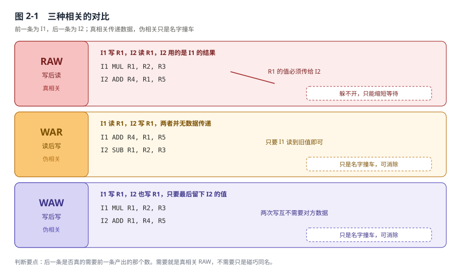
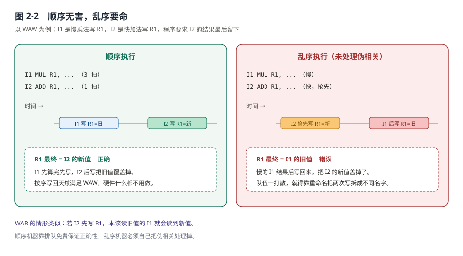
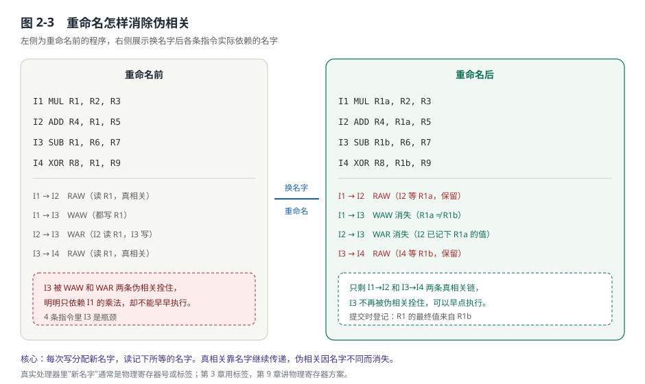

# 第 2 章　真相关与伪相关

> **本章导读**
> 上一章结尾留了一个话头：顺序流水线里 WAR 和 WAW 不会造成停顿，一旦想让指令乱序执行，它们立刻变成拦路虎。这话听着有点绕，却是理解乱序处理的关口。
>
> 这一章把"相关"这件事从头讲清楚。哪些是数据真的依赖、躲不开，哪些只是寄存器名字撞车、可以拆开。最后引出一个贯穿全书的思想：既然伪相关只是名字问题，那给寄存器换个名字不就行了？这正是第 3 章 Tomasulo 算法的起点。
>
> 学完本章，你应该能够：
> 1. 准确说出 RAW、WAR、WAW 三种相关的定义；
> 2. 判断一段指令序列里存在哪些相关，哪些是真依赖；
> 3. 解释为什么顺序执行时伪相关无害，乱序执行时却会写错结果；
> 4. 用换名字的思路说明寄存器重命名怎样消除伪相关。

---

## 2.1　什么叫相关

两条指令如果访问同一个寄存器，而且至少有一条要写它，它们之间就存在某种约束：谁先读、谁后写，不能乱来。这种约束叫相关（dependence）。

只看寄存器，相关有三种，用两条相邻的指令 I1（在前）和 I2（在后）就能说清楚：

| 类型 | 名称 | I1 做什么 | I2 做什么 | 通俗说法 |
|---|---|---|---|---|
| RAW | 写后读 | 写 R | 读 R | 后一条要用前一条的结果 |
| WAR | 读后写 | 读 R | 写 R | 后一条要覆盖前一条读过的值 |
| WAW | 写后写 | 写 R | 写 R | 两条都要往同一个地方写 |

三个名字里的"读"和"写"是按程序顺序说的：RAW 是"读发生在写之后"，也就是 I2 的读在 I1 的写后面；WAR 是"写发生在读之后"；WAW 是"第二次写在第一次写后面"。

如果两条指令都只是读同一个寄存器，那不构成任何相关，谁先读都一样。

> 有个记忆诀窍：把寄存器当成一个信封，写是往里塞新纸条，读是从里看纸条。RAW 是"我得等你把新纸条塞进去才能看"；WAR 是"你得等我看完旧的才能换新的"；WAW 是"咱俩都往里塞，最后留谁的"。三种关系的故事完全不同。

---

## 2.2　真相关 RAW

RAW 是三种里唯一躲不开的，因为它承载的是真实的数据流动。

```asm
I1:  MUL  R1, R2, R3
I2:  ADD  R4, R1, R5      # 读 R1，而 R1 正由 I1 写入
```

I2 要用的那个数，恰恰是 I1 算出来的。这不是名字的问题，是 I2 在逻辑上就需要 I1 的结果。你没有办法给 R1 换个名字来绕开它，因为无论叫什么，I2 要的都是"乘法的结果"这个具体的值。

第 1 章讲过的转发（forwarding）能缓解 RAW，但缓解不等于消除。转发只是把结果从流水线内部直接送过去，省掉写回寄存器堆再读出来的往返；如果产生结果的指令本身很慢，比如 load 要等访存、乘法要好几拍，那么等还是得等。

从并行的角度看，RAW 把两条指令拴成一条链：I2 必须在 I1 之后。链子有多长，这段代码就最快只能多快，这是数据本身决定的上限，再聪明的硬件也突破不了。

> 所以后面对 RAW 的所有优化，方向都不是"消掉它"，而是"缩短等待的时间"——转发、更早地算出结果、把慢操作拆开，都是这个思路。

---

## 2.3　伪相关 WAR 与 WAW

另外两种相关就没这么"讲道理"了。它们约束的不是数据，而是寄存器这个"名字"。

先看 WAR：

```asm
I1:  ADD  R4, R1, R5      # 读 R1（读的是旧值）
I2:  SUB  R1, R2, R3      # 写 R1，和 I1 读的是同一个名字
```

I2 要写 R1，但 I1 要读 R1。看起来 I2 得等 I1 读完。可是仔细想，I1 需要的只是"R1 此刻的值"，它读走之后这个值就和自己没关系了。I2 什么时候写、写成什么，只要不赶在 I1 读之前，就影响不到 I1。换句话说，这两条指令之间根本没有数据传递，唯一的牵扯是它们碰巧都提到了 R1 这个名字。

再看 WAW：

```asm
I1:  MUL  R1, R2, R3      # 写 R1
I2:  ADD  R1, R4, R5      # 也写 R1
```

两条都写 R1。顺序执行时，只要保证 I2 的结果最后留下就行。至于 I1 的结果什么时候算出来，中间有没有被谁看过，那是另一回事（如果中间有指令读 I1 的结果，那是它和 I1 之间的 RAW，以及它和 I2 之间的 WAR，另算）。两条写本身并不互相需要对方的数据。

这两类相关的共同点是：**它们只是名字撞车，不是数据依赖**。所以叫伪相关，也叫名称相关。



*图 2-1　RAW 传递真实数据，必须遵守；WAR 和 WAW 只是碰到同一个寄存器名字，数据之间并无依赖。*

---

## 2.4　顺序无害，乱序要命

这里要纠正一个常见的误解：伪相关并不是在任何机器里都会拖慢你。

在顺序流水线里，指令严格按程序顺序执行、按序写回寄存器堆。I1 在 I2 前面，就一定是 I1 先读先写、I2 后读后写。WAR 要求"I1 先读"，天然满足；WAW 要求"I2 最后写"，也天然满足。硬件什么都不用做，结果就是对的。所以在第 1 章的五级流水线里，你根本不会为 WAR 和 WAW 付出停顿。

问题出在乱序。一旦允许后面的指令越过前面的先执行， 麻烦就来了：

- 对 WAW，如果慢的 I1 还没算完，快的 I2 抢先写回了 R1，随后 I1 的结果再写回，R1 里留下的就是 I1 的旧值，顺序全乱。
- 对 WAR，如果 I2 先把新值写进 R1，而 I1 还没来得及读，I1 就会读到本不该读的新值。



*图 2-2　同样两条 WAW 指令，顺序执行结果正确，乱序时快的抢先写回、慢的后写覆盖，最终留下的是旧值。*

> 顺序机器靠"排队"免费保证了正确性，乱序机器把队伍打散了，就得自己掏钱买回这份正确性。这笔钱，就是接下来要讲的寄存器重命名。

第 1 章那句"真相关只能等、伪相关可以消掉"，现在可以补全了：伪相关之所以能消掉，是因为它本来就只是个名字问题。把名字换掉，撞车就不存在了。

---

## 2.5　寄存器重命名的思想

思路很直接：既然伪相关是多条指令用了同一个寄存器名字造成的，那就让每条写指令用自己的新名字。

还是刚才 WAW 的例子：

```asm
; 重命名前，两条都写 R1
I1:  MUL  R1, R2, R3
I2:  ADD  R1, R4, R5

; 重命名后，每次写拿到一个新名字
I1:  MUL  R1a, R2, R3     # I1 的结果叫 R1a
I2:  ADD  R1b, R4, R5     # I2 的结果叫 R1b
```

现在两条写的是不同名字，谁先算完都无所谓，不会互相覆盖。到提交的时候，登记一下"R1 的最终值来自 R1b"即可。WAW 消失了。

WAR 也一样。I1 读的是 R1 此刻的旧值，可以在读的时候就把这个值记下来（相当于复制一份）；之后 I2 写 R1，改的是 R1 这个名字的新归属，和 I1 手里已经记下的那份值无关。WAR 消失了。

关键是，RAW 不会被这套办法破坏。如果 I2 真的需要 I1 的结果，重命名时会让 I2 记下"我在等 R1a"，而不是去读 R1 当下的内容。这样真相关仍然通过 R1a 这个新名字准确地传递下去。

> 一句话总结：给每次写分配新名字，读的时候记下自己等的是哪个名字。真相关靠名字继续传递，伪相关因为名字不同而自然消失。

真实处理器里，"新名字"通常不是又造一个架构寄存器，而是从一批额外的物理寄存器里分配一个，或者用一个标签来代表这次写。第 3 章用的是标签（比如 #21、#24），第 9 章会讲更接近真实处理的物理寄存器方案。名字的具体形态会变，思想始终是这一套。



*图 2-3　每次写分配新名字，读记下所等的名字。RAW 照常传递，WAR 和 WAW 因名字不同而消失。*

---

## 2.6　把三种相关放在一起看

下面这段程序把三种相关凑齐了，可以拿来练手：

```asm
I1:  MUL  R1, R2, R3
I2:  ADD  R4, R1, R5      # 与 I1 是 RAW，读 R1
I3:  SUB  R1, R6, R7      # 与 I1 是 WAW（都写 R1），与 I2 是 WAR（I2 读 R1）
I4:  XOR  R8, R1, R9      # 与 I3 是 RAW，读 R1
```

逐条分析：

- I1 → I2 是 RAW，I2 要用 I1 的乘法结果，这条链断不掉；
- I1 → I3 是 WAW，两条都写 R1，但 I3 不需要 I1 的值，是伪相关；
- I2 → I3 是 WAR，I2 读 R1、I3 写 R1，I2 读的应该是 I1 写的旧 R1，而不是 I3 的新值，也是伪相关；
- I3 → I4 是 RAW，I4 要用 I3 的结果。

注意 I3 同时牵扯到两种相关：它和 I1 是 WAW，和 I2 是 WAR。重命名给 I1、I3 的两次写分别分配 R1a、R1b 后，WAW 没了；I2 记下自己读的是 R1a（I1 的旧值），于是 I3 写 R1b 也碰不到它，WAR 也没了。整段程序只剩下 I1→I2 和 I3→I4 两条真实的 RAW 链，I3 不再被两条伪相关拴住，可以早点执行。

这正是乱序处理器想知道的信息：哪些指令真的必须排队，哪些只是看起来要排队。

---

## 2.7　相关的其它维度

本章只讨论寄存器相关，因为它是乱序执行最直接、最频繁遇到的约束。程序里还有另外两类相关，先点个名，后面专门讲：

- **控制相关**：一条指令是否执行，取决于前面某条分支的结果。这是第 5、6 章分支预测要处理的问题。
- **访存相关**：两条访存指令是否访问同一个内存地址，光看寄存器名判断不出来，得算出地址才知道。这是第 12 章乱序访存的难点——它比寄存器相关还麻烦，因为寄存器的名字是译码时就明确的，内存地址却要等到执行阶段才算得出来。

把这几类相关都管住，乱序机器才能既跑得快又算得对。

> 关于本章的图：这一章讲的相关和重命名是概念，适合用时序对比图来讲，所以图 2-2 和图 2-3 直接把"顺序与乱序""重命名前后"画出来对照。Digital 那种可打开的电路留给能落到门级和连线的地方，比如第 1 章的冒险检测、第 3 章的标签匹配。三章合起来，先建立概念，再看局部电路，最后拼成完整数据通路。

---

## 2.8　香山一瞥（选读）

香山的重命名电路做的正是本章讲的事：把指令里的架构寄存器号，映射到物理寄存器堆里的某一项。每条写指令拿到一个新的物理寄存器，读到的是"当前哪个物理寄存器代表这个架构寄存器"。第 9 章会详细讲这套映射，包括分支预测错了怎么恢复到旧的映射——那是重命名引入的新问题，本章先不必深究。

对本章而言，只需记住香山和本书在思想上是同一个起点：用换名字拆掉伪相关，让更多指令能并行。

---

## 2.9　本章小结

- 两条指令访问同一寄存器且至少有一条写，就存在相关，分 RAW、WAR、WAW 三种。
- RAW 是真相关，承载真实数据流动，无法消除，只能缩短等待。
- WAR 和 WAW 是伪相关，只是寄存器名字撞车，数据之间没有依赖。
- 顺序流水线靠按序执行免费满足伪相关，因而无需为它停顿；乱序执行打乱顺序后，伪相关会导致写错结果，必须显式处理。
- 寄存器重命名给每次写分配新名字、让读记下所等的名字，从而消除伪相关，同时保留 RAW。这是第 3 章 Tomasulo 的起点。

## 思考题

1. 判断下面这段指令的相关类型，并指出哪些是真相关、哪些是伪相关：
   ```asm
   ADD R1, R2, R3
   SUB R2, R1, R4
   MUL R1, R5, R6
   ```
2. 为什么说顺序流水线不需要为 WAR 和 WAW 付出停顿？如果改成每周期发射两条指令但仍按序执行、按序写回，结论还成立吗？
3. 寄存器重命名消除 WAR 时，"读的时候把值记下来"这一步为什么必不可少？如果只改名字不记值会发生什么？
4. 重命名会不会把 RAW 也一起消掉？为什么必须保留 RAW？
5. 访存相关为什么比寄存器相关更难处理？提示：想想地址什么时候才能确定。

---

*下一章：第 3 章　Tomasulo 乱序执行的最小闭环。把本章的换名字思想，连同保留站和广播，拼成第一个能跑通的乱序模型。*
