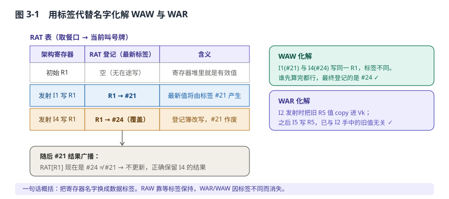
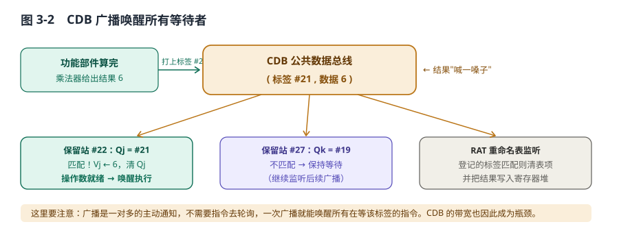
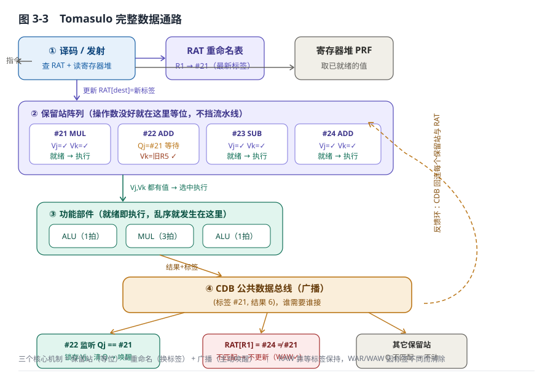
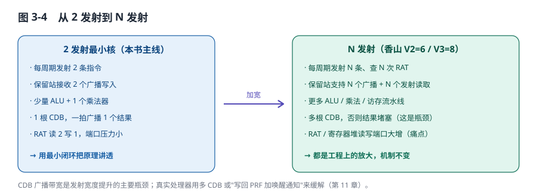

# 第 3 章　Tomasulo 乱序执行的最小闭环

> **本章导读**
> 上一章我们看到，WAR 和 WAW 这类"伪相关"会让一条明明可以执行的指令白白等待。本章给出解决它们的经典答案——Tomasulo 算法。1967 年 IBM 360/91 的浮点部件首次用它解决了"浮点除法很慢、但后面的加法其实不用等它"的问题。后来的 Alpha、Intel P6 一直到香山，都沿用了这套基本思路。
>
> 学完本章，你应该能够：
> 1. 说清楚保留站、寄存器重命名、公共数据总线（CDB）各自解决什么问题；
> 2. 手工走通一段指令序列从发射到写回的全过程；
> 3. 读懂一个 2 发射乱序核最核心的数据通路；
> 4. 理解"广播为什么是瓶颈"，以及 2 发射如何扩展到 N 发射。
>
> Tomasulo 这个名字听着唬人，其实没有引入新电路，只是把你已经熟悉的"流水线加转发"换了一种组织方式。

---

## 3.1　顺序流水线为什么会堵车

你设计过五级流水线，知道数据相关时可以用**转发（forwarding）**把结果直接从 EX 阶段送回输入端。转发很有效，但它有个前提：**指令必须按顺序流过流水线**。一旦某条指令卡住，后面所有指令都得跟着等——哪怕它们和这条指令毫无关系。

来看一段具体的整数指令序列（我们全书都用它当例子）：

```asm
I1:  MUL  R1, R2, R3      # 慢！假设 3 拍（乘法）
I2:  ADD  R4, R1, R5      # 真相关 RAW：要用 I1 的结果 R1
I3:  SUB  R6, R7, R8      # 完全独立，1 拍就好
I4:  ADD  R1, R9, R10     # 也写 R1 —— WAW，但和 I1 无关
I5:  XOR  R5, R11, R12    # 写 R5 —— WAR，I2 读的是旧的 R5
```

在顺序流水线里会发生什么？

- **I2 必须等 I1**：这是 RAW，真相关，躲不掉。乘法 3 拍，I2 至少停 2 拍。
- **I3 明明独立，却卡在 I2 后面**：因为顺序发射，它眼睁睁看着 ALU 空着也不能用。这叫**前端阻塞**。
- **I4 和 I1 都写 R1**，顺序机器里必须保证 I4 的结果"最后留下"，于是它也得排队。
- **I5 写 R5**，但 I2 还要读 R5 的旧值。顺序机器靠停止 I5 来保证 I2 先读到旧值。

后两条其实很冤：**I4 和 I1 写同一个寄存器，谁先算完谁后算完，只要最终 R1 里是 I4 的值就行；I5 写 R5 时，I2 早把旧 R5 取走了就相安无事。** 它们不是真的依赖，只是"名字撞车"了。这就是上一章说的**伪相关（WAR / WAW）**。

> 本章要回答一个问题：能不能让指令只在操作数就绪时才执行，同时保证结果最终按程序顺序呈现？办法是三件事：保留站、重命名、广播。

---

## 3.2　Tomasulo 的三个核心思想

先把三个概念分别讲清楚，再拼成完整系统。这里用一个贯穿全书的比喻：

> 把执行单元想成**厨师**，指令想成**订单**，寄存器想成**取餐口编号**。

### 3.2.1　保留站让指令就地等待

顺序流水线里，指令在译码后如果操作数没就绪，就堵在流水线上，挡住后面所有人。

**保留站（Reservation Station, RS）**的做法是：译码阶段一出问题指令，先把它**搬到一个小缓冲区（保留站）里待着**，然后立刻空出流水线，让后面的指令继续进来。指令在保留站里盯着自己的操作数，一旦就绪就被送去执行。

这就像餐厅：点单后不是站在取餐口死等，而是拿个号去座位坐下，叫到号再取餐。流水线门口不再堵。

保留站的每一项通常存这些东西：

| 字段 | 含义 | 类比 |
|---|---|---|
| `Busy` | 这一项是否被占用 | 座位是否有人 |
| `Op` | 要做什么运算 | 订单内容 |
| `Vj / Vk` | 操作数**数据值**（已就绪才有） | 手上已有的食材 |
| `Qj / Qk` | 操作数在等**哪个标签**广播（未就绪） | 在等哪桌上菜 |
| `Dest` | 结果要写到哪个标签/寄存器 | 取餐口编号 |

注意，`V` 和 `Q` 二选一。操作数要么已经有值（`V`），要么正在等人送（`Q`），这就记录了就绪还是未就绪。

### 3.2.2　寄存器重命名

重命名是消除伪相关的关键。想象一下：如果每条**写寄存器**的指令都拿到一个独一无二的标签，而读它的指令记下的是"我在等标签 #37"，而不是"我在等 R1"，会发生什么？

- **WAW 消失**：I1 和 I4 都写 R1，但它们拿到的是不同标签（比如 #21 和 #24）。"R1 的最新值来自谁"由一张**重命名表（RAT）**记录，后写的 I4 覆盖登记。谁先算完都无所谓，最终登记的是 I4。
- **WAR 消失**：I2 在发射时就把 R5 的**当前值**读走存进了自己的 `Vk`（因为那一刻 R5 的标签是空的，说明寄存器里就是有效值）。之后 I5 写 R5，改的是"R5 的最新标签"，和 I2 手里那份已经 copy 走的旧值无关。

**重命名表（RAT, Register Alias Table）**就是"取餐口 → 当前叫号牌"的对照表：

```
发射 I1 (MUL R1,...) 时：  RAT[R1] = #21   （R1 的最新值将由标签 #21 产生）
发射 I4 (ADD R1,...) 时：  RAT[R1] = #24   （覆盖！现在 R1 的最新值来自 #24）
```

读寄存器时查这张表：表里空 → 直接取寄存器堆里的值；表里是标签 → 记下这个标签，等广播。



*图 3-1　R1 被写两次时 RAT 标签的覆盖过程。I1 登记 #21，I4 覆盖为 #24，旧标签作废，WAW 随之化解。*

> 一句话概括：把寄存器名字换成数据标签。RAW 靠等标签保持（真相关），WAR/WAW 因标签不同而消失（伪相关消除）。

### 3.2.3　CDB 广播

功能部件算完结果后，不写回某个固定的地方让别的指令去读，而是把 **(标签, 结果值)** 放到一根共享的**公共数据总线（Common Data Bus, CDB）**上，广播给所有人：

- 所有保留站都听着：**如果我的 `Qj` 或 `Qk` 等于广播的标签，就把结果锁存进 `Vj`/`Vk`，并把对应的 `Q` 清空**——我的操作数就绪了！
- 重命名表 RAT 也听着：**如果哪一项登记的这个标签，就更新为"已就绪"，并把结果写入寄存器堆。**

这一喊就唤醒了所有在等这个结果的指令，不需要它们轮询，也不需要专门的控制。CDB 就是把各个模块连起来的公共通路。

> 类比：厨师做好一道菜，不是在桌上留纸条，而是举起来喊"37 号好了！"——所有在等 37 号的客人同时响应。



*图 3-2　结果打上标签放上 CDB，所有保留站同时监听。匹配的锁存数据并唤醒，不匹配的继续等待。*

---

## 3.3　把三块拼起来（完整数据通路）

三块合起来就是下面这张图。请对照文字读图，也可以用配套的 Digital 文件（见 3.7）动手连一遍。



*图 3-3　发射 → 保留站等位 → 就绪即执行 → CDB 广播 → 监听唤醒的完整闭环（SVG 矢量图，可编辑）。*

读图时留意这几点（对应 Digital 文件里的连线）：

1. **发射是单向的进**：指令从左边进，查 RAT、读寄存器堆，带着 `(V 或 Q)` 住进保留站；同时把 `RAT[dest]` 改成自己的标签。
2. **执行是按需的取**：只有 `Qj`、`Qk` 都空（即两个操作数都在 `V` 里）的保留站项才"有资格"被送往功能部件。这个"挑谁能执行"的动作叫**发射选择 / 唤醒-选择**（第 10 章详述，本章先理解为"就绪就能上"）。
3. **写回是广播的出**：功能部件结果汇入 CDB，CDB 的连线**回连到每一个保留站和 RAT**——这就是图里那一圈"监听"的箭头。这条反馈环路是 Tomasulo 的关键。

> **Digital 里怎么表达"广播"**：Digital 支持总线（多比特线束）和多路开关。把 CDB 画成一根带标签的总线，每个保留站的 `Q` 比较器挂在总线上；匹配信号作为"写入使能"。配套文件 `code/digital/03_tag_match_wakeup.dig` 搭出了这个比较器（1 位相等检测，`match` 即唤醒信号），建议边看边仿真——把 `CDB_tag` 和 `Qj` 拨成相同，`match` 就会亮起，这就是唤醒信号。

---

## 3.4　逐周期走一遍（本章重点）

原理讲完了，现在把 3.1 那段指令序列逐周期走一遍。走完之后，抽象的机制就具体了。为简化，假设每周期发射 1 条（2 发射的扩展放在 3.5），功能部件有独立的 ALU 和乘法器，乘法 3 拍、ALU 1 拍。

初始状态：RAT 全空（所有寄存器的值都在寄存器堆里且有效），所有保留站空闲。

### 周期 1　发射 I1 `MUL R1, R2, R3`

- 读 RAT[R2]、RAT[R3]：都空 → 从寄存器堆取值，设 `Vj=R2值, Vk=R3值`。
- 分配保留站 **#21**，`Op=MUL`，`Dest=R1`。
- 更新 **RAT[R1] = #21**。
- I1 两个操作数都就绪 → 送往乘法器开始执行。

### 周期 2　发射 I2 `ADD R4, R1, R5`

- 读 RAT[R1] = **#21**（非空！R1 的最新值还没出来）→ `Qj = #21`，`Vj` 无效。
- 读 RAT[R5] = 空 → 从寄存器堆取**旧 R5 值**，设 `Vk = R5旧值`。（← **WAR 在这里就被化解了**：I2 把旧值 copy 走了）
- 分配保留站 **#22**，`Op=ADD`，`Dest=R4`，更新 `RAT[R4]=#22`。
- `Qj` 非空 → I2 **留在保留站等待**，不堵流水线。

### 周期 3　发射 I3 `SUB R6, R7, R8`

- R7、R8 的 RAT 都空 → `Vj, Vk` 取到值。分配 **#23**，`Dest=R6`，`RAT[R6]=#23`。
- 操作数就绪 → 送往空闲 ALU 执行。**I3 越过了还在等的 I2，这就是乱序。**

### 周期 4　发射 I4 `ADD R1, R9, R10`

- R9、R10 都空 → `Vj, Vk` 就绪。分配 **#24**，`Dest=R1`。
- 更新 **RAT[R1] = #24**，覆盖之前的 #21。（← **WAW 在这里被化解了**：登记簿上 R1 的最新值现在归 #24）
- 操作数就绪 → 执行。注意：此时 I1 的乘法可能还没算完，但 I4 不用等它。

### 周期 5　发射 I5 `XOR R5, R11, R12`

- R11、R12 都空 → 就绪。分配 **#25**，`Dest=R5`，`RAT[R5]=#25`。
- 执行。此时 I2 手里的 `Vk` 是旧的 R5 值，I5 改 R5 不影响它，WAR 伪相关就是这样消除的。

### 周期 6 及以后　广播唤醒

假设 I1 的乘法在周期 6 完成，把 **(#21, 结果值)** 放上 CDB：

- **保留站 #22（I2）监听**：我的 `Qj == #21`！→ 把结果锁存进 `Vj`，清 `Qj`。I2 的 `Vj`、`Vk` 现在都有值了 → **被唤醒，送往 ALU 执行**。
- **RAT 监听**：RAT[R1] 现在是 #24，不是 #21 → 不更新。（I1 的结果被 I4 "覆盖"了，正确！）

随后 I4、I5、I3 的结果也陆续上 CDB，唤醒等待它们的指令并写回寄存器堆。所有指令最终完成。

### 一张表看懂全过程

| 指令 | 分配标签 | 源操作数来源 | 化解的相关 | 何时能执行 |
|---|---|---|---|---|
| I1 MUL R1,R2,R3 | #21 | R2,R3 直接取值 | — | 周期 1 立即 |
| I2 ADD R4,R1,R5 | #22 | R1 等 #21；R5 **取旧值** | **WAR**（旧 R5 已 copy） | 等 #21 广播后 |
| I3 SUB R6,R7,R8 | #23 | R7,R8 直接取值 | — | 周期 3 立即（超越 I2） |
| I4 ADD R1,R9,R10 | #24 | R9,R10 直接取值 | **WAW**（RAT[R1] 被覆盖为 #24） | 周期 4 立即 |
| I5 XOR R5,R11,R12 | #25 | R11,R12 直接取值 | **WAR**（不碰 I2 的旧值） | 周期 5 立即 |

> 想一想：RAW（I2 等 I1）并没有被消除，只是变成了等标签。因为 I2 真的需要 I1 算出的那个数，这是真实的数据依赖，绕不过去。Tomasulo 消除的只是假依赖（WAR/WAW）。

---

## 3.5　重点提炼与关键权衡

把本章的结论整理一下：

### 重点 1　收益来自三个解耦
- **指令与流水线解耦**（保留站）：操作数没好就去旁边等，不挡路。
- **名字与数据解耦**（重命名）：寄存器名只是标签，真数据跟着标签走。
- **生产与消费解耦**（广播）：结果一出来主动通知所有等待者。

### 重点 2　CDB 是吞吐量的瓶颈
所有功能部件的结果都要挤上一根（或少数几根）CDB。**同一周期只能广播有限个结果**。这就是为什么真实处理器会用多条 CDB、或把结果先写回 PRF 再靠"唤醒"通知（第 11 章）。问自己：如果 2 发射每周期产生 2 个结果，一根 CDB 够吗？

### 重点 3　从 2 发射扩展到 N 发射



*图 3-4　2 发射最小核与 N 发射的对照。机制不变，各部件同步加宽，CDB 带宽是主要瓶颈。*

| 部件 | 2 发射 → N 发射的扩展 |
|---|---|
| 发射逻辑 | 每周期读 N 条指令、查 N 次 RAT、分配 N 个保留站项 |
| 保留站 | 端口数增加：要能同时接收 N 个广播写入、N 个发射读取 |
| 功能部件 | 更多 ALU / 乘法器 |
| CDB | 需要更多广播带宽，否则结果堵塞 |
| RAT / 寄存器堆 | 读写端口数随发射宽度增长（这是物理实现的痛点） |

机制不变，只是路口变宽。这也是先把 2 发射闭环讲透的原因，N 发射只是在它上面加宽。

### 重点 4　本章留下的两个问题
1. 上面的写回是"广播即写入寄存器堆"。但如果一条指令在写回后才发现异常怎么办？寄存器已经被改脏了。**第 13 章的 ROB + 按序提交**解决它。
2. 分支预测错了，保留站里一堆"在等"的指令怎么办？**第 14 章的 checkpoint 恢复**解决它。

> 现阶段先接受这个"不完美但能跑"的最小闭环，把直觉建立起来，后面再逐步补全。

---

## 3.6　从一条指令开始搭电路

这一节跟着一条指令从发射走到写回。每个模块都先看它对外要提供哪些端口，再看内部怎么实现。端口不是一次列全的，需要哪个就加哪个，你会看到每个信号都是被具体需求逼出来的。完整可运行版见 `code/verilog/03_tomasulo/`。

### 3.6.1　保留站条目

**先看接口。**

**第一步，指令得能进来。** 译码后的指令要占住一个保留站条目。占用要有使能 `issue_en`，还要把这条指令的信息一起送进来，包括操作码、两个操作数以及结果贴什么标签。

```verilog
input  wire             issue_en,
input  wire [3:0]       op_in,
input  wire             vj_valid_in, vk_valid_in,
input  wire [DATA_W-1:0] vj_in, vk_in,
input  wire [TAG_W-1:0]  qj_in, qk_in,
input  wire [TAG_W-1:0]  dest_tag_in,
```

`vj_valid_in` 为 1 表示 `vj_in` 里已经是数值，为 0 表示 `qj_in` 里是它等待的标签。一个操作数用"值加标签"两种形式表示，是 Tomasulo 的关键约定。

**第二步，结果要能监听 CDB。** 等数据的条目得一直盯着总线，所以要有广播的有效位、标签和数值三个输入：

```verilog
input  wire             cdb_valid,
input  wire [TAG_W-1:0]  cdb_tag,
input  wire [DATA_W-1:0] cdb_data,
```

**第三步，操作数齐了要通知外面。** 条目本身不做运算，它只在操作数到齐时拉高 `ready`，并把操作码和值送出去给功能部件：

```verilog
output wire             ready,
output wire [3:0]       op_out,
output wire [DATA_W-1:0] vj_out, vk_out,
```

再加上时钟，接口就完整了。

**再看实现。**

**第四步，指令进来先记住三样东西。** 待着的时候要记操作码、两个操作数的状态，以及自己的目的标签：

```verilog
reg             busy;
reg [3:0]       op;
reg             vj_valid, vk_valid;
reg [DATA_W-1:0] vj, vk;
reg [TAG_W-1:0]  qj, qk;
reg [TAG_W-1:0]  dest_tag;

assign ready = busy && vj_valid && vk_valid;
```

`ready` 就是"两个操作数都到齐"，可以直接拿去启动功能部件。把等数据这件事从流水线上挪到这个小仓库，流水线门口就不再堵着。

**第五步，结果回来怎么唤醒。** 广播的标签和自己在等的标签一对上，就把值锁存下来，清掉等待标志：

```verilog
if (cdb_valid && busy) begin
    if (!vj_valid && qj == cdb_tag) begin
        vj       <= cdb_data;
        vj_valid <= 1'b1;
    end
    if (!vk_valid && qk == cdb_tag) begin
        vk       <= cdb_data;
        vk_valid <= 1'b1;
    end
end
```

两个 `if` 要并列写，不能合成一个。虽然一次广播只有一个标签，但两个操作数可能在等同一个标签，比如 `ADD R1, R2, R2`，两个源都是 R2，就得同时填上。

**第六步，发射和广播撞在同一拍。** 新指令要写入，旧结果同时广播回来，谁优先？让发射优先：

```verilog
if (issue_en) begin
    busy     <= 1'b1;
    op       <= op_in;
    dest_tag <= dest_tag_in;
    vj_valid <= vj_valid_in;  vk_valid <= vk_valid_in;
    vj       <= vj_in;        vk       <= vk_in;
    qj       <= qj_in;        qk       <= qk_in;
end else if (cdb_valid && busy) begin
    // 上面那段广播监听
end
```

新写入项的等待标签是刚分配的新标签，不可能等于这一拍广播的老标签，让它去响应没有意义。

**完整代码。** 端口就是上面定稿的那一份，内部是这三层逻辑拼起来：

```verilog
module reservation_station #(
    parameter TAG_W = 5,      // 标签位宽：32 个项
    parameter DATA_W = 32
)(
    input  wire             clk,
    input  wire             issue_en,
    input  wire [3:0]       op_in,
    input  wire             vj_valid_in, vk_valid_in,
    input  wire [DATA_W-1:0] vj_in, vk_in,
    input  wire [TAG_W-1:0]  qj_in, qk_in,
    input  wire [TAG_W-1:0]  dest_tag_in,
    input  wire             cdb_valid,
    input  wire [TAG_W-1:0]  cdb_tag,
    input  wire [DATA_W-1:0] cdb_data,
    output wire             ready,
    output wire [3:0]       op_out,
    output wire [DATA_W-1:0] vj_out, vk_out
);
    reg             busy;
    reg [3:0]       op;
    reg             vj_valid, vk_valid;
    reg [DATA_W-1:0] vj, vk;
    reg [TAG_W-1:0]  qj, qk;
    reg [TAG_W-1:0]  dest_tag;

    assign ready  = busy && vj_valid && vk_valid;
    assign op_out = op;
    assign vj_out = vj;
    assign vk_out = vk;

    always @(posedge clk) begin
        if (issue_en) begin
            busy       <= 1'b1;
            op         <= op_in;
            dest_tag   <= dest_tag_in;
            vj_valid   <= vj_valid_in;  vk_valid <= vk_valid_in;
            vj         <= vj_in;        vk       <= vk_in;
            qj         <= qj_in;        qk       <= qk_in;
        end else if (cdb_valid && busy) begin
            if (!vj_valid && qj == cdb_tag) begin
                vj       <= cdb_data;
                vj_valid <= 1'b1;
            end
            if (!vk_valid && qk == cdb_tag) begin
                vk       <= cdb_data;
                vk_valid <= 1'b1;
            end
        end
        // 被功能部件取走后释放此项，完整版用握手信号实现
    end
endmodule
```

### 3.6.2　操作数里的标签是谁填的

**先看接口。**

**第一步，发射时要查两个源寄存器。** 源寄存器号 `rs1`、`rs2` 进来，查表后输出它们的等待标签 `q1`、`q2` 和有效位：

```verilog
input  wire [4:0]       rs1, rs2,
output wire [TAG_W-1:0]  q1, q2,
output wire             q1_valid, q2_valid,
```

**第二步，发射时还要更新目的寄存器。** 给 `rd` 分配一个新标签并登记，需要使能 `rename_en` 和新标签 `new_tag`：

```verilog
input  wire             rename_en,
input  wire [4:0]       rd,
input  wire [TAG_W-1:0]  new_tag,
```

**第三步，结果写回时要清登记。** 某个标签的结果出来后，要把登记着这个标签的表项标成有效，所以要监听 CDB：

```verilog
input  wire             cdb_valid,
input  wire [TAG_W-1:0]  cdb_tag,
```

加上时钟，接口齐了。

**再看实现。**

**第四步，查表。** 译码一条指令时读它的源寄存器。如果那个寄存器正有写入在途，就不能取寄存器堆里的旧值，而要记下产生新值的标签：

```verilog
assign q1_valid = valid[rs1];
assign q1       = q1_valid ? tag_ram[rs1] : 0;
```

`valid[rs1]` 为 1，表示"R1 的新值还在路上，正等着标签 `tag_ram[rs1]`"；为 0 就直接去寄存器堆取值。

**第五步，两条指令写同一个寄存器。** 这就是第 2 章说的 WAW。RAT 的办法很干脆，新指令一来直接覆盖登记：

```verilog
if (rename_en) begin
    valid[rd]   <= 1'b1;
    tag_ram[rd] <= new_tag;
end
```

旧标签的结果广播回来时，`tag_ram[rd]` 里已经是新标签，匹配不上，自然不会误清。WAR 也不需要额外动作：读指令早把旧值的标签或数值记在自己保留站里了，后来者改写 RAT 影响不到它。

**第六步，结果写回后清登记。** 某个标签的结果一旦出来，所有登记着这个标签的寄存器都可以标记为有效值已在寄存器堆：

```verilog
if (cdb_valid)
    for (i = 0; i < NREG; i = i + 1)
        if (valid[i] && tag_ram[i] == cdb_tag)
            valid[i] <= 1'b0;
```

一个 `for` 循环并行清掉所有匹配项，这就是"广播一次唤醒所有等待者"在 RAT 上的样子。

**完整代码。** 端口即定稿的接口，内部就是查表、覆盖、清除三件事：

```verilog
module rat #(
    parameter NREG = 32,
    parameter TAG_W = 5
)(
    input  wire             clk,
    input  wire [4:0]       rs1, rs2,
    output wire [TAG_W-1:0]  q1, q2,
    output wire             q1_valid, q2_valid,
    input  wire             rename_en,
    input  wire [4:0]       rd,
    input  wire [TAG_W-1:0]  new_tag,
    input  wire             cdb_valid,
    input  wire [TAG_W-1:0]  cdb_tag
);
    localparam NREG_LAST = NREG - 1;
    reg [TAG_W-1:0] tag_ram [0:NREG_LAST];
    reg             valid  [0:NREG_LAST];

    assign q1_valid = valid[rs1];
    assign q2_valid = valid[rs2];
    assign q1 = q1_valid ? tag_ram[rs1] : {TAG_W{1'b0}};
    assign q2 = q2_valid ? tag_ram[rs2] : {TAG_W{1'b0}};

    integer i;
    always @(posedge clk) begin
        if (rename_en) begin
            valid[rd]   <= 1'b1;
            tag_ram[rd] <= new_tag;
        end
        if (cdb_valid)
            for (i = 0; i < NREG; i = i + 1)
                if (valid[i] && tag_ram[i] == cdb_tag)
                    valid[i] <= 1'b0;
    end
endmodule
```

> **动手提示**：存储器取名 `tag_ram`，数组上界先转成 `localparam`。在 Icarus Verilog 里 `table` 是保留字，数组上界也不能直接写 `[0:NREG-1]`。配套文件 `code/verilog/03_tomasulo/rat.v` 还加了复位，并让写回优先于重命名，读者可以对照着看。

### 3.6.3　一根总线一次只能过一个结果

**先看接口。**

**第一步，N 个功能部件要请求广播。** 每个部件给一个请求位，外加它要广播的标签和数值：

```verilog
input  wire [N-1:0]              req,
input  wire [N-1:0][TAG_W-1:0]   req_tag,
input  wire [N-1:0][DATA_W-1:0]  req_data,
```

**第二步，裁决结果送上一根总线。** 仲裁器从 N 路里选一路，输出有效位、标签和数值：

```verilog
output reg                       cdb_valid,
output reg  [TAG_W-1:0]          cdb_tag,
output reg  [DATA_W-1:0]         cdb_data
```

这个模块是纯组合逻辑，不需要时钟。

**再看实现。**

**第三步，多个结果同时回来。** 乘法器、加法器、访存部件可能在同一拍都算完，都要上 CDB。但总线只有一根，一次只能过一个标签和一个值，所以要仲裁：

```verilog
for (k = 0; k < N; k = k + 1)
    if (req[k]) begin           // 第一个请求者优先
        cdb_valid = 1'b1;
        cdb_tag   = req_tag[k];
        cdb_data  = req_data[k];
        break;
    end
```

优先级的选法很随意，这里的规则是编号小的先走。真正要紧的是看清这个模块的代价：N 个部件要广播，一拍只放行一个，这正是 3.5 说的广播瓶颈。想提高发射宽度，就得增加 CDB 条数，或者让不同部件的结果走不同通路。

**完整代码。** 端口就是前面那两组，内部一个带 `break` 的循环：

```verilog
module cdb_arbiter #(
    parameter N = 4,
    parameter TAG_W = 5,
    parameter DATA_W = 32
)(
    input  wire [N-1:0]              req,
    input  wire [N-1:0][TAG_W-1:0]   req_tag,
    input  wire [N-1:0][DATA_W-1:0]  req_data,
    output reg                       cdb_valid,
    output reg  [TAG_W-1:0]          cdb_tag,
    output reg  [DATA_W-1:0]         cdb_data
);
    integer k;
    always @(*) begin
        cdb_valid = 1'b0; cdb_tag = 0; cdb_data = 0;
        for (k = 0; k < N; k = k + 1) begin
            if (req[k]) begin
                cdb_valid = 1'b1;
                cdb_tag   = req_tag[k];
                cdb_data  = req_data[k];
                break;
            end
        end
    end
endmodule
```

---

## 3.7　配套 Digital 文件与实验

本书的数字逻辑图用 [Digital](https://github.com/hneemann/digital) 绘制（开源、免费）。本章配套文件：

| 文件 | 格式 | 内容 | 用法 |
|---|---|---|---|
| `figures/fig3-3-datapath.svg` | SVG | 完整数据通路（发射→保留站→执行→广播→唤醒） | 对照 3.3 节读，可在矢量编辑器中修改 |
| `figures/fig3-1-rename.svg` | SVG | 重命名化解 WAW/WAR 的 RAT 覆盖过程 | 对照 3.2.2 节 |
| `figures/fig3-2-cdb-broadcast.svg` | SVG | CDB 广播唤醒机制 | 对照 3.2.3 节 |
| `figures/fig3-4-scale-to-n.svg` | SVG | 2 发射 → N 发射的扩展对照 | 对照 3.5 节 |
| `code/digital/03_tag_match_wakeup.dig` | Digital | 唤醒核心：标签相等检测器（1 位比较，`match` 即唤醒信号），自带测试向量 | 拨动 `CDB_tag` 与 `Qj`，观察 `match`；相等时亮起 |
| `code/verilog/03_tomasulo/` | Verilog | RAT、保留站、CDB 仲裁的可综合实现 + 测试 | 见 3.6 节与下方 Verilog 实验 |

> **关于插图**：本书所有结构图、流程图均为 SVG 矢量格式，存放在 `figures/` 目录。SVG 是纯文本、可编辑的开放格式——用浏览器直接打开查看，用 Inkscape、Illustrator、VS Code 等均可修改文字、颜色和连线，缩放不失真。

> Digital 的 `.dig` 文件是 XML 格式，直接用 Digital 软件打开即可。`03_tag_match_wakeup.dig` 内嵌了测试向量（Testcase），点击仿真即可看到"相等→match=1"。把 CDB 标签拨成和 `Qj` 一样，看到匹配信号亮起，就对应正文说的广播唤醒。完整系统连接用 3.3 节的分层图配合 Verilog 代码理解（Digital 适合表达局部机制，完整乱序核用 Verilog 更清晰，这也是本书图形化与代码分工的原则）。

### 本章实验

1. **手算实验**：把 3.4 的例子在纸上走一遍，画出每个周期 RAT 和三个保留站项的状态表。
2. **Digital 实验**：在保留站演示里故意让 CDB 广播一个**不匹配**的标签，确认保留站不动作；再广播匹配标签，确认唤醒。
3. **Verilog 实验**：给 `rat` 写一个 testbench，发射两次写 R1（标签 #21、#24），然后广播 #21，检查 RAT[R1] 是否**仍登记为 #24**（验证 WAW 未被错误覆盖）。

---

## 3.8　香山一瞥（选读）

香山（昆明湖）的后端用的还是 Tomasulo 那套思路，只是做了三点工程调整，了解它们可以把本章知识和真实处理器对上号：

- **从"保留站里存数据"到"物理寄存器堆 PRF"**：香山在重命名时直接分配一个**物理寄存器**（第 11 章的概念），指令发射后结果写进 PRF，保留站里只存"指向哪个物理寄存器"。这样避免了 CDB 广播数据时的大位宽连线，代价是要更大的寄存器堆和更复杂的回收逻辑。
- **唤醒与选择分拍优化**：经典 Tomasulo 里"广播唤醒 + 就绪判断 + 选一个发射"可能挤在一拍里，时序紧张。香山把发射队列组织成分区结构，配合精心的流水线排布来缓解（第 10、12 章会讲思想）。
- **分散的发射队列与执行单元**：整数、浮点、访存各有自己的发射队列和流水线，访存还进一步分成 load / store 地址 / store 数据三条（第 12 章）——本质都是"增加并行通路，减少互相等待"。

这些都不是新原理，只是围绕三个核心机制做加宽、加深、分块。把 2 发射闭环吃透，再看香山的代码就有了头绪。

---

## 3.9　本章小结

- **问题**：顺序流水线里，真相关必须等，伪相关（WAR/WAW）却造成无谓停顿，独立指令也被堵住。
- **解法（三个核心机制）**：
  1. **保留站**让指令就地等待，不堵流水线；
  2. **寄存器重命名**用标签代替名字，消除 WAR/WAW；
  3. **CDB 广播**让结果主动唤醒所有等待者。
- **边界**：Tomasulo 只解伪相关，**RAW 真相关仍须等待**；本节的简单写回还不能处理精确异常和分支恢复（第 13、14 章补）。
- **扩展**：2 发射 → N 发射是"加宽路口"，思想不变；CDB 带宽是主要瓶颈。

## 思考题

1. 在 3.4 的例子里，如果把 I4 改成写 **R6**（而不是 R1），它和 I3 之间构成什么相关？Tomasulo 会怎么处理？（提示：I3 写 R6 在前）
2. 为什么 RAT 里"标签为空"就可以直接从寄存器堆取值？需要什么前提保证此时寄存器堆里的值是最新的？
3. 如果只有一根 CDB，但 2 发射每周期可能产生 2 个结果，会发生什么？系统里哪个部件最先感受到压力？
4. 本章的保留站是"按标签广播唤醒"。如果改用"物理寄存器堆方案"（香山做法），保留站还需要存 `Vj/Vk` 数据吗？为什么？（可先猜，第 11 章揭晓）

---

*下一章：第 4 章　前端全景与解耦取指。后端已经能乱序执行了，前端怎么喂饱它？*
