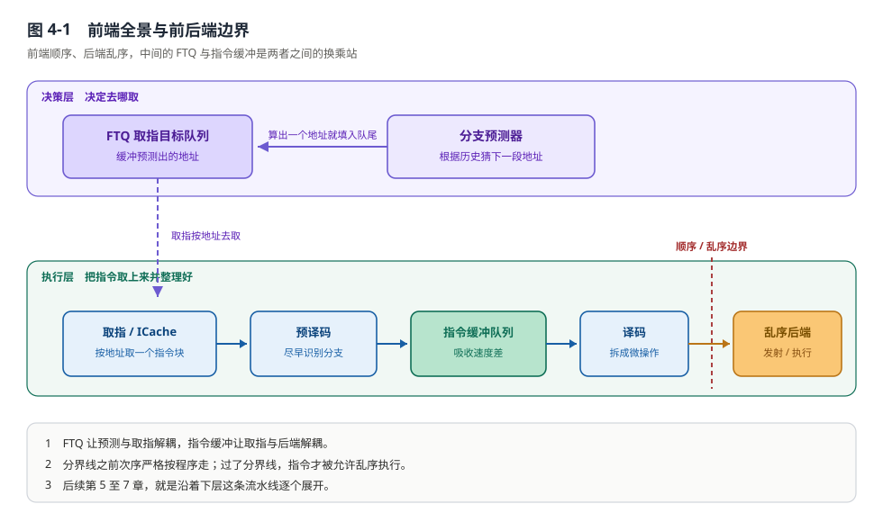
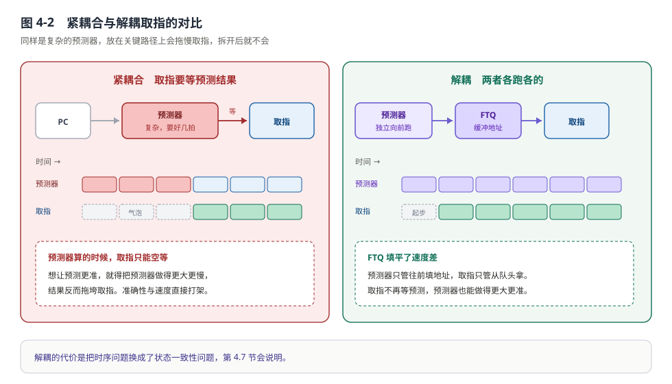
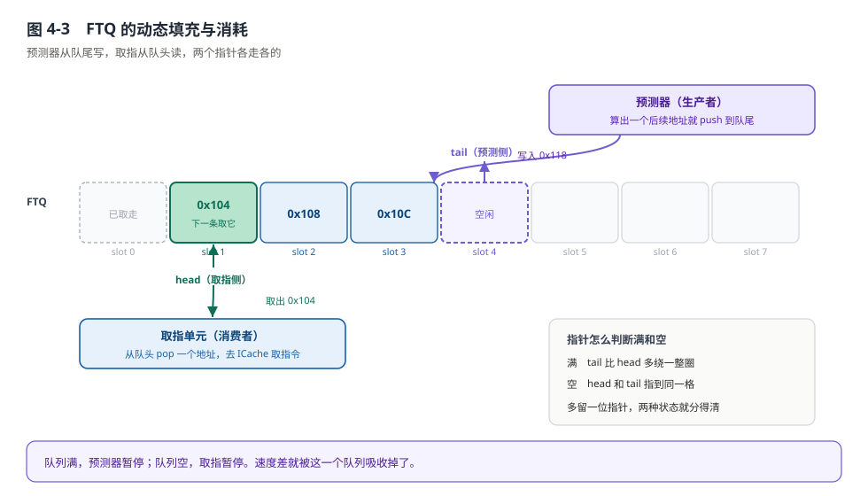
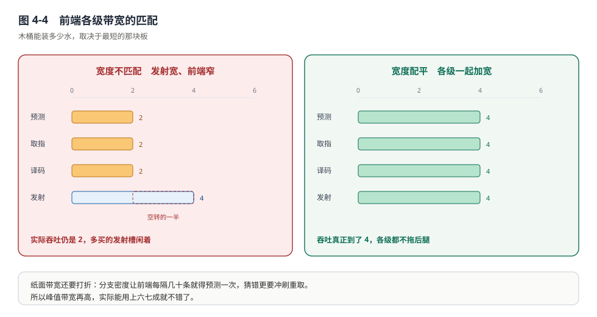

# 第 4 章　前端全景与解耦取指

> **本章导读**
> 前三章我们一直在折腾后端，讲怎么让指令乱序执行。但再强的后端，没人喂指令也只能空转。从本章起，我们把目光转向前端，回答一个朴素的问题：乱序后端每周期能吃两条甚至更多指令，前端怎么才能持续、准确地把它们供上来？
>
> 学完本章，你应该能够：
> 1. 说清前端和后端各管什么，分界线画在哪里；
> 2. 理解"解耦取指"的思想，以及它为什么要靠一个队列；
> 3. 看懂取指目标队列（FTQ）怎样把预测和取指拆成两条独立的流水线；
> 4. 明白取指带宽要和后端吞吐匹配，光取够不行，还得取对地方。
>
> 前端的活儿不只是"取指"两个字。它得一边猜、一边取，还要在猜错时尽快刹车。本章先搭起全景，后面三章再逐个拆开细讲。

---

## 4.1　后端再快，也得有指令喂

先算一笔账。我们的教学模型是 2 发射乱序核，后端每周期最多能开始执行 2 条指令。如果前端每周期只能送来 1 条，后端就有一半的发射槽闲着——相当于花两份钱买了两个灶眼，却只开一个。

真正的高性能核更夸张。发射宽度做到 6 甚至 8，意味着前端每周期要稳定供上 6 到 8 条指令。这个数字看着不小，但把需求拆开看，无非三件事：

- **足量**。每周期供给的指令条数要跟得上发射宽度。
- **准确**。取来的必须是将要执行的指令。分支猜错了，后面取的一堆全作废。
- **及时**。后端要的时候就得有，不能让执行单元干等。

这三件事里，最费劲的是"准确"。因为程序里平均每隔几条就有一个分支，而分支要等执行完才知道往哪走。前端只能猜。猜就容易错，错了就得把已经取进来、甚至已经开始执行的指令全部冲掉，从正确的地方重新取。这一冲一取，吃掉的正是我们好不容易省下来的性能。

所以前端的设计，本质上是在和"分支的不确定性"搏斗。解耦取指就是这场搏斗里的关键一招。

---

## 4.2　前端和后端的分界线

先把整条流水线切成两半。

**前端**按顺序工作：程序计数器（PC）一条道走到黑，取指、预译码、译码，指令像排队进场的观众，先来后到，次序不乱。

**后端**从第 3 章的发射开始就乱了序：指令进入保留站，谁的操作数先就绪谁先执行，完成次序和程序次序可以完全不同。

于是一个自然的问题出现了：这两半怎么接起来？总不能让顺序的前端直接连到乱序的后端中间吧。

答案是**在中间放缓冲队列**。前端把译码后的指令按顺序塞进队列，后端按自己的节奏从队列里取。前端不必等后端消化完当前这批，后端也不会因为前端慢一拍而停顿。这些队列就是顺序世界和乱序世界之间的"换乘站"。

在前端这一侧，有一个关键的队列叫**取指目标队列（Fetch Target Queue, FTQ）**。它不存指令本身，而是存"下一段指令从哪里开始取"的地址。先把全景画出来，看看 FTQ 站在什么位置。



*图 4-1　前端各模块按顺序排列，FTQ 与指令缓冲是顺序前端通向乱序后端的换乘站。*

从图里可以看到，前端内部其实还分成了两层。上面一层是分支预测器和 FTQ，它们决定"去哪取"；下面一层是取指、预译码、译码和指令缓冲，它们负责"把指令取上来并整理好"。这两层之间，正是靠 FTQ 解耦的。下一节讲为什么非要拆开。

---

## 4.3　为什么要解耦

最早的做法很直接：取指单元每取一段指令，就顺手问一声预测器"前面有没有分支，如果跳，下一段去哪取"。预测器算出来，取指单元立刻照着去取。这叫**紧耦合**。

紧耦合有个要命的问题。分支预测器，尤其是后面要讲的 TAGE、统计校正这类高精度预测器，电路很复杂，算一次要好几拍。而取指是紧接着要用到这个结果的下游。预测器慢，取指就得站在原地等它——这一等，流水线里就出现了气泡。你想把预测器做得更准（通常也更慢），结果反而拖垮了取指速度。

**解耦取指**换了个思路：既然预测器慢，就别让它挡在取指的关键路径上。把"决定去哪取"和"真正去取"拆成两件独立的事：

- 预测器变成一条独立向前跑的流水线，它不停地往前算未来一段段的取指地址，算出一个就往 FTQ 里填一个。
- 取指单元也独立跑，它只从 FTQ 的队头拿地址，拿到就去 ICache 取指令。
- 中间的 FTQ 吸收两者的速度差。预测器算得快，队列就攒满一些；算得慢，取指就等一下。

用一个日常的例子来说：预测器像坐在副驾的导航员，一直往前报"下一个路口左转、再下一个右转"；取指像开车的人，只管按报出来的路口走。导航员算得快就把接下来几个路口都报出来存着，算得慢司机就慢点开。两个人各干各的，谁也不堵谁。



*图 4-2　紧耦合时取指要等预测结果，解耦后预测和取指各跑各的，由 FTQ 填平速度差。*

解耦带来的好处不只是少几个气泡。更重要的是，它把预测器从取指的时序关键路径上摘了下来。设计者于是可以自由地把预测器做得更大、更准，而不必担心"预测器一复杂，前端就慢"。这正是现代高性能前端敢用 TAGE 这类复杂预测器的前提。

---

## 4.4　取指目标队列怎样工作

FTQ 是一个典型的**先进先出队列（FIFO）**，可以用生产者—消费者模型来看它。

- **生产者是预测器**。它每算出一个后续取指地址，就从队尾写入（push）一个表项。表项里主要是目标地址，实战中还会带上这次预测的辅助信息（比如分支历史快照、返回栈状态），我们这里先只看地址。
- **消费者是取指单元**。它从队头读出（pop）一个地址，据此去取一段指令。
- **队列满**说明取指跟不上预测的节奏。这时预测器暂时停下来，反正地址存再多也没地方放。
- **队列空**说明暂时没有地址可取。通常发生在前端刚刚被冲刷、或者预测器还没来得及算出下一段的时候，取指只能停一拍。

把一次动态过程走一遍，FTQ 的行为就清楚了。



*图 4-3　预测器从队尾填入地址，取指从队头取走地址，两个指针各自前进，速度差由队列深度吸收。*

要留意一个容易混淆的点：FTQ 里存的是**地址**，不是指令。真正的指令要等取指单元拿着地址去 ICache 取上来，再经过预译码、译码，才进入指令缓冲队列等待后端。所以前端其实串着两个队列：FTQ 缓冲"去哪取"，指令缓冲队列缓冲"取上来的指令"。前者管预测和取指的解耦，后者管取指和译码后端之间的速度差。第 6 章会细讲后者。

FTQ 队列指针的判空、判满逻辑，本质就是"头指针追上尾指针"的比较。本章配套的 Digital 电路用一个小电路把这个判断画了出来，Verilog 骨架则给出一个真正能跑的 FIFO。

---

## 4.5　取指带宽要和后端吞吐匹配

前端供给的速度，通常用**取指带宽**衡量，也就是每周期能取回多少条指令。它必须和后端吞吐匹配，否则又是一处木桶短板。

匹配关系可以这样想：

- 后端是 2 发射，前端每周期至少得供 2 条，否则发射槽填不满。
- 前端内部也有带宽匹配问题。预测宽度、取指宽度、预译码宽度、译码宽度，最好都大致等于发射宽度。任何一环窄了，都会成为瓶颈。

现代处理器一次不是取一条指令，而是取一个**取指块**，比如 16 到 32 字节，里面装着好几条定长或变长指令。这样一次 ICache 访问就能喂饱后端几拍。但块越大，跨界的问题越多：一个块里往往横跨了分支，块尾的指令可能根本不该执行。

再看分支密度。整数程序里平均每五到十条指令就有一个分支，也就是说每取几十条指令就得预测一次。一旦猜错，不光已取的要作废，还要等重新定位、重新取，这段时间前端的有效带宽大幅下降。所以纸上算出来的峰值带宽，实际能用到六七成就不错了。



*图 4-4　预测、取指、译码、发射各级宽度应大致相等，最窄的一环决定整体吞吐。*

这里可以体会到一个贯穿全书的思想：**处理器设计很大程度上是配平的艺术**。把某一级做快并不难，难的是让所有级协同地快。只把发射宽度从 2 提到 4，前端供不上，性能几乎不变，面积和功耗却上去了。

---

## 4.6　前端各模块一览

有了全景图，再把各模块按指令流过的顺序点一遍，顺便交代它们分别在哪一章展开。

1. **分支预测器**。根据历史预测分支往哪跳，把后续取指地址填进 FTQ。第 5 章讲原理，重点是 2 位计数器、BTB、RAS 和 TAGE 的思想。
2. **取指目标队列 FTQ**。缓冲预测出的地址，解耦预测和取指。就是本章的主角。
3. **指令缓存 ICache**。按地址把指令取上来。本书只讲它的接口和作用，不展开缓存的内部实现。第 6 章。
4. **预译码**。在指令还没正式译码前，先粗粗看一眼，尽早发现分支，好让预测错误能提前暴露、提前冲刷。第 6 章。
5. **指令缓冲队列**。吸收取指和后端之间的速度差，让后端要指令时随时有。第 6 章。
6. **译码与微操作拆分**。把一条复杂指令翻译成后端能处理的简单操作，必要时做指令融合或拆分。第 7 章。

走完这六站，指令就跨过顺序与乱序的边界，交给后端了。后面三章就是沿着这张清单往下讲。

---

## 4.7　重点与权衡

本章的概念不多，但有几个值得记牢的点。

**第一，前端顺序、后端乱序，中间靠队列换乘。** 这是理解整个处理器结构的骨架。FTQ 和指令缓冲队列都是"换乘站"，它们让两边不必互相等待。

**第二，解耦是一种通用思想。** 把"决策"和"执行"拆成两条独立流水线，中间用队列吸收速度差——这个套路在前端是预测与取指解耦，在后端还有取指与执行解耦、地址生成与数据访问解耦。看懂一次，以后到处都用得上。

**第三，宽度要配平。** 木桶效应在前端尤其明显，孤零零地把某一级做宽没有意义。

**关于权衡**，最典型的是 FTQ 的深度。队列深，能吸收更大的速度差，前端被短暂停顿时也不至于马上断粮；但队列越深，面积越大，而且一旦预测错误被冲刷，队列里攒的这些地址全白算了，浪费也更多。和处理器里的大多数参数一样，深度是一个折中值，没有唯一正确答案。

还有一个隐藏的取舍值得点一下：解耦让预测器可以做得更复杂、更准，但预测结果要隔一段才被取指用上，这中间如果分支历史或返回栈发生了变化，得保证信息能对得上。真实设计要为此在 FTQ 表项里附带额外的状态。本书不展开这些细节，但你要知道，"解耦"不是免费的，它把时序问题换成了状态一致性问题。

---

## 4.8　配套的图形与代码

本章配了两套材料，分工和前几章一致。

**图形**。图 4-1 是前端全景连接图，把模块边界和数据流画在一起；图 4-3 是 FTQ 的动态填充与消耗过程，适合对照 4.4 节看。另外有一个可以在 Digital 里打开仿真的小电路 `code/digital/04_ftq_status.dig`，它把判空判满最底层的一步——指针的逐位比较——单独画出来：拨动 `head_bit` 和 `tail_bit`，相等时 `equal` 亮起。多位比较单元的结果按 4.4 节讲的判据组合起来，就是完整的 `empty` 和 `full`。Digital 擅长表达这种落到连线上的局部机制，全景和数据流则用 SVG 分层图更清楚。

**代码**。写代码前先看接口，再看实现。接口也不是一次给全的，需要哪个信号就加哪个，你会看到每个信号都是被具体需求逼出来的。完整文件和测试在 `code/verilog/04_frontend/`。

### 4.8.1　先看接口

把 FTQ 当成一个黑盒子，看看谁要跟它打交道。

**第一步，预测器要把地址放进来。** 队列存在的意义就是暂存取指地址，所以得有写入口。写需要两样东西，一个"这一拍要写"的使能，一个"写什么"的地址：

```verilog
input  wire             push,
input  wire [ADDR_W-1:0] push_addr,
```

**第二步，取指要把地址取走。** 光进不出没意义，读出端同样要一个使能和一个地址输出：

```verilog
input  wire             pop,
output reg  [ADDR_W-1:0] pop_addr,
```

`pop_addr` 写成 `reg`，是因为它在时钟沿里被赋值。

**第三步，写满了得有人喊停。** 预测器只管往前写，队列满了还写就会丢地址。所以队列要能告诉它"满了"：

```verilog
output wire             full,
```

**第四步，取空了也得有人喊停。** 同理，取指来拿时若队列是空的，拿到的就是无效地址，所以还要一个"空了"：

```verilog
output wire             empty,
```

**第五步，时钟和复位。** 指针要跟着时钟推进，复位时得回到起点，这两个信号少不了：

```verilog
input  wire             clk,
input  wire             rst_n,
```

**接口定稿。** 把五步攒起来，加上两个参数，就是 FTQ 对外完整的样子：

```verilog
module ftq #(
    parameter DEPTH  = 8,
    parameter ADDR_W = 32
)(
    input  wire             clk,
    input  wire             rst_n,
    // 预测器写端口（生产者）
    input  wire             push,
    input  wire [ADDR_W-1:0] push_addr,
    output wire             full,
    // 取指读端口（消费者）
    input  wire             pop,
    output reg  [ADDR_W-1:0] pop_addr,
    output wire             empty
);
```

接口定了，内部怎么实现就顺着这些信号走。

### 4.8.2　再看实现

**第一步，先有地方存。** 队列说到底是一排格子，加两个下标：写的人往 `tail` 指的格子放，读的人从 `head` 指的格子拿。

```verilog
reg [ADDR_W-1:0] ftq_mem [0:DEPTH_M1];
reg [PTR_W-1:0]  head;
reg [PTR_W-1:0]  tail;
```

`DEPTH_M1` 就是 `DEPTH-1`，先转成 `localparam` 是因为这个版本的 iverilog 不接受数组上界直接写参数表达式。

**第二步，怎么知道空了。** 读写两边都得知道队列状态。最简单的判断是 `head == tail`：一开始两个指针都在起点，队列空；写入让 `tail` 前进，读出让 `head` 前进；等 `head` 追上 `tail`，就没有可读的了。这正是接口里的 `empty` 要输出的东西：

```verilog
assign empty = (head == tail);
```

**第三步，怎么知道满了。** 麻烦来了。深度 8 只要 3 位指针，可写满 8 个之后 `tail` 绕回 0，这时 `head == tail`，和空完全一样，分不清。办法是多留一位，用 4 位指针。写满时 `tail` 走到第 8 格（`4'b1000`），最高位从 0 翻成 1，而 `head` 还在 0。于是：

```verilog
assign full = (head[PTR_W-1] != tail[PTR_W-1]) &&
              (head[PTR_W-2:0] == tail[PTR_W-2:0]);
```

最高位不同、其余位相同，就是满。多出来的这一位不参与寻址，只用来区分状态。

**第四步，让指针动起来。** 预测器写、取指读，两边各推各的指针，接口上的 `push` 和 `pop` 在这里派上用场：

```verilog
if (push && !full) begin
    ftq_mem[tail[PTR_W-2:0]] <= push_addr;
    tail                     <= tail + 1'b1;
end
if (pop && !empty) begin
    pop_addr <= ftq_mem[head[PTR_W-2:0]];
    head     <= head + 1'b1;
end
```

两个 `if` 并列而不是二选一，因为预测器写队尾、取指读队头完全可以发生在同一拍，各走各的指针互不干扰。

**第五步，一个隐蔽的坑。** 注意索引数组用的是 `tail[PTR_W-2:0]`，也就是低 3 位，不是完整的 `tail`。写满时 `tail` 的值是 8，而数组只有 `[0:7]`——直接用完整指针就越界了，仿真会读出一片 `x`。这个错误不报编译错，很难发现。记住：指针的最高位只服务于判满，别拿它当数组下标。

**第六步，补上复位，拼成完整模块。** 把前面几步合起来，加上复位，就是 `ftq.v` 的全部：

```verilog
module ftq #(
    parameter DEPTH  = 8,
    parameter ADDR_W = 32
)(
    input  wire             clk,
    input  wire             rst_n,
    input  wire             push,
    input  wire [ADDR_W-1:0] push_addr,
    output wire             full,
    input  wire             pop,
    output reg  [ADDR_W-1:0] pop_addr,
    output wire             empty
);
    localparam PTR_W    = 4;
    localparam DEPTH_M1 = DEPTH - 1;

    reg [ADDR_W-1:0] ftq_mem [0:DEPTH_M1];
    reg [PTR_W-1:0]  head;
    reg [PTR_W-1:0]  tail;

    // 判空：两个指针完全相同
    // 判满：最高位不同、其余位相同（tail 比 head 多绕了一整圈）
    assign empty = (head == tail);
    assign full  = (head[PTR_W-1] != tail[PTR_W-1]) &&
                   (head[PTR_W-2:0] == tail[PTR_W-2:0]);

    integer i;
    always @(posedge clk or negedge rst_n) begin
        if (!rst_n) begin
            head     <= {PTR_W{1'b0}};
            tail     <= {PTR_W{1'b0}};
            pop_addr <= {ADDR_W{1'b0}};
            for (i = 0; i < DEPTH; i = i + 1)
                ftq_mem[i] <= {ADDR_W{1'b0}};
        end else begin
            if (push && !full) begin
                ftq_mem[tail[PTR_W-2:0]] <= push_addr;
                tail                     <= tail + 1'b1;
            end
            if (pop && !empty) begin
                pop_addr <= ftq_mem[head[PTR_W-2:0]];
                head     <= head + 1'b1;
            end
        end
    end
endmodule
```

动手时还会遇到两个小麻烦：存储器不能取名 `table`，testbench 里的信号也不能叫 `expect`，它们在 Icarus Verilog 里都是保留字（配套文件用的是 `ftq_mem` 和 `exp_addr`）。

配套的 testbench 依次做了复位、连续写入至满、读出至空、以及读写同拍几种情形，全部通过。运行方法见目录里的 README。

---

## 4.9　香山一瞥（选读）

香山采用了典型的解耦前端：分支预测作为一个独立的前级先行，把预测结果送进取指目标队列，取指级再从队列里取地址。这样设计的一个直接好处，是取指不会被复杂预测器的计算时间拖住，前端气泡明显减少。

前面几章说过，本书不展开香山的工程细节。这里只想让你看到那个熟悉的影子：**它用的正是本章讲的"解耦 + 队列缓冲"思想**，只不过规模更大、预测器更复杂、状态管理更精细。思想对上了，具体的表项和参数留给你以后去读源码。

---

## 4.10　小结与思考题

### 小结

- 前端要同时做到足量、准确、及时地给后端供指令，难点在于分支的不确定性。
- 前端顺序、后端乱序，两者的边界靠 FTQ 和指令缓冲这类队列来衔接。
- 解耦取指把"决定去哪取"（预测）和"真正去取"（取指）拆成两条独立流水线，由 FTQ 吸收速度差，既减少气泡，又让预测器可以做得很复杂。
- FTQ 是存地址的 FIFO，生产者是预测器，消费者是取指单元，满则暂停预测，空则暂停取指。
- 取指带宽要和后端发射宽度及各前端模块宽度配平，木桶短板决定整体吞吐。

### 思考题

1. 如果把 FTQ 去掉，让取指级直接等预测器的结果，前端会付出什么代价？试着从气泡和预测器复杂度两方面回答。
2. FTQ 满了说明什么？这时候该限制预测器还是限制取指？反过来队列空了呢？
3. 为什么说解耦"把时序问题换成了状态一致性问题"？提示一下，想想 4.7 节提到的分支历史和返回栈。
4. 一个 4 发射的核，前端各级宽度都做成 4 就一定够快吗？还有哪些因素会让实际带宽打折？
5. 本章的 FTQ 用"多一位指针"区分满和空。如果换成"计数器记录当前元素个数"，判空判满会怎么变？两种办法各有什么好处？
