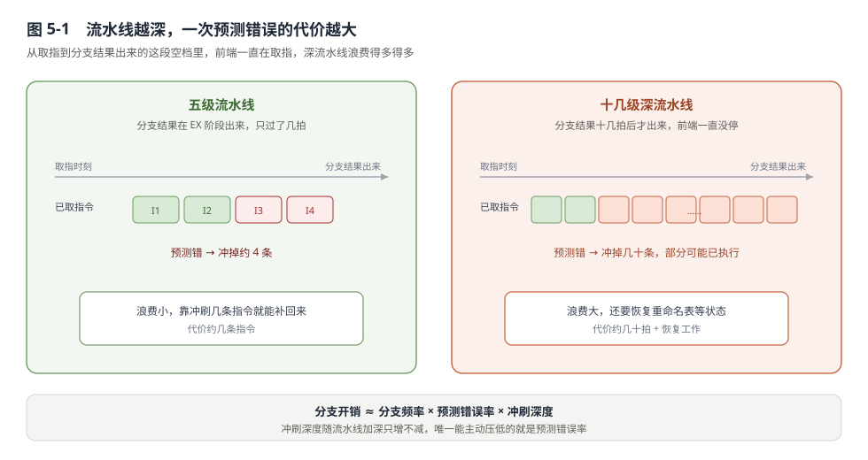
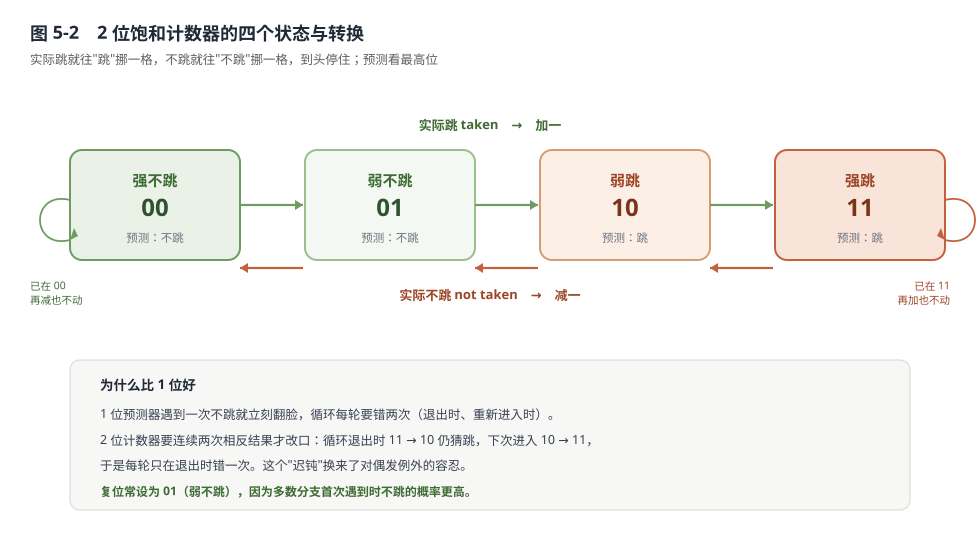
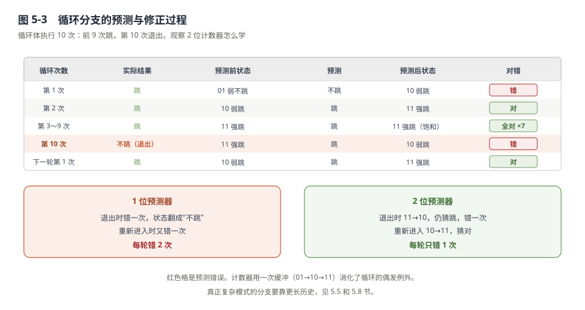
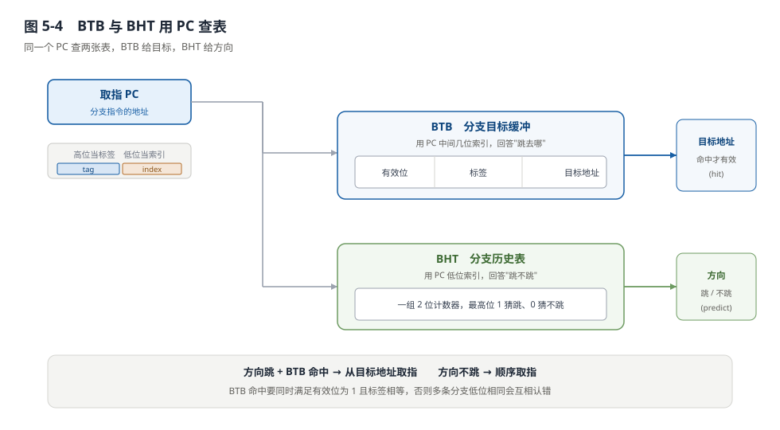
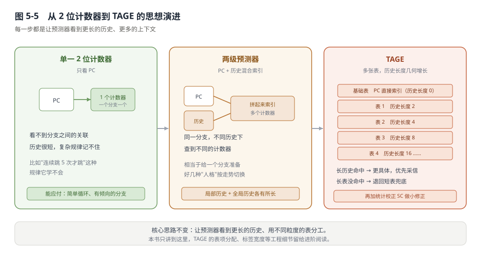

# 第 5 章　分支预测原理

## 本章导读

第 4 章把前端的骨架搭起来了：预测器往前跑，取指跟着 FTQ 里的地址走。这一章要填的是预测器这块。读者已经知道五级流水线里分支要等到执行阶段才知道跳不跳，那时候后面几条指令已经取错了，得冲掉重来。本章把这个"冲掉重来"的代价算清楚，再讲怎么用预测把它降到可接受。

本章的路线是这样的：先看控制冒险在不同深度的流水线里有多贵，再讲预测的基本想法，然后依次引入 2 位饱和计数器、BTB、BHT、全局与局部历史、返回地址栈。最后站在思想层面看一眼 TAGE 是怎么把这些想法组织起来的——只看思路，不碰实现。学完这一章，你会明白一个分支预测器大体由哪几块组成，每块解决什么问题。

## 5.1　控制冒险为什么越来越贵

先看一个让人不太舒服的事实。五级流水线里，一条分支指令在执行阶段算出结果，此时它后面已经有四条指令进了流水线。如果分支真的跳了，这四条全白取了，冲掉，从新地址重新取。这个损失是固定的几条指令，忍忍也就过去了。

流水线一深，情况就变了。现代乱序核的流水线动辄十几级，从取指到分支结果出来，中间隔着十几拍。这十几拍里前端一直在取指，按每周期取 4 条算，已经取了几十条指令。等到发现预测错了，这几十条里的一部分可能已经执行完，甚至已经改了处理器的状态。冲刷的代价从"几条指令"变成"几十拍的时间加上一堆恢复工作"。

把这笔账写成式子，分支带来的额外开销大约是：

```text
分支开销 ≈ 分支频率 × 预测错误率 × 冲刷深度
```

三项里，分支频率由程序决定，改不了；冲刷深度随着流水线加深只会越来越大；唯一能主动压低的，就是预测错误率。这就是为什么深流水线特别依赖预测——不是锦上添花，是不预测就没法用。



*图 5-1　同样是预测错误，五级流水线冲掉几条，深流水线冲掉几十条。纵轴是浪费的取指带宽，示意。*

顺带说一句，这也解释了为什么第 4 章要把预测和取指解耦。预测得足够早、足够准，取指才不会跟着一条错误路径狂奔太久。

## 5.2　预测的基本想法

分支预测说穿了很简单：分支还没算出来的时候，先猜一个结果，按猜的方向继续取指。猜对了皆大欢喜，猜错了再回头。

要猜的东西其实有两样。

一是**方向**，这条分支到底跳不跳。条件分支（`beq`、`bne` 之类）靠历史行为来猜，因为程序里的分支大多有倾向性——循环大概率继续，错误检查大概率不触发。

二是**目标**，如果跳，跳到哪里。这个相对好办，因为同一条分支指令每次跳的目标通常是一样的。把上次的目标记下来就行。

于是预测器自然分成两半：猜方向的，和猜目标的。后者简单些，先看它。

## 5.3　猜目标 BTB

分支目标缓冲（Branch Target Buffer，BTB）就是一张小表，用分支指令的地址查，表里存它上次跳转的目标。取指时拿当前 PC 去查，如果命中，就说明"这条指令上次是条跳转的分支"，直接把表里的目标当成下一条取指地址。

BTB 的组织很像一本书的目录。目录不告诉你每一页写了什么，只告诉你"想找第几章，翻到第几页"。BTB 也不判断这条分支这次跳不跳（那是方向预测的事），只负责回答"如果它跳，去哪儿"。

最简单的 BTB 用 PC 的几位做索引，直接映射。表项里通常放三样东西：

- **有效位**。表项有效，说明这个索引上确实记录过一条分支。
- **标签**。PC 的高几位，用来确认查到的表项是不是当前这条分支——因为多条分支可能映射到同一个索引。
- **目标地址**。跳转要去的地方。

命中要同时满足有效位为 1、标签对得上。命中了就把目标地址送出去；没命中就按默认路径顺序取指。分支真正执行完后，再把正确的目标写回表项。

BTB 有个天生的短板：它记的是"上次跳到哪"，对间接跳转（`jalr`，目标来自寄存器）效果不好，因为同一个 `jalr` 在不同调用点可能跳到不同地方。这类分支要单独想办法，第 9 章之后会用到的 ITTAGE 就是干这个的，本书不展开。

## 5.4　猜方向 2 位饱和计数器

现在回到方向预测。最朴素的想法是记一条分支上次跳没跳，这次就照样猜。这叫 1 位预测器，但有个明显的毛病。

拿最常见的循环来说。一个循环体执行 10 次，分支在前 9 次跳、第 10 次不跳。1 位预测器会这样：前 9 次都猜跳，全对；第 10 次还猜跳，错了——这时候它的记录被改成"不跳"。等下一次进这个循环，第一次又猜不跳，再错一次。于是**每执行一轮循环，稳定地错两次**：一次在退出时，一次在重新进入时。

这个毛病出在 1 位预测器太容易被一次例外翻盘。改进办法是让它变得"迟钝"一点：需要连续两次不跳，才把判断从跳改成不跳。这就是 2 位饱和计数器。



*图 5-2　四个状态，强/弱各两个。实际跳转就往"跳"的方向挪一格，实际不跳就往"不跳"挪一格，到头就停住（饱和）。*

它有四个状态，可以理解为对这条分支"有多相信它会跳"：

| 状态 | 编码 | 含义 | 预测 |
|---|---|---|---|
| 强不跳 | 00 | 连续多次不跳 | 不跳 |
| 弱不跳 | 01 | 大多不跳，刚遇到过一次跳 | 不跳 |
| 弱跳 | 10 | 大多跳，刚遇到过一次不跳 | 跳 |
| 强跳 | 11 | 连续多次跳 | 跳 |

规则只有两条。实际跳了，状态加一，加到 11 就不再加；实际不跳，状态减一，减到 00 就不再减。预测时看最高位，1 就猜跳，0 就猜不跳。

回到循环的例子。进入循环后计数器很快爬到 11（强跳），前 9 次全猜对。第 10 次实际不跳，状态从 11 降到 10（弱跳）——还是猜跳的方向，但已经松动了。下次进循环第一次，状态从 10 升回 11，猜跳，对了。于是**每轮循环只错一次**，比 1 位预测器少一半。

"饱和"这个词就是说它有上下限，不会无限增长。这个小小的迟钝，换来的是对偶发例外的容忍——程序里的分支偏偏就充满了偶发例外。



*图 5-3　一个 10 次循环的预测过程。2 位计数器让每轮只在退出时错一次；橙色格是预测错误。*

## 5.5　BHT 与分支历史

一条分支一个计数器，这么多分支放哪？答案是和历史信息一起，做成表。

分支历史表（Branch History Table，BHT）是一组 2 位计数器的集合，用分支 PC 的几位做索引。取指时同时查 BTB 和 BHT：BTB 给目标，BHT 给方向。两者结合，才知道"跳不跳，跳的话去哪"。

这里有个需要想清楚的问题：分支PC的高几位和低几位，用途不一样。



*图 5-4　取指时拿 PC 同时查两张表。BTB 命中给目标，BHT 计数器的最高位给方向。*

先说低几位。一条指令占 4 字节，PC 的最低 2 位恒为 0，没用。再往上的几位做索引正好——同一段代码里的分支地址相近，能散开到不同表项。

再说高几位。它们用来当标签，解决刚才说的冲突问题：两条分支 PC 的低位相同，会查到同一个表项，标签能区分它们是不是同一条分支。

### 局部历史与全局历史

只用 PC 索引的 2 位计数器，看不到分支之间的关联。可程序里的分支常常是有关联的。举个简单的例子：

```c
if (a) ...
if (a) ...
```

两条分支条件一样，第一条的结果强烈预示着第二条的结果。如果各记各的，这个关联就浪费了。

于是有了两种"历史"：

- **局部历史**，每条分支只记自己过去几次的结果。适合那种"自己跟自己较劲"的分支，比如循环。
- **全局历史**，用一个移位寄存器记最近所有分支的结果，叫全局历史寄存器（GHR）。适合捕捉分支之间的关联。

用历史去查表，比光用 PC 查要准。做法是把 PC 的位和历史的位拼（或者异或）起来当索引，这样同一条分支在不同的历史模式下，能查到不同的计数器——也就是给这条分支准备了多个"人格"，根据最近的走势切换。这种把 PC 和历史混合索引的预测器，叫**两级预测器**。

2 位计数器加上几位历史，已经能应付相当一部分分支。但历史再长一些、模式再复杂一些，它就不够用了。5.8 节会讲这个演进方向。

## 5.6　返回地址栈 RAS

有一类分支值得单拎出来：`call` 和 `ret`。调用一个函数时跳到函数入口，返回时跳回调用点的下一条。

用 BTB 猜 `ret` 的目标效果很差。因为同一个 `ret` 指令，被不同地方调用后，返回地址不一样——它不像普通分支那样有个固定目标。

但这类跳转有个极好的性质：**后进先出**。最后一次调用的函数，最先返回。这不是概率问题，是调用关系本身保证的。既然如此，用一个栈来记返回地址就行了。

- 遇到 `call`，把返回地址（调用指令的下一条）压栈。
- 遇到 `ret`，从栈顶弹出一个地址当预测目标。

这个结构叫返回地址栈（Return Address Stack，RAS）。它不需要历史学习，靠结构本身保证正确，命中率通常很高。

RAS 也有边界情况：递归调用会反复压栈，栈深不够就会溢出；函数里的异常返回不经过 `ret`，会让栈和真实调用路径脱节。这些都是实现时要处理的细节，本书不展开。

## 5.7　预测错了怎么办

前面都在讲怎么猜对，现在讲猜错了的后果。

预测错误分两种，处理难度差很多。

**方向猜错**。本来不跳却猜跳，或者反过来。前端顺着错误路径取了一串指令，发现后要把这串指令全部作废，从正确地址重新取。这靠第 4 章的 FTQ 和第 14 章的重定向机制完成。

**目标猜错**。方向对了但跳错地方，同样要冲掉错误路径上的指令。

还有一种更麻烦的情况，叫**目标猜对但方向猜错的延迟发现**。因为取指是预测驱动的，错误路径上的指令可能已经进了后端甚至执行了一部分。乱序机器要恢复的不只是 PC，还有重命名表、发射队列、LSQ 里那些错误路径指令留下的痕迹。这正是第 14 章"重定向与状态恢复"要解决的问题——预测器越深、越激进，恢复的代价越大。

所以预测器不是越复杂越好。提高几个百分点的准确率，如果换来的是更长的预测延迟和更复杂的恢复逻辑，账未必划算。这是设计预测器时反复要做的权衡。

## 5.8　从 2 位计数器到 TAGE

到这里，读者已经能看到一条清晰的演进思路。TAGE 不是凭空冒出来的，它是把前面这些想法推到极致的结果。这一节只讲思想，不碰实现。

先看 2 位计数器的局限。它用 PC 查一张表，一个分支只有一个计数器。就算混进几位历史，历史长度也很有限。可有些分支的规律藏在很长的历史里——比如"前面连续 5 次跳，且其中某个分支不跳，这次才跳"。短历史看不出这种规律。

一个直接的想法是：多用几张表，每张表用不同长度的历史去索引。短历史表捕捉简单规律，长历史表捕捉复杂规律。这就引出了 TAGE 的核心结构。

TAGE 的名字来自它组织的几张表：

- **T** 表示 tagged，每张表的表项带标签，因为多个 PC 和历史组合会撞到同一项，标签用来确认。
- **A** 表示 address-based，短历史表用 PC 直接索引。
- **G** 表示 global，其余的表用不同长度的全局历史索引。
- **E** 表示 geometric，历史长度按几何级数增长，比如 2、4、8、16、32、64。

为什么用几何级数？因为这样可以用很少的几张表覆盖很宽的历史范围。一张表一个历史长度线性增长，要覆盖到 64 得准备 60 多张表；几何级数只要 6、7 张。

每张表项除了 2 位（或 3 位）预测计数，还有一个"使用性"计数器，记录这项有多常用。新表项来了往哪放、旧表项什么时候淘汰，都看这个计数器。这解决的是表资源有限时如何优中选优的问题。

预测时，所有表各出一个预测，选历史最长的那张命中的表作为最终预测。这个"最长者优先"的原则，背后是这么个判断：长历史表如果能命中，说明它记住了一个更具体的规律，比短历史表的泛化判断更可信；只有当长表没命中时，才退回到短表。



*图 5-5　从单一计数器，到引入历史，到多张不同历史长度的表。每一步都是为了让预测器看到更多上下文。*

在 TAGE 之上还常加一层**统计校正**（Statistical Corrector，SC）。它用分支之外的信息——比如路径历史、分支之间的相关性——对 TAGE 的预测做一个小修正。思想是把各种弱信号收集起来投票，纠正主预测器的系统性偏差。

到这里要刹个车。TAGE 和 SC 的实现细节相当复杂，涉及表项分配策略、标签宽度、预测选择逻辑等一大堆工程问题。本书到此为止——读者需要带走的是那条演进思路：**让预测器看到更长的历史、更多的上下文，并用多个不同粒度的表分工合作**。有了这个认识，将来读真实预测器的资料就不会发怵。

## 5.9　重点与权衡

这一章的要点集中在几个权衡上。

**预测精度 versus 预测延迟**。预测必须在取指那一拍就给出结果，晚了就失去意义（取指被卡住，等于预测没用）。表越大、历史越长，查表越慢。所以真实设计里预测器是多级流水化的，快的粗预测先给个结果，慢的精预测后面再修正。第 4 章讲的 μBTB 到 TAGE 的多层结构，本质上就是延迟和精度的分层。

**表容量 versus 冲突**。表项多了精度高，但面积和功耗跟着涨。表小了冲突就多——两条分支查到同一项互相覆盖，学不到东西。标签和使用性计数器都是为了在有限容量里减少无效冲突。

**局部规律 versus 全局关联**。局部历史对循环这类分支好，全局历史对有关联的分支好。现代预测器通常两者都用。

**预测收益 versus 恢复代价**。前面说过，越激进的预测，猜错时恢复越贵。这是前端和后端共同承担的账。

## 5.10　配套的图形与代码

### 图形

图 5-2 是 2 位计数器的状态机，图 5-3 是它在循环里的实际表现，两张对照看最容易理解。图 5-4 把 BTB 和 BHT 放在一起，看取指时怎么同时查两张表。另外有一个可在 Digital 里打开的小电路 `code/digital/05_bht_cell.dig`，它画的是饱和判断最底层的一步——把当前状态的一位和边界值（11 或 00）的对应位做比较，`bit_match` 亮起表示这一位匹配；两位的 `bit_match` 都亮，就说明状态到了边界、该饱和了。Digital 适合表达这种落到连线上的局部逻辑，状态机全貌和查表流程则用 SVG 更清楚。

### 代码

下面写两个模块，都是先看接口再看实现，接口按需求逐步添加。完整文件和测试在 `code/verilog/05_branch/`。

#### 2 位饱和计数器 BHT

先看接口。

**第一步，预测时要能读出计数器状态。** 给一个 PC 进来，输出它的预测方向。方向只看计数器最高位：

```verilog
input  wire [PC_W-1:0]  pc,
output wire             predict,       // 1 = 猜跳
output wire [1:0]       cnt_out,       // 保留原始状态，便于观察
```

**第二步，分支执行完要能更新计数器。** 需要写使能、分支 PC 和真实方向：

```verilog
input  wire             update_en,
input  wire [PC_W-1:0]  update_pc,
input  wire             taken,         // 1 = 实际跳了
```

**第三步，时钟和复位。** 计数器存在寄存器里，需要时序控制：

```verilog
input  wire             clk,
input  wire             rst_n,
```

接口到这就齐了。再看实现。

**第四步，用一组 2 位寄存器当表。** 表的深度做成参数，`PC_W` 位地址里取低几位做索引：

```verilog
reg [1:0] cnt [0:IDX_MAX];
wire [IDX_W-1:0] idx      = pc[IDX_W-1:0];
wire [IDX_W-1:0] upd_idx  = update_pc[IDX_W-1:0];
assign cnt_out = cnt[idx];
assign predict = cnt[idx][1];
```

`IDX_MAX` 是 `2^IDX_W-1`，先转成 `localparam`，因为 iverilog 不接受数组上界直接写参数表达式。

**第五步，更新时加一减一，并且饱和。** 这是整个模块的核心：

```verilog
if (update_en) begin
    if (taken)      cnt[upd_idx] <= (cnt[upd_idx] == 2'b11) ? 2'b11 : cnt[upd_idx] + 1'b1;
    else            cnt[upd_idx] <= (cnt[upd_idx] == 2'b00) ? 2'b00 : cnt[upd_idx] - 1'b1;
end
```

到 11 再加还是 11，到 00 再减还是 00——这就是饱和。一位判断挡住了溢出，让状态稳定停在两端。

**完整代码。**

```verilog
module bht #(
    parameter PC_W  = 32,
    parameter IDX_W = 4          // 表深 2^IDX_W = 16 项
)(
    input  wire             clk,
    input  wire             rst_n,
    input  wire [PC_W-1:0]  pc,
    output wire             predict,
    output wire [1:0]       cnt_out,
    input  wire             update_en,
    input  wire [PC_W-1:0]  update_pc,
    input  wire             taken
);
    localparam IDX_MAX = (1 << IDX_W) - 1;
    reg [1:0] cnt [0:IDX_MAX];

    wire [IDX_W-1:0] idx     = pc[IDX_W-1:0];
    wire [IDX_W-1:0] upd_idx = update_pc[IDX_W-1:0];
    assign cnt_out = cnt[idx];
    assign predict = cnt[idx][1];

    integer i;
    always @(posedge clk or negedge rst_n) begin
        if (!rst_n) begin
            for (i = 0; i <= IDX_MAX; i = i + 1)
                cnt[i] <= 2'b01;     // 初始弱不跳，偏保守
        end else if (update_en) begin
            if (taken) cnt[upd_idx] <= (cnt[upd_idx] == 2'b11) ? 2'b11 : cnt[upd_idx] + 1'b1;
            else       cnt[upd_idx] <= (cnt[upd_idx] == 2'b00) ? 2'b00 : cnt[upd_idx] - 1'b1;
        end
    end
endmodule
```

复位成 01（弱不跳）而不是 00，是因为程序里大多数分支首次遇到时不跳的概率更高，从保守一边起步更稳妥。这是个经验选择，换成 00 也能跑。

#### 分支目标缓冲 BTB

先看接口。

**第一步，取指时按 PC 查表。** 想要知道命中没有、目标是什么：

```verilog
input  wire [PC_W-1:0]  pc,
output wire             hit,
output wire [PC_W-1:0]  target,
```

**第二步，分支执行完要能写入正确目标。** 一条分支解析出来后，把它的 PC 和目标登记进表：

```verilog
input  wire             update_en,
input  wire [PC_W-1:0]  update_pc,
input  wire [PC_W-1:0]  update_target,
```

**第三步，时钟和复位。** 同样是寄存器表：

```verilog
input  wire             clk,
input  wire             rst_n,
```

再看实现。

**第四步，表项由标签和目标地址两部分组成。** 用两个数组并排放，索引取 PC 的中间几位（最低 2 位恒为 0，拿来做索引就浪费了）：

```verilog
reg [TAG_W-1:0]  tag    [0:IDX_MAX];
reg [PC_W-1:0]   target_mem [0:IDX_MAX];
reg              valid  [0:IDX_MAX];

wire [IDX_W-1:0] idx     = pc[IDX_W+1:2];
wire [IDX_W-1:0] upd_idx = update_pc[IDX_W+1:2];
wire [TAG_W-1:0] pc_tag  = pc[PC_W-1:PC_W-TAG_W];
assign hit    = valid[idx] && (tag[idx] == pc_tag);
assign target = target_mem[idx];
```

标签取 PC 的高 `TAG_W` 位。命中条件是有效位为 1 且标签相等，缺一不可。

**第五步，更新时写入标签和目标。** 分支解析后把这一项填上：

```verilog
if (update_en) begin
    valid[upd_idx]      <= 1'b1;
    tag[upd_idx]        <= update_pc[PC_W-1:PC_W-TAG_W];
    target_mem[upd_idx] <= update_target;
end
```

直接映射表的弱点在这里看得很清楚：两条 PC 中间位相同的分支会抢同一个表项，后来的把先来的覆盖掉。加大表深、改用组相联都能缓解，但那是工程上的取舍，本书到此为止。

**完整代码。**

```verilog
module btb #(
    parameter PC_W  = 32,
    parameter IDX_W = 4,          // 表深 16 项
    parameter TAG_W = 6
)(
    input  wire             clk,
    input  wire             rst_n,
    input  wire [PC_W-1:0]  pc,
    output wire             hit,
    output wire [PC_W-1:0]  target,
    input  wire             update_en,
    input  wire [PC_W-1:0]  update_pc,
    input  wire [PC_W-1:0]  update_target
);
    localparam IDX_MAX = (1 << IDX_W) - 1;
    reg [TAG_W-1:0]  tag        [0:IDX_MAX];
    reg [PC_W-1:0]   target_mem [0:IDX_MAX];
    reg              valid      [0:IDX_MAX];

    wire [IDX_W-1:0] idx     = pc[IDX_W+1:2];
    wire [IDX_W-1:0] upd_idx = update_pc[IDX_W+1:2];
    wire [TAG_W-1:0] pc_tag  = pc[PC_W-1:PC_W-TAG_W];

    assign hit    = valid[idx] && (tag[idx] == pc_tag);
    assign target = target_mem[idx];

    integer i;
    always @(posedge clk or negedge rst_n) begin
        if (!rst_n) begin
            for (i = 0; i <= IDX_MAX; i = i + 1) begin
                valid[i]      <= 1'b0;
                tag[i]        <= {TAG_W{1'b0}};
                target_mem[i] <= {PC_W{1'b0}};
            end
        end else if (update_en) begin
            valid[upd_idx]      <= 1'b1;
            tag[upd_idx]        <= update_pc[PC_W-1:PC_W-TAG_W];
            target_mem[upd_idx] <= update_target;
        end
    end
endmodule
```

配套的 testbench 做了几件事：把计数器从 01 一路推到 11、验证饱和不会溢出、检查标签不匹配时 BTB 不误报命中。全部通过。运行方法见目录里的 README。

## 5.11　香山一瞥（选读）

香山的分支预测是分层的，这个结构很能说明前面讲的延迟与精度权衡。

最靠近取指的是一级很浅的预测，表项少、查得快，覆盖短距离回跳这类常见分支——可以把它理解成零级预测。往后是容量更大的 BTB，提供跳转目标。再往后才是主力预测器，用 TAGE 加统计校正，查得慢但准得多。

这几层不是互相替代，而是分工。快的那层先给出预测让取指别停，慢的那层随后算出一个更准的结果；如果两者不一致，后端会做一次轻量级的纠正。这样既不让取指等慢预测器，又能享受高精度预测的好处。

读者不必记这些层次的名字，要记的是那个思路——把"快而粗"和"慢而准"分开，让前端先跑起来。这个思路在第 4 章讲解耦取指时已经出现过一次，这里换了个场景又用了一遍。

## 5.12　本章小结

- 深流水线里分支代价大，唯一能主动压低的是预测错误率。
- 预测分方向和目标两件事。BTB 记目标，BHT 里的 2 位计数器记方向。
- 2 位计数器靠"迟钝"扛住偶发例外：每轮循环只错一次，比 1 位少一半。
- BHT 用 PC 索引，可以混入历史位；局部历史看自己，全局历史看所有分支的走势。
- 返回地址栈用后进先出的结构猜 `ret` 的目标，靠结构保证，不靠学习。
- TAGE 用多张不同历史长度的表分工，长历史优先；背后的思想是让预测器看到更多上下文。
- 预测器越激进，猜错时恢复越贵，精度和延迟要一起权衡。

## 5.13　思考题

1. 一个循环执行 100 次，1 位预测器和 2 位预测器各错几次？如果把循环体里的分支改成"每 10 次不跳一次"，答案怎么变？
2. BTB 命中但 BHT 预测不跳，这时前端应该怎么取指？反过来呢？
3. 为什么 BTB 的索引取 PC 的中间几位，而不是最低几位？
4. 全局历史寄存器只有 8 位，能捕捉"前面连续 20 次跳"这种规律吗？TAGE 是怎么解决这类问题的？
5. 返回地址栈如果深度只有 4，遇到 5 层递归调用会发生什么？有什么补救办法？

下一章讲取指单元怎样把这些预测结果变成实际的指令流，以及预译码如何提前发现错误。
