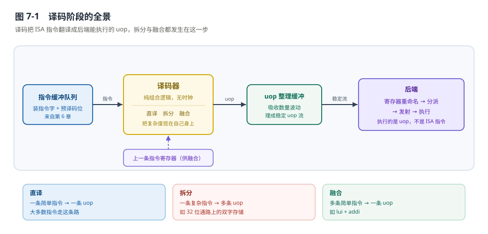
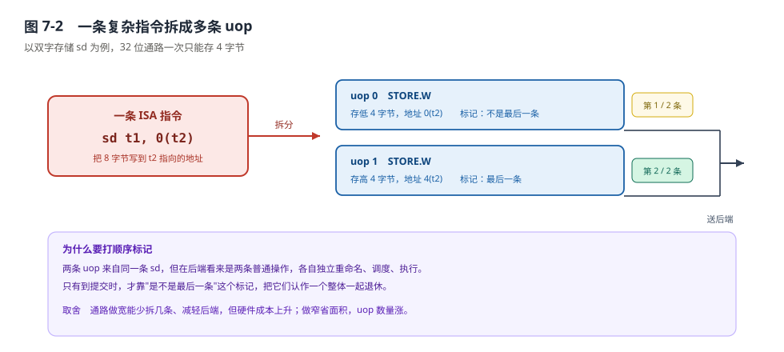
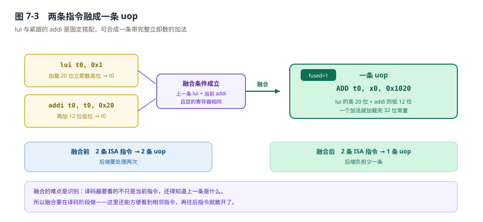
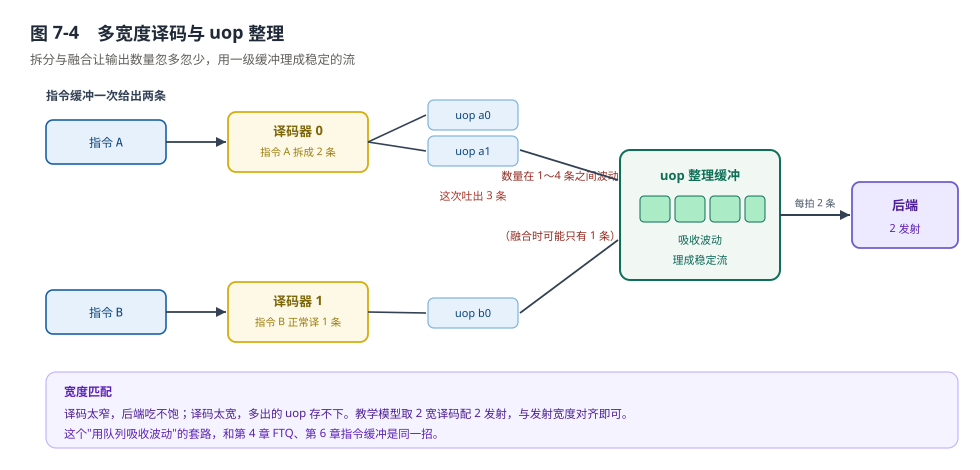

# 第 7 章 译码、指令融合与微操作

## 7.1 译码这一步要做什么

指令经过取指、预译码，存进指令缓冲队列，接下来就轮到译码。预译码只是匆匆看一眼，认出"这是不是分支"这类粗信息；译码则要真正把指令看懂，翻译成后端能执行的动作。

这里有个关键概念：后端并不直接执行 RISC-V 指令，它执行的是处理器自己定义的一种内部操作，叫微操作（micro-operation，简称 uop）。译码器的工作，就是把一条条 ISA 指令翻译成一条条 uop。

为什么要多这一层？因为 ISA 指令和后端执行单元的需求对不上。RISC-V 指令格式多样，有的带 12 位立即数，有的带 20 位，有的访问内存，有的做原子操作。而后端希望面对的是一批格式统一、动作简单、数据通路能直接处理的小操作。uop 就是这个统一格式。

打个比方。ISA 指令像是客户点的整桌菜，uop 像是厨房里厨师实际做的每一道工序。客户不关心工序，厨师也不直接照着菜单炒菜——中间得有人把菜单拆成一道道工序。译码器就是这个中间人。

图 7-1 是这一章的全景。先看清楚译码在整条流水线里的位置。



*图 7-1　指令从缓冲队列取出，经译码变成 uop 送往后端的重命名与分派。拆分和融合都发生在这一步。*

## 7.2 uop 长什么样

uop 的具体格式由处理器设计者自己定，没有标准。但不管怎么定，都绕不开这么几样东西：

- **做什么**，也就是操作类型，是加法、减法、访存还是别的；
- **操作数在哪**，源寄存器的编号；
- **结果放哪**，目的寄存器的编号；
- **立即数**，如果这条操作带常量的话。

除此之外，后端往往还需要一些标志位，比如"这条 uop 是不是一条分支""是不是一条访存""是不是某条指令拆出来的最后一条"。这些位帮助后端做调度和提交。

uop 比 ISA 指令更规整。ISA 里操作码字段位置会根据指令类型变，uop 里所有操作的字段位置都一样，后端取字段时不用先判断类型。这份规整是译码器换来的——译码器干的就是把千差万别的 ISA 格式，理成清一色的 uop。

这里能看出译码器的一个设计原则：复杂度尽量放在译码这一步，让后端简单。后端是每周期都要高速运转的地方，译码器相对没那么敏感。把麻烦留在译码器，后端就能轻装上阵。

## 7.3 一条指令拆成多条

不是所有指令都能一条变成一个 uop。有些指令太复杂，一个 uop 装不下，得拆成好几条。这个过程叫指令拆分，也有人叫 cracking。

举几个常见的例子。

**访存指令。** 一条双字存储指令要写入 8 个字节，如果后端的数据通路一次只能处理 4 个字节，就得拆成两次 4 字节存储。

**宽运算。** 在 32 位数据通路上做 64 位乘法，硬件乘法器只有 32 位，一条乘法指令要拆成好几条 32 位乘法和加法。

**带大立即数的运算。** RISC-V 的加法立即数通常只有 12 位，如果程序想要加一个 32 位的常量，得先 `lui` 加载高位、再 `add` 相加。有些处理器会把这种序列在译码阶段拆成两条 uop，让后端按部就班地做。

拆分带来一个新问题：一条 ISA 指令对应多条 uop 之后，后端怎么知道哪些 uop 属于同一条指令？答案是给每条 uop 打上标记，比如"我是第几条""我是不是最后一条"。提交的时候，一条 ISA 指令要等它所有的 uop 都完成才能退休，这些标记就是依据。

图 7-2 用一条访存指令做例子，看它怎样被拆成多条 uop。



*图 7-2　一条双字存储指令在数据通路只有 32 位时，被拆成两条 32 位存储 uop，并打上顺序标记。*

拆分的代价是 uop 变多，后端负担变重。所以设计时要权衡：数据通路做宽一点，能少拆几条，但硬件成本上升；做窄一点省面积，但 uop 数量涨。这里的取舍和第 6 章取指宽度的权衡是同一类问题。

## 7.4 多条指令合成一条

有拆就有合。有些时候，相邻的两条简单指令能合成一条 uop，这叫指令融合（instruction fusion）。融合的目的和拆分相反——减少 uop 数量，给后端减负。

最经典的例子是"比较加分支"。很多 ISA 里，一次条件跳转要先比较、再分支，这是两条指令。融合之后变成一条 uop，后端一次就能处理，还省掉了一个中间结果。

RISC-V 里也有能融合的组合。比如 `lui` 加上紧跟的 `addi`：`lui` 加载一个 20 位立即数的高位，`addi` 再加上 12 位低位，两条指令合起来就是加载一个 32 位常量。译码器认出这个组合，可以直接合成一条带 32 位立即数的加法 uop，一步到位。

图 7-3 画的是这个融合过程。



*图 7-3　lui 与紧跟的 addi 被认出是固定组合，融合成一条带完整立即数的 uop，uop 数量少了一条。*

融合的难点在于识别。译码器要看的不只是当前这一条指令，还得知道上一条是什么。所以做融合的译码器要记住一点历史——通常是个很浅的流水级寄存器，存上一条指令的信息。这也是为什么融合要在译码阶段做：这里还能方便看到相邻的指令，再往后指令就散开了。

融合还有个边界情况要处理：如果两条指令之间存在其他依赖，或者第一条有多个使用者，就不能随便合并。设计 fusion 规则时要保证合前合后的行为完全一样，这是个细致活。

## 7.5 多宽度译码

到这里讲的都是一次译码一条指令。但我们的目标是每周期给后端供给多条 uop，译码器也得跟上。

办法是并排放好几个译码器，一次译码多条指令，这叫多宽度译码。比如 2 宽译码就是一次吃进两条指令、吐出两条 uop。香山的译码宽度更大，那是工程选择，道理一样。

多宽度译码有个麻烦：拆分和融合会让输入输出数量对不齐。

- 一条指令拆成两条，2 宽译码一次可能吐出 3 条、4 条 uop；
- 两条指令合成一条，2 宽译码一次可能只吐出 1 条 uop；
- 指令缓冲队列里如果不巧只剩一条指令，另一个译码器就得空着。

所以译码器后面往往还要加一级缓冲，把忽多忽少的 uop 整理成稳定的流，再送给后端。这又是一个用队列吸收波动的例子，和第 4 章的 FTQ、第 6 章的指令缓冲是一个套路。

还有个匹配问题：译码宽度、发射宽度、提交宽度要协调。译码太窄，后端吃不饱；译码太宽，多出来的 uop 存不下。教学模型里让它们保持一致就好——2 宽译码配 2 发射。真实处理器会精细调配，那是第 15 章性能分析的话题。

图 7-4 画的是多宽度译码加上输出整理的结构。



*图 7-4　两个译码器并行工作，拆分与融合让输出数量波动，后面用一级缓冲整理成稳定的 uop 流。*

## 7.6 走通一段指令

把前面几个概念串起来，看一小段 RISC-V 指令经过译码会变成什么。

假设从指令缓冲队列里取出三条指令：

```
lui   t0, 0x1        # t0 = 0x1000
addi  t0, t0, 0x20   # t0 = 0x1020
sd    t1, 0(t2)      # 把 t1 的双字存到 t2 指向的地址
```

译码器一条条处理。

第一条 `lui` 和第二条 `addi` 是固定搭配，融合的条件成立。译码器认出后，把两条合成一条 uop：

```
uop0:  ADD  rd=t0, rs1=x0, imm=0x1020    # 一个加法就加载完常量
```

第三条 `sd` 是双字存储。假设数据通路只有 32 位，它要拆成两条：

```
uop1:  STORE.W  rs1=t2, rs2=t1, imm=0      # 低 4 字节，标记"不是最后一条"
uop2:  STORE.W  rs1=t2, rs2=t1, imm=4      # 高 4 字节，标记"最后一条"
```

三条 ISA 指令，最后变成三条 uop。数量碰巧一样，但内部的来龙去脉完全不同：前两条融成了一条，后一条拆成了两条。这个例子正好说明，融合和拆分是同时存在的两个方向。

这三条 uop 送进后端后，各自独立地被重命名、调度、执行。`uop1` 和 `uop2` 虽然来自同一条 `sd`，但在后端看来是两条普通操作；只有到提交时，才把它们作为一个整体来退休。

## 7.7 几个关键权衡

这一章的取舍集中在"在哪儿花复杂度"。

**译码器做多聪明。** 融合规则越丰富、拆分越优化，uop 越少，后端越轻松，但译码器本身越复杂、延时越长。译码在取指之后的关键路径上，太慢会拖慢整个前端。通常只做几种收益最大的固定组合。

**uop 做多通用。** uop 格式越贴近 ISA，译码越简单，但后端处理起来越麻烦；uop 越精简统一，后端越舒服，译码要做的工作越多。多数设计选后者，把复杂度前置到译码。

**拆分到什么粒度。** 拆得越细，每条 uop 越简单、越好调度，但 uop 数量涨、重命名和提交的负担变重。粒度是个平衡点。

**译码宽度怎么定。** 宽度大供给足，但面积和连线复杂，还要处理拆分融合带来的数量不齐。教学模型取 2 宽，和发射宽度对齐即可。

## 7.8 译码器的代码实现

现在把译码器落到代码。这一章的重点是拆分和融合这两个思想，所以代码只做能体现它们的几条指令，不追求覆盖完整 RISC-V。还是老规矩，先看接口，再看实现。

### 7.8.1 先看接口

把译码器当黑盒子，从最基本的需求出发，一样样加信号。

**第一步，最基本的功能。** 给它一条指令，它得吐出一条 uop。加指令输入和 uop 输出。

```verilog
module decoder (
    input  [31:0] inst,      // 一条 RISC-V 指令
    output [47:0] uop1       // 译出的第一条 uop
);
```

`uop1` 是 48 位的打包总线，里面装着操作类型、寄存器号、立即数，具体字段下一节再拆开看。

**第二步，拆分需要第二条 uop。** 一条复杂指令会拆出两条，所以再加一个 uop 输出，外加一个有效位告诉后端"这第二条到底有没有效"。

```verilog
    output [47:0] uop2,
    output        uop2_valid
```

**第三步，融合需要看到上一条指令。** 判断 `lui` 加 `addi` 这种组合，光看当前指令不够，得知道上一条是什么。加一组输入带上一条指令的信息。

```verilog
    input         prev_valid,   // 上一条指令是否有效
    input  [31:0] prev_inst     // 上一条指令
```

**第四步，融合结果要告诉外面。** 加一个 `fused` 信号。它有效时，说明 `uop1` 已经是融合后的结果，`uop2_valid` 必然为零。

```verilog
    output        fused
```

**接口定稿。** 四步攒齐的完整端口列表如下。

```verilog
module decoder (
    input         prev_valid,
    input  [31:0] prev_inst,
    input  [31:0] inst,
    output [47:0] uop1,
    output [47:0] uop2,
    output        uop2_valid,
    output        fused
);
```

值得注意的是，这里没有时钟和复位信号。译码是纯组合逻辑——给一条指令进来，当场算出 uop 出去，不需要存储状态。融合要的"上一条指令"由外部寄存器提供，不属于译码器自己。这点和第 4、6 章那些带状态的队列不同，接口自然就短。

### 7.8.2 再看实现

接口定了，现在填内部。先看 uop 这 48 位怎么分。

**第一步，定 uop 的字段布局。** 把 48 位切成几段，各装一样东西。

```verilog
    localparam OP_HI = 47, OP_LO = 44;    // 4 位操作码
    localparam RD_HI = 43, RD_LO = 39;    // 5 位目的寄存器
    localparam R1_HI = 38, R1_LO = 34;    // 5 位源寄存器 1
    localparam R2_HI = 33, R2_LO = 29;    // 5 位源寄存器 2
    localparam IM_HI = 28, IM_LO = 0;     // 29 位立即数
```

**第二步，造一个打包 uop 的函数。** 每次要拼 uop 时都手工移位太啰嗦，写个函数统一处理。

```verilog
    function [47:0] pack_uop;
        input [3:0]  op;
        input [4:0]  rd, rs1, rs2;
        input [28:0] imm;
        begin
            pack_uop = {op, rd, rs1, rs2, imm};
        end
    endfunction
```

**第三步，先按当前指令正常译码。** 用 `case` 看操作码，识别几条代表性指令。先给个默认值，再逐条覆盖。

```verilog
    reg [47:0]  d_uop1, d_uop2;
    reg         d_uop2_valid, d_fused;

    always @* begin
        d_uop1 = pack_uop(4'd0, 5'd0, 5'd0, 5'd0, 29'd0);  // 默认空操作
        d_uop2 = {48{1'b0}};
        d_uop2_valid = 1'b0;
        d_fused = 1'b0;

        case (inst[6:0])
            7'b0010011: begin  // ADDI
                d_uop1 = pack_uop(OP_ADD, inst[11:7], inst[19:15],
                                  5'd0, {17'd0, inst[31:20]});
            end
            // 其余指令按操作码类似处理
        endcase
    end
```

**第四步，加上拆分。** 识别出双字存储时，拆成两条 32 位存储，第二条标有效。

```verilog
            7'b0100011: begin  // S 型存储，SD 拆两条
                if (inst[14:12] == 3'b011) begin  // funct3=011 表示双字
                    d_uop1 = pack_uop(OP_ST, 5'd0, inst[19:15], inst[24:20],
                                      {17'd0, inst[31:25], inst[11:7]});
                    d_uop2 = pack_uop(OP_ST, 5'd0, inst[19:15], inst[24:20],
                                      {17'd0, inst[31:25], inst[11:7]} + 29'd4);
                    d_uop2_valid = 1'b1;
                end
            end
```

**第五步，加上融合。** 上一条是 `lui`、当前是 `addi`、且目的寄存器相同时，把两条合成一条带完整立即数的加法。

```verilog
        if (prev_valid && (prev_inst[6:0] == 7'b0110111) &&   // LUI
            (inst[6:0] == 7'b0010011) &&                       // ADDI
            (prev_inst[11:7] == inst[19:15]) &&
            (prev_inst[11:7] == inst[11:7])) begin
            d_uop1 = pack_uop(OP_ADD, inst[11:7], 5'd0, 5'd0,
                              {prev_inst[31:12], inst[31:20]});  // 拼出 32 位立即数
            d_fused = 1'b1;
            d_uop2_valid = 1'b0;
        end
```

**第六步，拼成完整模块。** 把接口和实现合起来，就是 `code/verilog/07_decode/decoder.v`。完整文件里操作码用 `localparam` 定义，指令识别也更完整，读者可以对照着看。

这里提醒一句：立即数的拼接要特别小心位数。`lui` 提供高 20 位，`addi` 提供低 12 位，拼起来是 32 位，而 uop 里的立即数字段只有 29 位。代码里做了截断，教学模型够用；真实处理器会把 uop 的立即数字段做够宽，或者用别的办法携带完整立即数。

### 7.8.3 和前面模块的对照

译码器和第 4 章的 FTQ、第 6 章的指令缓冲队列有明显区别。后两者是有时序状态的队列，接口里有时钟和复位；译码器是纯组合逻辑，进来一条指令当场出结果，接口里没有时钟。

这个区别很值得体会。处理器里有的模块是"流水线站"，靠时钟一拍拍推进；有的是"组合逻辑块"，给输入就算出输出。判断一个模块该不该有时钟，看它要不要存储跨拍的状态。译码器自己不存状态，融合要的历史由外部寄存器给，所以它不需要时钟。

## 7.9 图形与实验

图 7-1 是全景，适合对照本章开头读。图 7-2 讲拆分，图 7-3 讲融合，两张方向相反，对着看最容易理解。图 7-4 是多宽度译码和输出整理，重点看数量波动怎么被缓冲吸收。

另外有一个可以在 Digital 里打开的小电路 `code/digital/07_fusion_detect.dig`，它做的是融合检测最底层的一步：判断上一条指令是不是 `lui`、当前是不是 `addi`，两个条件都成立时点亮 `can_fuse`。拨动输入看信号变化。Digital 适合表达这种落到门电路上的局部判断，译码全貌和数据流则用 SVG 分层图更清楚。

Verilog 实验在 `code/verilog/07_decode/`，`decoder.v` 是译码器，`tb_decode.v` 是自测程序。建议先跑一遍仿真，看几条指令分别译出什么 uop，再对照 7.8 节看代码是怎么一步步长出来的。

## 7.10 香山一瞥（选读）

香山的译码阶段做了不少融合优化，比如把可以合并的指令对在译码时就合成一条 uop，减少后端的压力。它也支持把复杂指令拆成多条 uop。本章讲的拆分和融合两个方向，在香山里都有对应的工程实现。

多宽度译码方面，香山一次译码多条指令，和这里 2 宽译码的道理一样，只是宽度更大、输出整理更复杂。理解本章的宽度匹配问题，再看香山的前端结构就不会陌生。

至于具体融合了哪些指令对、uop 格式长什么样，这些是工程细节，本书不展开。有兴趣的读者可以顺着"指令融合"和"微操作"这两个线索去读香山文档。

## 7.11 小结

这一章讲译码阶段，核心是把 ISA 指令翻译成后端能处理的 uop。

uop 是处理器自定义的统一格式，字段规整，后端处理起来简单。译码器把复杂度揽在自己身上，让后端轻装上阵。拆分把一条复杂指令变成多条 uop，融合把相邻的简单指令合成一条，两个方向同时存在，目的都是让 uop 流更适合后端。多宽度译码一次处理多条指令，输出的数量波动用一级缓冲整理成稳定的流。

代码部分按接口渐进的方式搭出了译码器：先有指令输入和 uop 输出，拆分时加第二条 uop，融合时加上一条指令输入，最后加融合标志。这个译码器是纯组合逻辑，没有时钟——判断一个模块要不要时钟，看它要不要存跨拍状态。

一句话记住本章：译码是菜单变工序的地方，复杂的拆开、能并的合并，端给后端一盘规整的 uop。

## 7.12 思考题

1. uop 为什么要设计成统一的格式？如果后端直接执行 ISA 指令，会有哪些麻烦？
2. 一条指令拆成多条 uop 之后，为什么需要标记"是不是最后一条"？这个标记在哪个环节会用到？
3. 融合要看到上一条指令，为什么这个活适合在译码阶段做，而不放到更靠后的执行阶段？
4. 本章的译码器没有时钟信号，而第 4 章的 FTQ 和第 6 章的指令缓冲队列都有。判断一个模块要不要时钟的依据是什么？
5. 多宽度译码时，拆分和融合会让输入输出数量对不齐。如果译码器后面不加整理缓冲，直接送给后端，可能出什么问题？
