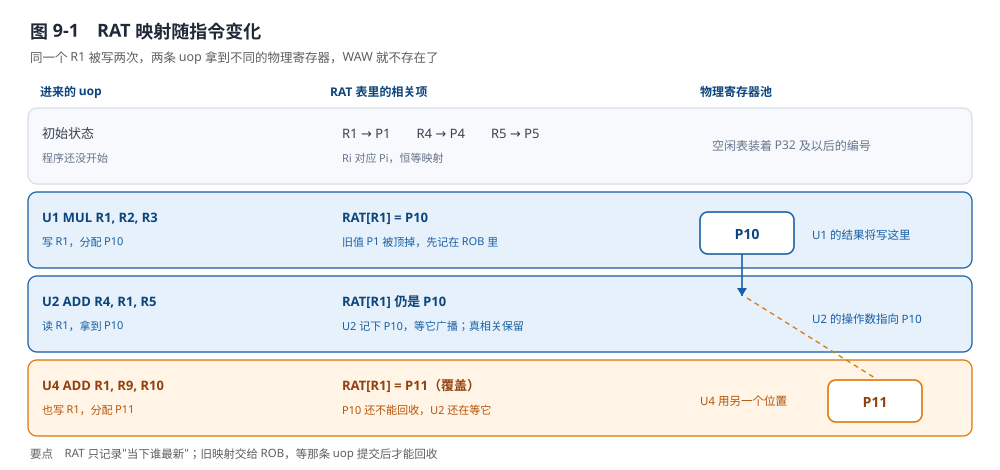
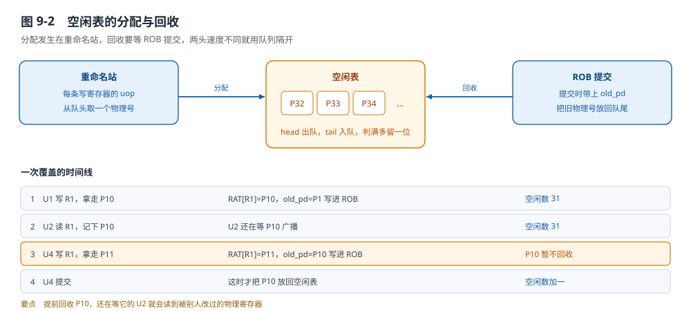
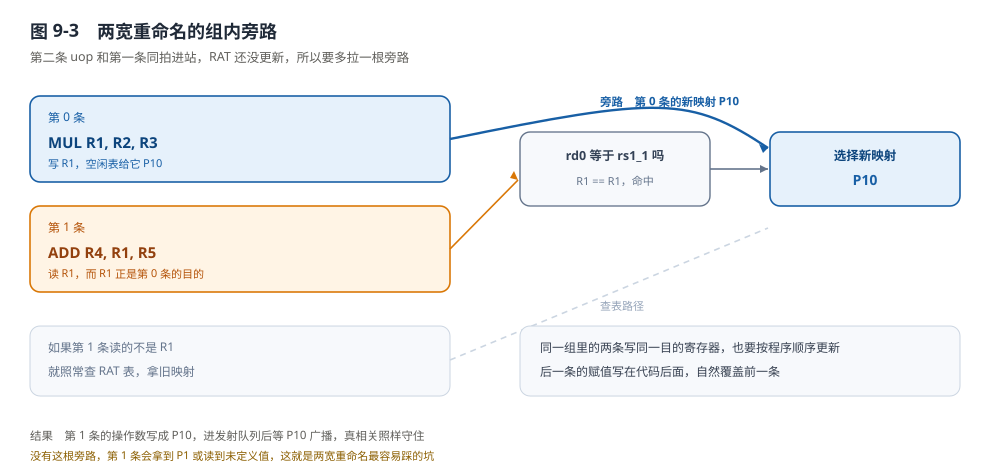
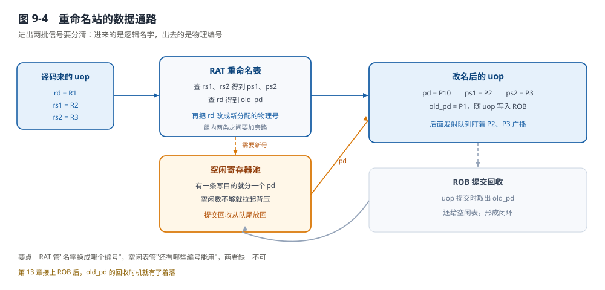

# 第 9 章 寄存器重命名

第 8 章的地图上，第一站叫重命名。它站在乱序段的最前面，uop 一进后端就先在这里换名字。换完名字，后面的发射队列才知道该等谁、执行单元才知道结果往哪送。

这一章把这个站点拆开来看。第 3 章讲 Tomasulo 时已经用过"标签"这个词：写寄存器的指令领一个标签，读寄存器的指令记下自己等哪个标签。那时标签寄存在保留站的编号里，有点借住的意思。现在要给标签一个正式的家，它就是物理寄存器编号。本章要回答三个问题：换成什么名字，谁来管这张对照表，旧名字什么时候还回去。

## 9.1 为什么寄存器要换名字

先把全书那条熟悉的例子再摆一次。为了聚焦后端，假设前端已经把指令译码成了 uop。

```
U1  MUL R1, R2, R3     # 写 R1，慢
U2  ADD R4, R1, R5     # 读 R1，依赖 U1；读 R5
U3  SUB R6, R7, R8     # 独立指令
U4  ADD R1, R9, R10    # 也写 R1
U5  XOR R5, R11, R12   # 写 R5
```

RISC-V 指令集规定程序员能看到 32 个整数寄存器，R1 只有一个。如果不做点什么，U1 和 U4 都得往 R1 写，顺序一乱就可能把结果写反；U2 要读 R5 的旧值，U5 却可能提前把 R5 改掉。

第 2 章已经分析过，后面这条是 WAR，前面那条是 WAW，都是名字撞车造成的伪相关。当时的解法是"换个名字"。现在把这个解法落实成电路：

- 处理器里实际做出比 32 个更多的物理寄存器，比如 64 个，编号 P0 到 P63；
- U1 写 R1 时，从空闲堆里拿一个物理寄存器，比如 P10；
- U4 也写 R1 时，再拿一个，比如 P11；
- 谁代表"最新的 R1"，由一张表说了算，这张表就是重命名表。

于是 U1 把结果放 P10，U4 把结果放 P11，两条并行算、谁先算完都行。U2 在进后端时记下"R1 此刻对应 P10"，它等的是 P10 的广播，U4 改不改 R1 的登记跟它没关系。U5 改 R5 也是同理，U2 手里那份 R5 的旧编号已经取走了。

一句话概括这一步：**程序员看到的寄存器是名字，处理器内部用的是位置**。重命名就是把名字翻译成位置，让在飞的每条写指令各占一个位置。

## 9.2 逻辑寄存器和物理寄存器

这里要把两个词分清楚，后面才不会绕晕。

**逻辑寄存器**是指令集里写的 R1、R2。它是程序员和编译器看到的接口， RISCV 规定整数逻辑寄存器有 32 个。编译器排指令时只能使用这些名字，它不知道芯片里到底有多少个存储位置。

**物理寄存器**是芯片里真正能放数的触发器或存储单元。它的数量可以比逻辑寄存器多，多出来的部分专门供乱序执行周转。物理寄存器编号通常用 P 开头，比如 P10、P33。

从逻辑寄存器到物理寄存器的对照关系存在**重命名表**里，英文常写作 RAT。机器复位时可以把表初始化成 Ri 对应 Pi 的恒等映射，这样没有乱序发生时的行为看起来最朴素。之后每遇到一条写寄存器的 uop，就从空闲池里取一个新的物理号，把表里相应的一项改掉。

物理寄存器本身也是标签。一条 uop 的操作数被改写成 P10 之后，发射队列就盯着 P10，等它出现在结果总线上。这样第 3 章那个"等标签"的说法，在这里变成了"等某个物理寄存器被写回"。同一套道理，换了种记账方式。

多出来的物理寄存器不是白送的。它们是乱序窗口的燃料：同时在飞的写指令越多，需要的物理寄存器越多。用完了就得停下来等提交回收，这也是重命名站会产生背压的原因。

## 9.3 重命名表记什么

RAT 的表项很朴素，逻辑寄存器号作地址，表项内容是一个物理寄存器号。复位后 Ri 对应 Pi。表之外还要记两件事。

第一件是旧映射。把 RAT[R1] 从 P1 改成 P10 之前，得先把 P1 保存下来，随 uop 一起送到 ROB。为什么不能直接把 P1 扔回空闲池？因为可能还有在飞的指令读的是 R1 的旧值，它手里的编号正是 P1。回收的时机留到第 9.4 节讲。

第二件是 x0。RISC-V 的 x0 永远是零，不能被改名。电路里做法很简单：目的寄存器号为零时，不发写使能。

写指令和读指令查表的方式不同。

- 写指令的目的寄存器 rd 要分配新号 pd，更新 RAT[rd]，并输出改动前的 old_pd。
- 读指令的源寄存器 rs1、rs2 要查表，得到 ps1、ps2。查到的物理号如果还没被写回，就当作等待标签用；如果已经就绪，发射队列自然能拿到值。就绪与否由物理寄存器堆和发射队列管理，重命名这一站只负责给出正确编号。

图 9-1 把两次写 R1 的过程画了出来。



*图 9-1　U1 和 U4 都写 R1，分别拿到 P10 和 P11；RAT 只登记最新的一条，旧映射交给 ROB。*

看这张图时有个容易忽略的地方。U2 在 U1 之后、U4 之前读 R1，所以它拿到的是 P10。如果它的位置挪到 U4 之后，拿到的就应该是 P11。也就是说，重命名反映的是程序顺序上的"当下"，顺序一乱，谁的登记算数就没法判定了。这正是重命名必须按程序顺序进行的原因。

## 9.4 空闲表与旧值回收

空闲物理寄存器放在一个循环队列里，通常叫空闲表。重命名时从队头取，提交时往队尾放。第 4 章讲 FTQ、第 6 章讲指令缓冲队列时，已经见过这种环形缓冲的套路，这里只是把存的东西换成物理寄存器号。

回收时机是这一站最容易出错的地方。继续用上面的例子，把时间线拉开看。

1. U1 写 R1，分到 P10。RAT[R1] 从 P1 改成 P10，P1 被记为 U1 的 old_pd。
2. U2 读 R1，记下 P10。它在发射队列里等 P10 的结果。
3. U4 写 R1，分到 P11。RAT[R1] 从 P10 改成 P11，P10 被记为 U4 的 old_pd。
4. 此时 P10 能回收吗？不能。U2 还在等它，一旦 P10 被分给别人，U2 等到的就是别人的结果。
5. 一直等到 U4 提交，才说明"R1 从 P10 变成 P11"这件事已经对程序员生效，这之前的结果不可能再被需要。这时把 P10 放回空闲表才安全。

图 9-2 把这条时间线画成了图。



*图 9-2　分配发生在重命名，回收发生在提交。旧物理寄存器要等覆盖它的那条 uop 提交后才能回到空闲表。*

这里可以记一句不太严谨但好用的话：**旧值的寿命，取决于谁把它挤下去，而不是它自己什么时候算完**。U1 算完得再快，它占的 P1 也要等 U1 提交才能还；P10 虽然被 U4 挤掉了，却要等 U4 提交，因为中间还有 U2 在等它。

空闲表空了怎么办？只能停下来。重命名站拉起背压，前端暂缓送 uop 进来，直到有旧的物理寄存器被提交释放。第 13 章接上 ROB 后，这条回收通路就完整了。本书的代码里先把它留成一个外部输入端口，谁在什么时候调用它，由那一章补齐。

## 9.5 两宽重命名的组内依赖

本书的教学核每周期重命名两条 uop。宽度一上来，就多了一件麻烦事：同一周期进来的两条之间可能本身就有依赖。

还看那两条：

```
第 0 条  MUL R1, R2, R3
第 1 条  ADD R4, R1, R5
```

第 1 条读的 R1，正是第 0 条这一拍要写的。RAT 要到这一拍结束才更新，如果第 1 条老老实实查表，拿到的还是旧映射，真相关就丢了。

办法是加一根旁路。第 1 条查表的同时，拿自己的源寄存器号和第 0 条的目的寄存器号比一下。相等就直接用第 0 条的新物理号，不相等才用查表结果。图 9-3 画的是这根旁路。



*图 9-3　第二条 uop 的源恰好是第一条的目的时，新的物理号要当场旁路过去，不能等到下一拍查表。*

这个比较器很小，两宽只要比一次。宽度扩到四宽、八宽，组内任意两条之间都可能要看，比较器的数量涨得很快。这是重命名宽度不容易做大的原因之一，第 15 章谈扩展时会再提。

同一组里如果两条都写同一个逻辑寄存器，也有规矩：后一条的登记最终生效。代码里只要把后一条的赋值写在后面，硬件上去就是后写覆盖前写，不需要额外判断。但要记得给后一条准备独立的 old_pd，它看到的"旧值"是前一条刚分到的那个物理号。

## 9.6 走通一段指令

现在把 U1 到 U5 按两宽重命名的节奏走一遍。正文用 P10 开始的编号方便阅读，配套代码从 P32 开始分配，因为 P0 到 P31 被拿去做复位时的恒等映射了，两者只是起点不同。

重命名站的输入输出如图 9-4 所示。



*图 9-4　逻辑寄存器号进来，物理编号出去；RAT 负责改名，空闲表负责分配和回收，old_pd 顺路写进 ROB。*

**第一拍，U1 和 U2 一起进来。** U1 写 R1，空闲表给 P10，RAT[R1] 改成 P10，old_pd 是 P1。U2 读 R1 和 R5，写 R4。它读 R1 时撞上组内旁路，拿到 P10；读 R5 时查表拿到 P5。U2 写 R4 分到 P12。两条 uop 出去时，源操作数已经写成 P2、P3 和 P10、P5。

**第二拍，U3 和 U4 一起进来。** U3 写 R6，分到 P13。U4 写 R1，分到 P11，RAT[R1] 被覆盖成 P11，old_pd 记的是 P10。注意 P10 没有回收，它还在 U2 手里等着。

**第三拍，U5 进来。** U5 写 R5，分到 P14，old_pd 是 P5。U2 在上一拍已经把 P5 取走了，所以 U5 改 R5 不影响 U2，WAR 在这里就这样悄悄化解了。

表 9-1 把五条 uop 的结果汇总一下。

| uop | 分配到的物理号 | 源操作数改名 | old_pd | 化解的相关 |
|---|---|---|---|---|
| U1 MUL R1,R2,R3 | P10 | P2、P3 | P1 | 无 |
| U2 ADD R4,R1,R5 | P12 | P10、P5 | P4 | RAW 保留为等 P10；WAR 靠取走 P5 |
| U3 SUB R6,R7,R8 | P13 | P7、P8 | P6 | 无 |
| U4 ADD R1,R9,R10 | P11 | P9、P10 | P10 | WAW 靠 RAT 覆盖 |
| U5 XOR R5,R11,R12 | P14 | P11、P12 | P5 | WAR 靠 U2 已取走 P5 |

表中 U5 的源写成了 P11、P12，是因为按照程序顺序，它读的 R11、R12 恰好在这段序列前面的指令里被改过。即使这两条指令还在执行也没关系，U5 记下编号等着就行。

走完这段可以看出，重命名并不判断操作数是否就绪，它只保证编号是对的。至于等谁、什么时候能执行，是下一站发射队列的活。

## 9.7 两个小优化

重命名站还顺手承担了两个优化，都不复杂，但很能体现"把问题在前面解决掉"的思路。

### 9.7.1 move 消除

`mv rd, rs` 或者 `addi rd, rs, 0` 这种指令，意思只是把源寄存器的值复制一份给目的寄存器。如果老老实实走一遍，它要占一个物理寄存器、要进发射队列、要等源就绪、还要写回一次，结果只是把同样的数搬了个地方。

其实可以只改登记：让 RAT[rd] 直接指向 RAT[rs] 当前指向的物理寄存器，不分配新的，也不送去执行。old_pd 照常记下来，提交时该回收还是回收。这样一条指令几乎不花执行资源就完成了。

边界情况要想清楚。rd 和 rs 是同一个寄存器时，这条指令什么也不用做；rd 是 x0 时本来就不该改名。更复杂的情形留给真实处理器去处理，这里只要体会"改表就能完成一条指令"这个想法。

### 9.7.2 ROB 压缩

被消除的 move 仍然占着 ROB 的一项，因为 ROB 原本按每条 uop 记录提交顺序。可是这条 uop 既不写新值，也不需要等执行完成，让它占着位置就白费了 ROB 的深度。

**ROB 压缩**的想法是：重命名之后，把那些不需要对外呈现的 uop 从 ROB 的队列里挤掉，只留下真正要按顺序交差的部分。它的结果已经在别处生效，恢复状态需要的信息也另外保管。这样一来，同样大小的 ROB 能容纳更长的在飞指令序列。

本章只讲动机。ROB 条目长什么样、哪些 uop 可以被挤掉、恢复信息放在哪里，都是第 13 章的内容。

## 9.8 为分支恢复留一手

前端会猜分支方向。猜错了，后端已经重命名的那些 uop 就得撤销。发射队列里的可以冲掉，RAT 却不能一冲了之：它已经被一堆错误路径上的指令改过了。

简单的办法是在遇到分支时给 RAT 拍一张快照，连空闲表的头尾指针一起存下来。分支后来被判定猜错，就把这张快照恢复回去，机器回到分支刚进来时的命名状态。这些快照放在一个小缓冲里，通常叫检查点（checkpoint）。拍整张表很占地方，真实处理器还会用"只记改动过哪几项"的历史缓冲来省空间。

检查点缓冲也有满的时候。满了就得停下来，等旧的分支退出再继续重命名。这和第 9.4 节空闲表用完时拉起背压是同一类问题：乱序机器里，几乎每种有限资源满了都要学会说"等一下"。

第 14 章会把预测错误时的恢复完整走一遍，那时这些快照就派上用场了。

## 9.9 重点与权衡

**物理寄存器数量。** 少了容易耗尽，重命名站经常被背压卡住；多了要占面积，物理寄存器堆的读写端口也更难做。这个数量要和 ROB 深度、发射队列大小一起定。

**回收时机。** 按提交回收最稳妥，因为提交点之前的旧值都可能还有人要用。有人设想在执行完成时就回收，这要求精确知道"还有没有指令在读这个旧编号"，代价往往不划算。

**重命名宽度。** 两宽只要处理一组内的旁路，比较器很少。宽度加大后，组内依赖的检查变多，RAT 的写端口也要能同时改多项。前端供指再快，这一站做不宽也白搭。

**检查点成本。** 每个在飞分支都可能要一份 RAT 快照。分支越密集，快照越多。存整表省事但占地方，存增量省地方但恢复逻辑复杂，这是常见的取舍。

**x0 和特殊指令。** 这些边界情况不显眼，却最容易在仿真里漏掉。代码里对 x0 单独挡了一道写使能，就是为了这个。

## 9.10 Verilog 骨架

配套代码在 `code/verilog/09_rename/`，分成三个文件：`free_list.v` 是空闲表，`rat.v` 是重命名表，`rename.v` 把两者接起来。还是老规矩，先看接口，再看实现，接口也按需要一步一步长出信号。

### 9.10.1 空闲表的接口先长出来

先想最基本的事。重命名站要分配物理寄存器，一拍最多两条，所以接口里先有分配个数。

```verilog
    input  wire [1:0]           alloc_i,     // 本拍要分配几个
```

分出去的编号当然也要出来，这就是接下来两个输出。

```verilog
    output wire [PHYS_W-1:0]    pd_o0,       // 分配出去的物理寄存器号
    output wire [PHYS_W-1:0]    pd_o1,
```

只有分配，池子迟早见底。于是加上提交侧送来的回收信号。

```verilog
    input  wire [1:0]           free_en_i,   // 本拍要回收几个
    input  wire [PHYS_W-1:0]    free_i0,     // 回收的物理寄存器号
    input  wire [PHYS_W-1:0]    free_i1,
```

重命名站需要知道还能不能继续收指令，所以再引出状态和空闲数量。

```verilog
    output wire                 empty_o,
    output wire                 full_o,
    output wire [PTR_W-1:0]     count_o
```

最后补上时钟和复位。队列有状态，这两个信号躲不掉。

```verilog
    input  wire                 clk,
    input  wire                 rst_n,
```

到这里接口定稿，按用途列一遍。

| 方向 | 信号 | 作用 |
|---|---|---|
| 输入 | `alloc_i` | 本拍分配几个，取值 0、1、2 |
| 输入 | `free_en_i`, `free_i0`, `free_i1` | 提交侧回收哪几个物理号 |
| 输入 | `clk`, `rst_n` | 时钟和复位 |
| 输出 | `pd_o0`, `pd_o1` | 分出去的两个物理号 |
| 输出 | `empty_o`, `full_o`, `count_o` | 空满状态和空闲数量 |

有个细节值得先说清楚。`free_en_i` 是逐位使能，`2'b11` 表示两个都要回收，不是数值 3。这和 `alloc_i` 不一样，后者是数量，`2'b10` 才是两个。代码里对这两种编码区别对待，测试也专门覆盖了这一点。

### 9.10.2 空闲表的实现一步步写出来

第一步，准备存储。指针比地址多一位，这是第 4 章用过的判满办法。

```verilog
    localparam [PTR_W-1:0] TAIL_INIT = DEPTH;

    reg [PHYS_W-1:0] fl_mem [0:DEPTH-1];
    reg [PTR_W-1:0] head, tail;
```

第二步，从队头读。分配两个时，第二个要跳过一项。这里有个坑：偏移量取的是 `alloc_i[1]`，不是 `alloc_i[0]`。分配一个时 `alloc_i` 是 `2'b01`，最高位为零；分配两个时是 `2'b10`，最高位才是 1。

```verilog
    // 多一位指针判满时，索引存储器只能用低位
    assign pd_o0 = fl_mem[head[PTR_W-2:0]];
    // 分配两个时第二个要跳过一项；alloc_i 为 2 时最高位为 1
    assign pd_o1 = fl_mem[head[PTR_W-2:0] + alloc_i[1]];
```

还有第二个坑。索引存储器只能用低位。写满时完整指针会等于深度，拿它去索引 0 到深度减一的数组，读出的是 x，仿真时很难看出哪里错了。

第三步，把空满状态算出来。判满仍然用当前指针，不用加一之后的指针，否则深度会平白少一格。

```verilog
    assign empty_o = (head == tail);
    assign full_o  = (head[PTR_W-1] != tail[PTR_W-1]) &&
                     (head[PTR_W-2:0] == tail[PTR_W-2:0]);
    assign count_o = tail - head;
```

第四步，复位时装池子，时钟沿推进头尾指针。指针推进时，`free_en_i` 要按位数相加，不能直接当数值。

```verilog
        if (!rst_n) begin
            head <= {PTR_W{1'b0}};
            tail <= TAIL_INIT;
            for (i = 0; i < DEPTH; i = i + 1)
                fl_mem[i] <= (i + NUM_LOGIC) & ((1 << PHYS_W) - 1);
        end else begin
            head <= head + alloc_i;
            // free_en_i 是逐位使能，11 表示回收两个，不能直接当数值 3 加
            tail <= tail + {4'b0, free_en_i[0]} + {4'b0, free_en_i[1]};
```

复位后 `head` 是 0，`tail` 是 32，池子里装着 P32 到 P63，正好是 32 个空闲项。

第五步，把回收的物理号写回队尾。第二个写入位置要根据第一个是否有效来挪一格。

```verilog
            if (free_en_i[0])
                fl_mem[tail[PTR_W-2:0]] <= free_i0;
            if (free_en_i[1])
                fl_mem[tail[PTR_W-2:0] + free_en_i[0]] <= free_i1;
```

这两行和指针更新放在同一个时钟沿，写进去的号要在池子转一圈以后才被取出来。所以测试里回收 P32、P33 之后，紧接着分到的是 P36、P37，而不是刚还回来的那两个。

### 9.10.3 RAT 的接口也按需求添加

RAT 先要有"本拍谁要改映射"。

```verilog
    input  wire [RENAME_W-1:0]     wen_i,       // 本拍几条 uop 要改映射
    input  wire [LOGIC_W-1:0]      rd_idx_i0,   // 第一条的目的逻辑寄存器
```

改成什么由空闲表给，所以再引一个输入。

```verilog
    input  wire [PHYS_W-1:0]       new_pd_i0,   // 第一条拿到的物理寄存器
```

光会改表还不够，读指令要查表，于是加上源寄存器输入。

```verilog
    input  wire [LOGIC_W-1:0]      rs1_idx_i0,  // 第一条的源逻辑寄存器
    input  wire [LOGIC_W-1:0]      rs2_idx_i0,
```

查表结果要送给后面的模块，输出也跟着加。

```verilog
    output wire [PHYS_W-1:0]       ps1_o0,      // 改名后的源物理寄存器
    output wire [PHYS_W-1:0]       ps2_o0,
```

旧映射要送 ROB，再加一个输出。

```verilog
    output wire [PHYS_W-1:0]       old_pd_o0,   // 被覆盖前的旧映射，交给 ROB
```

两宽重命名要把上面这套信号再来一遍。端口按用途排在一起，第二条的目的和两条 uop 的新物理号是这几行。

```verilog
    input  wire [LOGIC_W-1:0]      rd_idx_i1,   // 第二条的目的逻辑寄存器
    input  wire [PHYS_W-1:0]       new_pd_i0,   // 第一条拿到的物理寄存器
    input  wire [PHYS_W-1:0]       new_pd_i1,
    input  wire [LOGIC_W-1:0]      rs1_idx_i0,  // 第一条的源逻辑寄存器
    input  wire [LOGIC_W-1:0]      rs2_idx_i0,
    input  wire [LOGIC_W-1:0]      rs1_idx_i1,
    input  wire [LOGIC_W-1:0]      rs2_idx_i1,
```

第二条的输出接在输出列表末尾，第一条的 old_pd 正好排在它前面。

```verilog
    output wire [PHYS_W-1:0]       ps1_o1,
    output wire [PHYS_W-1:0]       ps2_o1,
    output wire [PHYS_W-1:0]       old_pd_o0,   // 被覆盖前的旧映射，交给 ROB
    output wire [PHYS_W-1:0]       old_pd_o1
```

最后是时钟和复位。RAT 存着跨拍的映射关系，必须有时钟。

```verilog
    input  wire                    clk,
    input  wire                    rst_n,
```

接口定稿如下。

| 方向 | 信号 | 作用 |
|---|---|---|
| 输入 | `wen_i` | 两位，分别对应两条 uop 是否写目的寄存器 |
| 输入 | `rd_idx_i0`, `rd_idx_i1` | 两条 uop 的目的逻辑寄存器 |
| 输入 | `new_pd_i0`, `new_pd_i1` | 空闲表分给它们的新物理号 |
| 输入 | `rs1_idx_i*`, `rs2_idx_i*` | 两条 uop 的源逻辑寄存器 |
| 输入 | `clk`, `rst_n` | 时钟和复位 |
| 输出 | `ps1_o*`, `ps2_o*` | 改名后的源物理号 |
| 输出 | `old_pd_o*` | 被覆盖前的旧映射 |

### 9.10.4 RAT 的实现

第一步，准备表项，并把 x0 挡在门外。

```verilog
    reg [PHYS_W-1:0] rat_ram [0:NUM_LOGIC-1];
    integer i;

    // x0 永远是 0，不能被改名
    wire we0 = wen_i[0] && (|rd_idx_i0);
    wire we1 = wen_i[1] && (|rd_idx_i1);
```

第二步，复位成恒等映射，时钟沿更新表项。两条都写同一个逻辑寄存器时，后一条的赋值写在后面，自然覆盖前一条。

```verilog
        if (!rst_n) begin
            for (i = 0; i < NUM_LOGIC; i = i + 1)
                rat_ram[i] <= i;
        end else begin
            if (we0) rat_ram[rd_idx_i0] <= new_pd_i0;
            // 同一组两条都写同一逻辑寄存器时，后一条的赋值写在后面，最终生效
            if (we1) rat_ram[rd_idx_i1] <= new_pd_i1;
        end
```

第三步，解决组内旁路。把查表和旁路判断写成一个小函数，源寄存器和旧映射都能用它。

```verilog
    // 组内旁路：第二条读到的若是第一条刚写的目的寄存器，要立刻看到新映射
    function [PHYS_W-1:0] lookup;
        input [LOGIC_W-1:0] src_idx;
        input [LOGIC_W-1:0] prev_rd;
        input [PHYS_W-1:0] prev_pd;
        input              prev_en;
        begin
            if (prev_en && (src_idx == prev_rd))
                lookup = prev_pd;
            else
                lookup = rat_ram[src_idx];
        end
    endfunction
```

`src_idx` 是要查的逻辑寄存器号，`prev_rd` 和 `prev_pd` 是同组前一条的目的和新物理号。四个输入齐了，函数就能决定该返回新映射还是查表结果。

第四步，接输出。第一条没有"组内前一条"，直接查表；第二条的两个源和 old_pd 都过一遍函数。

```verilog
    assign ps1_o0    = rat_ram[rs1_idx_i0];
    assign ps2_o0    = rat_ram[rs2_idx_i0];
    assign old_pd_o0 = rat_ram[rd_idx_i0];

    assign ps1_o1    = lookup(rs1_idx_i1, rd_idx_i0, new_pd_i0, we0);
    assign ps2_o1    = lookup(rs2_idx_i1, rd_idx_i0, new_pd_i0, we0);
    assign old_pd_o1 = lookup(rd_idx_i1,  rd_idx_i0, new_pd_i0, we0);
```

为什么 `old_pd_o1` 也要旁路？因为如果第一条已经把 R1 改成了 P10，第二条又写 R1，那么第二条眼里的旧映射就是 P10，而不是表还没更新时的 P1。这个 P10 会随第二条进 ROB，将来由它负责回收。

### 9.10.5 把两块接成重命名站

顶层 `rename.v` 的接口不复杂：一边是两条 uop 的逻辑寄存器号，一边是改名后的物理号、旧映射和背压信号。中间多了一组回收输入，来自将来第 13 章的 ROB。

```verilog
    input  wire [1:0]           free_en_i,   // 来自 ROB 的提交回收
    input  wire [PHYS_W-1:0]    free_i0,
    input  wire [PHYS_W-1:0]    free_i1,
```

实现的第一步是算本拍要分配几个。

```verilog
    wire [1:0] alloc;
    assign alloc = {1'b0, wen_i[0]} + {1'b0, wen_i[1]};
```

第二步是连线。空闲表给出的 `pd_o0`、`pd_o1` 直接接到 RAT 的 `new_pd_i0`、`new_pd_i1`。这根线本身就是重命名最核心的动作：一个新号从池子出来，写进表里，也写进 uop 的目的字段。代码里是两条例化语句，读的时候盯着这几根线看即可。

第三步是背压。空闲数加上本拍要回收的数，如果还不够本拍要分的数，就拉起停顿信号。

```verilog
    wire [6:0] avail;
    assign avail = {1'b0, free_cnt_o} + {6'b0, free_en_i[0]} + {6'b0, free_en_i[1]};
    assign stall_o = (avail < {5'b0, alloc});
```

这里把回收算进可用数，是因为同拍回收的物理号可以在这一拍就被分出去。真实实现还要考虑更多时序细节，教学模型做到这一步就够用了。

需要说明的是，`stall_o` 只是一个输出信号。配套代码没有实现"停顿后截断上游输入"的逻辑，测试里也保证不会在空闲数不够时硬塞 uop 进来。完整的握手要等全局的后端控制一起考虑。

## 9.11 图形与实验

本章有四张 SVG。图 9-1 看 RAT 怎么随两次写 R1 而变化，图 9-2 看空闲表的分配和回收，图 9-3 看两宽重命名的组内旁路，图 9-4 看整个重命名站的数据通路。矢量图可以直接用浏览器打开，也能用 Inkscape、Illustrator 或 VS Code 修改。

Digital 电路在 `code/digital/09_rat_cell.dig`，它画的是 RAT 的一个表项。中间是一个六位的多路选择器和一个六位触发器：写使能 `we` 为 1 时，时钟沿把 `new_pd` 装进去；`we` 为 0 时，触发器保持原值，多路选择器把输出绕回输入端。拨动开关、点动时钟，观察 `pd` 是不是只在 `we` 为 1 的那拍改变。三十二个这样的表项排起来，地址由逻辑寄存器号给出，就是一张 RAT。

Verilog 实验在 `code/verilog/09_rename/`。进入目录后执行：

```bash
iverilog -g2012 -o sim.vvp *.v
vvp sim.vvp
```

自测程序有 27 项检查，覆盖复位恒等映射、单条分配、RAW 改名、WAW 覆盖、组内旁路、提交回收和背压。建议打开波形或照着测试里的打印走一遍，特别留意两处：第二条 uop 拿到的是旁路过去的 P34，而不是查表得到的旧值；回收 P32、P33 之后，下一拍分到的是 P36、P37。

## 9.12 香山一瞥（选读）

香山的重命名同样围绕 RAT 和物理寄存器池展开。uop 进来时查表、分配物理寄存器、记录旧映射，和本章讲的是同一件事。宽度更大、表项更多、物理寄存器堆的端口更复杂，这些是工程规模上的差别，不是原理上的差别。

它也在分支处保存恢复信息。由于同时在飞的分支很多，逐分支拍整张表的代价不小，实际设计会在快照和增量记录之间做取舍。move 消除、ROB 压缩这类优化也能在它的设计里找到对应思想。

读香山文档时，可以顺着"重命名""物理寄存器堆""检查点恢复"这几个词找过去。看到具体表项数和时序细节不必纠缠，认出本章讲过的那几件事就够了。

## 9.13 小结

这一章把第 3 章的标签落到了物理寄存器编号上。

逻辑寄存器是程序员看到的 32 个名字，物理寄存器是芯片里真正放数的位置。RAT 记录"当下每个逻辑寄存器对应哪个物理寄存器"，空闲表负责分配和回收。写指令拿新号、记旧号，读指令查表拿编号，两条同拍进来的 uop 之间还要加一根旁路。

回收时机是这一站最要紧的规矩。旧物理寄存器要等覆盖它的那条 uop 提交之后才能还回池子，提前回收会让还在等它的指令读到错的值。ROB 就是带着 old_pd 来完成这件事的，那是第 13 章的内容。

重命名站还顺手做了 move 消除，也为 ROB 压缩提供了可能。分支处的检查点快照则给第 14 章的恢复埋下了伏笔。

一句话记住本章：重命名让每条写指令都去领一个新房间，程序员看到的还是那 32 个门牌号。

## 9.14 思考题

1. 物理寄存器为什么要比逻辑寄存器多？如果只做 32 个物理寄存器，重命名还能消除 WAW 和 WAR 吗？
2. 在 9.6 节的例子里，U4 把 RAT[R1] 从 P10 改成了 P11。为什么 P10 不能在改名这一拍就还给空闲表？
3. 两宽重命名为什么需要组内旁路？如果省掉它，第二条 uop 读第一条刚写的寄存器时会拿到什么？
4. move 消除没有真正运算，为什么还要记录 old_pd？直接改完 RAT 就结束会有什么问题？
5. 空闲表空了和检查点缓冲满了，重命名站都要停下来。这两种停顿分别是在等什么资源被释放？
