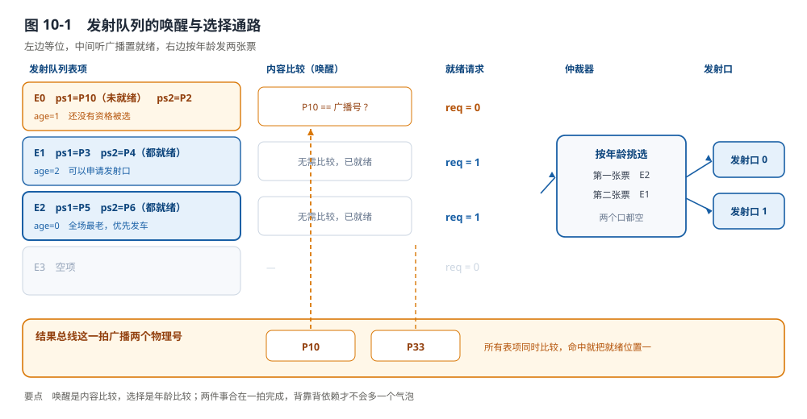
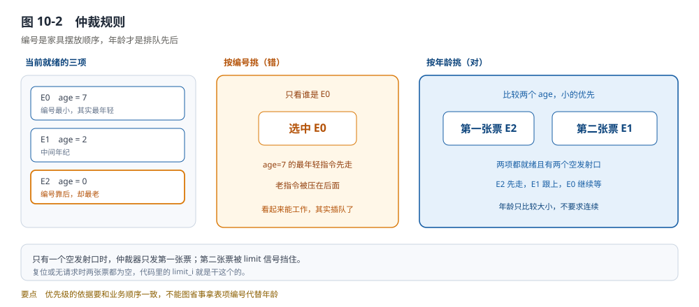
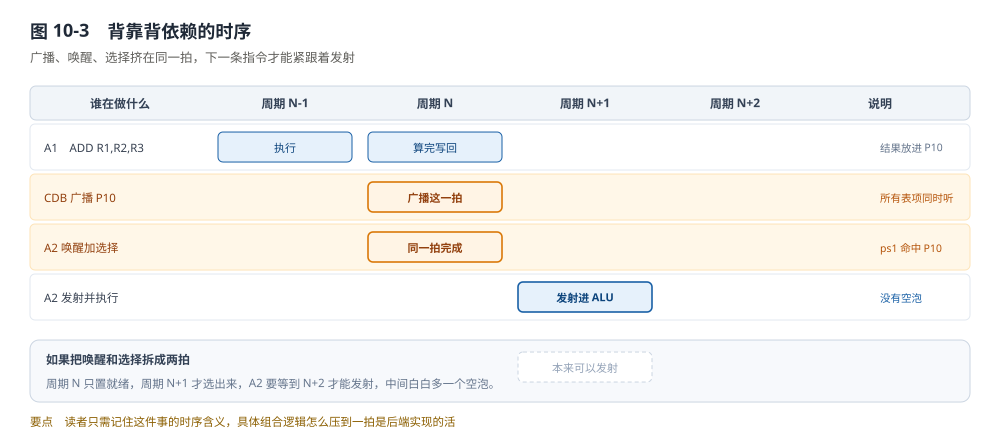
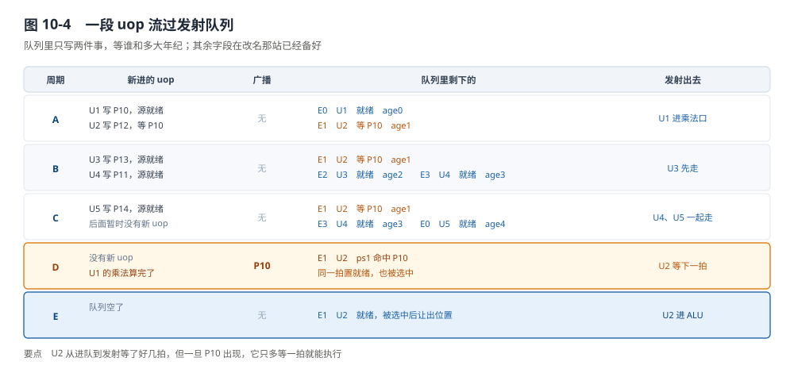

# 第 10 章 发射与调度

第 9 章结束时，uop 已经带着物理寄存器编号离开了重命名站。这时它们知道自己在等谁，但还不一定能马上算：有的操作数已经在物理寄存器里，有的还在执行单元里慢慢算。不能因为某个操作数没到，就把后面所有 uop 都堵住。

发射队列就是解决这件事的等待区。uop 在这里住下，盯着结果总线；一旦自己等的物理号被广播出来，它就举手申请执行。如果同时举手的比执行口还多，就得有个仲裁规则决定谁先走。

这一章讲清楚两件事：怎么知道一个 uop 可以走了，以及谁来先走。

## 10.1 为什么要有一个等待区

顺序流水线里，指令卡在数据相关上时，整条流水线跟着停。第 3 章讲 Tomasulo 时给出的办法是让指令先搬进保留站，空出流水线给后面的指令。发射队列是同一个办法在现代乱序核里的延续，只是名字换了，记账方式更规整了。

重命名站出来的 uop 带着三个关键编号：两个源物理号 ps1、ps2，一个目的物理号 pd。源物理号还没有值，就说明它在等广播；已经有值，就说明可以执行。队列要做的，是替每一条 uop 记住这个状态，别让它们在重命名站门口堵成一团。

这里有个容易混淆的地方。第 3 章的保留站既存等待状态，又存操作数的值，标签就是保留站编号。本章的发射队列通常只存物理编号和就绪位，值放在物理寄存器堆里。两种做法的思想一样，都是"记下等谁，谁来就唤醒"，只是现代处理器把值和标签分开存放了。

## 10.2 发射队列里存什么

一个表项至少要存这些内容。

| 字段 | 含义 |
|---|---|
| `valid` | 这一项有没有住着 uop |
| `ps1`, `ps2` | 两个源操作数对应的物理寄存器号 |
| `rdy1`, `rdy2` | 两个源是否已经就绪 |
| `dest` | 目的物理寄存器号，写回时要用 |
| `age` | 年龄，用来决定谁更该先走 |

有些设计还会存执行单元类型、ROB 编号、是否是 load 或 store 等。本书的教学核不依赖这些字段，先把最简单的骨架立起来。

就绪位有两种填法。入队时如果某个源的物理号已经就绪，直接把对应位置一；如果还没就绪，就清零，等广播来置位。怎么知道入队时就绪没有？这要看物理寄存器堆的忙碌状态，属于写回一侧的事情，本章先当作外部已经告诉了我们。

队列的组织也有两种常见做法。**集中式**是一个大队列供所有执行单元使用，调度灵活，但选择电路的规模随表项数增长。**分布式**是给每个执行单元配一个小队列，选择简单，但 uop 进队时要决定去哪边，分不匀就浪费。本书用集中式，四项队列，两个发射口，正好把原理讲清楚。

## 10.3 唤醒与选择放在同一拍

发射队列的核心动作分两步。

**唤醒**。执行单元算完结果，把目的物理号打上广播送到队列。每一项拿自己的 ps1、ps2 和广播号比一比。相等就把对应的就绪位置一。这一步是内容比较，不是按地址查表——队列不知道结果会送到哪里，只能让所有项一起听。第 3 章的 CDB 监听就是这件事。

**选择**。在就绪的项里挑出最多两个，送到空闲的执行口。挑的时候要考虑两个条件：操作数都就绪，以及有空的执行口。没有空口的 uop 只能继续等着。

图 10-1 把这两步画在了一条通路上。



*图 10-1　广播命中后置就绪位，仲裁器再从就绪项里按年龄挑出最多两个送往执行口。*

唤醒和选择要放在同一拍完成，这件事值得多说两句。假设加法 A1 在周期 N 广播结果 P10，而加法 A2 正等着 P10。如果这一拍只做唤醒，下一拍才做选择，那么 A2 要到周期 N+2 才能发射，中间白白空出一拍。把两步合到一拍，A2 在周期 N 结束时就知道自己可以走了，周期 N+1 就能进执行单元。第 10.5 节会用时序图专门看这件事。

"一拍里既要比较又要选择"听起来有点赶。这在真实芯片里确实是时序上的难点，表项越多、广播路数越多，比较和选择就越慢。本书只要求理解它为什么必须这么安排，至于电路怎么压到一拍，属于具体实现技巧，不在这里展开。

## 10.4 谁来先走

就绪的项不止一条时，需要仲裁规则。最容易想到的是按表项编号挑，编号小的优先。这个规则实现起来最简单，但不一定对。

表项编号是 uop 住进哪个房间的号码，跟它的出生先后没关系。E0 可能是刚进来的年轻指令，E2 反而可能是很早就住下、只差一个操作数的老指令。按编号挑，等于让后来者插队。

按**年龄**挑才符合直觉。重命名站是按程序顺序收 uop 的，给每条 uop 附一个递增的序号，序号小的更老。仲裁器比较年龄，把票先发给最老的就绪项。年龄不一定连续，中间有指令没进队列也没关系，只比较大小。

图 10-2 对比了这两种规则。



*图 10-2　按表项编号挑会选中最年轻的 E0；按年龄挑才会先放最老的 E2 走。*

两个发射口同时空闲时，就发两张票。第一张给最老的，第二张在剩下的就绪项里再挑最老的。如果只有一个口空闲，第二张票就不发。仲裁器的 `limit` 输入就是干这个的。

除了年龄，还可以按执行单元类型、按 uop 的关键程度来挑。真实处理器里这些规则会叠加，但基本套路没变：先筛出有资格的，再按某种优先级发票。

## 10.5 背靠背依赖

来看一段最短的依赖链。

```
A1  ADD R1, R2, R3     # 写 P10
A2  ADD R4, R1, R5     # 读 P10，等 A1 的结果
```

A2 的操作数就是 A1 的结果。这类"前一条刚算出、后一条马上要用"的情况叫背靠背依赖。乱序处理器能不能把这两条挨着执行，直接影响 IPC。

图 10-3 是它的时序。



*图 10-3　周期 N 广播、唤醒、选择三件事连在一起，A2 周期 N+1 就能发射；拆成两拍就会多一个空泡。*

跟着图走一遍。周期 N-1，A1 在 ALU 里算。周期 N，A1 算完，把 P10 放上结果总线。同一拍里，发射队列中 A2 的那一项比较命中，就绪位置一，仲裁器发现它已经可以走了，给它发出授权。周期 N+1 的时钟沿，A2 进入 ALU。两条加法就这样背靠背执行完了。

这里要注意"同一拍"的精确含义。广播是组合信号，比较也是组合逻辑，授权在同一拍内算出来，状态变化发生在时钟沿。读者只要记住时序上的结论：生产者写回的下一拍，消费者就能发射。

## 10.6 走通一段 uop

把第 9 章那五条 uop 接着往下走。重命名之后，U1 写 P10、U2 写 P12 且等 P10、U3 写 P13、U4 写 P11、U5 写 P14。图 10-4 给出了队列的几个快照。



*图 10-4　U1、U3、U4、U5 陆续就绪就走，等 P10 的 U2 一直留到 U1 广播，然后紧跟着发射。*

**周期 A**，U1 和 U2 进队。U1 的两个源都就绪，当场被选中，送去乘法单元。U2 的 ps1 是 P10，还没广播，留在队列里。

**周期 B**，U3 和 U4 进队，两个源都就绪。U3 年龄更小，先拿到发射口；U4 继续等机会。

**周期 C**，U5 进队。此时 U4 和 U5 都就绪，两个发射口都空，一起发出去。队列里只剩 U2。

**周期 D**，U1 的乘法完成，广播 P10。U2 的内容比较命中，就绪位置一，同一拍就被仲裁器选中。

**周期 E**，U2 进入 ALU。从进队到发射它等了好几拍，但这是真相关，躲不掉。能做的是让步子跟得紧些：P10 一出现，U2 只多等一拍就执行了。

这一段还说明了一个经常有人问的问题：乱序是不是完全不看顺序？不是。U3、U4、U5 确实越过了 U2，但仲裁时仍按年龄决定谁先用空闲的执行口。乱序的是执行时刻，不是优先级规则。

## 10.7 重点与权衡

**队列深度。** 深队列能容纳更多在飞的 uop，挖出更多并行度；但每一项都要挂比较器，选择逻辑也要看更多请求，面积和延迟一起涨。深度是和 ROB、重命名站一起定的。

**广播路数。** 每拍能广播几个结果，决定了同拍能唤醒多少等待者。广播路数少，连续几个执行单元同时出结果时就会排队；路数多，队列里每一项的比较器都要成倍增加。第 3 章说过 CDB 是瓶颈，这里可以看到瓶颈的具体形状。

**集中式还是分布式。** 集中式调度灵活，分布式连线简单。折中做法也很多，比如按执行单元类型分成几个小队列，再在小队列之间做有限的借用。这里只认路，不细走。

**选择逻辑的延迟。** 从就绪信号到授权信号要在同一拍内完成，表项越多越紧张。真实处理器会用分级选择、预先排序等办法缓解，本书不展开这些时序收敛技巧。

**年龄从哪来。** 重命名站按程序顺序收 uop，顺手发个递增序号最自然。如果年龄丢失或重复，仲裁就会出错。这是前后两站之间一个不起眼但重要的接口约定。

## 10.8 Verilog 骨架

配套代码在 `code/verilog/10_issue/`，两个模块：`arbiter.v` 做仲裁，`issue_queue.v` 做队列。先搭仲裁器，再搭队列。

### 10.8.1 仲裁器的接口先长出来

仲裁器最起码要知道谁在举手。

```verilog
    input  wire [N-1:0]         req_i,
```

一位代表一个表项，1 表示该表项的操作数都就绪了。还要知道本拍最多能发几张票，因为执行口可能没空。

```verilog
    input  wire [1:0]           limit_i,   // 最多批几个：0、1 或 2
```

一开始只按编号挑的话，有这两个输入就够了。但前面说过，编号不能代表年龄，于是加上年龄输入。为了让模块的端口不受表项数变化影响，年龄被拍平成一个长向量，每项占 `SEQ_W` 位。

```verilog
    input  wire [N*SEQ_W-1:0]   age_i,     // 每项的年龄，数越小越老
```

最后是输出。两张票分开给，便于观察；合并后的授权也输出，接队列时更方便。

```verilog
    output wire [N-1:0]         grant0_o,  // 第一个被选中的项
    output wire [N-1:0]         grant1_o,  // 第二个被选中的项
    output wire [N-1:0]         grant_o
```

接口定稿如下。

| 方向 | 信号 | 作用 |
|---|---|---|
| 输入 | `req_i` | 一位热编码的就绪请求 |
| 输入 | `age_i` | 每项年龄，拍平成一个向量 |
| 输入 | `limit_i` | 本拍最多发几张票 |
| 输出 | `grant0_o`, `grant1_o` | 第一、第二张票，一位热 |
| 输出 | `grant_o` | 两张票的或，方便直接接后级 |

### 10.8.2 仲裁器的实现

第一张票给年龄最小的请求。这里用的是严格小于，年龄相同的两项不会被同时选中。

```verilog
        // 第一张票给年龄最小的请求，不是编号最小的请求
        g0 = {N{1'b0}};
        best = {SEQ_W{1'b1}};
        for (i = 0; i < N; i = i + 1)
            if (req_i[i] && (age_i[i*SEQ_W +: SEQ_W] < best)) begin
                best = age_i[i*SEQ_W +: SEQ_W];
                g0 = {N{1'b0}};
                g0[i] = 1'b1;
            end
```

注意 `g0 = {N{1'b0}}` 写在发现更小年龄之后。每找到一个更老的，就把旧的票擦掉重新发，循环结束时留下的就是最老的那一项。

第二张票在剩下的请求里重复同样的比较，只要多一个条件：`!g0[i]`，也就是第一张票已经给出去的项不能再拿一张。

```verilog
        // 第二张票在剩下的请求里同样挑最老的
        g1 = {N{1'b0}};
        best = {SEQ_W{1'b1}};
        for (i = 0; i < N; i = i + 1)
            if (req_i[i] && !g0[i] && (age_i[i*SEQ_W +: SEQ_W] < best)) begin
                best = age_i[i*SEQ_W +: SEQ_W];
                g1 = {N{1'b0}};
                g1[i] = 1'b1;
            end
```

最后用 `limit` 挡住多余的票。没有空口时两张都不发，只有一个空口时把第二张擦掉。

```verilog
        if (limit_i == 2'd0) begin
            g0 = {N{1'b0}};
            g1 = {N{1'b0}};
        end else if (limit_i == 2'd1) begin
            g1 = {N{1'b0}};
        end
```

组合逻辑的结果直接连到输出。

```verilog
    assign grant0_o = g0;
    assign grant1_o = g1;
    assign grant_o  = g0 | g1;
```

这块电路没有时钟。它看到请求和年龄，当场算出授权。Digital 里那个两请求的小电路演示的是同样的事情，只是它按编号定优先级；真实队列按年龄，对应到这里就是上面那两个循环。

### 10.8.3 发射队列的接口

队列先要有入队口。为了把"放到哪一项"和"放什么内容"分开，接口里带一位热的槽号。

```verilog
    input  wire [1:0]              alloc_en_i,     // 本拍新进几条
    input  wire [ENTRY-1:0]        alloc_slot_i0,  // 第一条放到哪一项
    input  wire [ENTRY-1:0]        alloc_slot_i1,
    input  wire [UOP_W-1:0]        alloc_uop_i0,   // 打包好的 uop
    input  wire [UOP_W-1:0]        alloc_uop_i1,
```

uop 用 32 位打包总线传递，字段划分和代码里一致。

```verilog
    // uop 打包格式，总共 32 位
    localparam TYPE_HI = 31, TYPE_LO = 30;
    localparam RDY1    = 29, RDY2    = 28;
    localparam PS1_HI  = 27, PS1_LO  = 22;
    localparam PS2_HI  = 21, PS2_LO  = 16;
    localparam DEST_HI = 15, DEST_LO = 10;
    localparam AGE_HI  =  9, AGE_LO  =  2;
```

唤醒要听广播，接口里加广播使能和两个广播号。

```verilog
    input  wire [1:0]              wakeup_en_i,    // 本拍有几路广播
    input  wire [PS_W-1:0]         wakeup_pd_i0,
    input  wire [PS_W-1:0]         wakeup_pd_i1,
```

出队要问执行口空不空，再把选中的 uop 和授权送出去。

```verilog
    input  wire [1:0]              unit_free_i,    // 本拍空着几个发射口
    output wire [ENTRY-1:0]        grant0_o,
    output wire [ENTRY-1:0]        grant1_o,
    output wire [ENTRY-1:0]        grant_o,
    output wire [UOP_W-1:0]        issue_uop_o0,
    output wire [UOP_W-1:0]        issue_uop_o1,
    output wire [ENTRY-1:0]        busy_o
```

最后是时钟和复位。队列存着跨拍状态，少不了这两个。接口定稿按用途列一遍。

| 组 | 信号 | 作用 |
|---|---|---|
| 入队 | `alloc_en_i`, `alloc_slot_i*`, `alloc_uop_i*` | 进几条、进哪项、内容是什么 |
| 唤醒 | `wakeup_en_i`, `wakeup_pd_i*` | 这一拍广播了哪些物理号 |
| 出队 | `unit_free_i`, `grant*_o`, `issue_uop_o*` | 有几个空口、选中了谁、送出去什么 |
| 观察 | `busy_o` | 哪些项还占着 |

### 10.8.4 发射队列的实现

第一步，准备表项。每项有有效位、两个就绪位、两个源物理号、目的号和年龄，类型字段也留着，只是本章不参与选择。

```verilog
    reg          valid [0:ENTRY-1];
    reg  [1:0]   typ   [0:ENTRY-1];
    reg          rdy1  [0:ENTRY-1];
    reg          rdy2  [0:ENTRY-1];
```

第二步，算出谁有资格申请发射。两个源都就绪才行。

```verilog
    // 操作数都就绪的项才有资格被选
    always @* begin
        for (e = 0; e < ENTRY; e = e + 1)
            req[e] = valid[e] & rdy1[e] & rdy2[e];
    end
```

第三步，把空发射口的数量变成仲裁器的 `limit`，再把年龄拍平接过去。

```verilog
    // 空闲发射口的数量就是本次最多能批几个
    wire [1:0] limit;
    assign limit = {1'b0, unit_free_i[0]} + {1'b0, unit_free_i[1]};
```

```verilog
    wire [ENTRY*SEQ_W-1:0] age_flat;
    genvar gi;
    generate
        for (gi = 0; gi < ENTRY; gi = gi + 1) begin : flatten_age
            assign age_flat[gi*SEQ_W +: SEQ_W] = age[gi];
        end
    endgenerate

    arbiter #(.N(ENTRY), .SEQ_W(SEQ_W)) u_arb (
        .req_i(req), .age_i(age_flat), .limit_i(limit),
        .grant0_o(grant0_o), .grant1_o(grant1_o), .grant_o(grant_o)
    );
```

`generate` 在这里只是把二维的年龄数组接成仲裁器认识的一维向量，没有别的玄机。

第四步，唤醒。每一项都拿自己的两个源号和广播号比较，命中就置位。这段代码放在时钟沿里，所以唤醒后的就绪状态在下一拍的授权中才生效，正好符合"同一拍唤醒加选择"的时序安排。

```verilog
                // 唤醒：内容比较，命中就把对应的就绪位置一
                if (valid[e] && wakeup_en_i[0] && (ps1[e] == wakeup_pd_i0)) rdy1[e] <= 1'b1;
                if (valid[e] && wakeup_en_i[0] && (ps2[e] == wakeup_pd_i0)) rdy2[e] <= 1'b1;
                if (valid[e] && wakeup_en_i[1] && (ps1[e] == wakeup_pd_i1)) rdy1[e] <= 1'b1;
                if (valid[e] && wakeup_en_i[1] && (ps2[e] == wakeup_pd_i1)) rdy2[e] <= 1'b1;
```

第五步，让被选中的项让出位置，再写入新来的项。两件事写在一个时钟沿里，顺序不能颠倒。

```verilog
                // 被选中的项让出位置
                if (grant0_o[e] || grant1_o[e])
                    valid[e] <= 1'b0;

                // 新进来的项写进去；写在最后，同拍不会把新项又选出去
                if (alloc_en_i[0] && alloc_slot_i0[e]) begin
```

如果把入队写在前面，非阻塞赋值的最后一条会是"让出位置"，刚住进来的项当场被赶走。调试时这种现象很难看出来，只会觉得"怎么刚进来就没了"。

最后，把选中的项重新打包送出去。打包函数把分散的字段拼回 32 位，和入队时的格式严格对应。

```verilog
    function [UOP_W-1:0] pack_entry;
        input [1:0] t;
        input r1, r2;
        input [PS_W-1:0] s1, s2, d;
        input [SEQ_W-1:0] a;
        begin
            pack_entry = {t, r1, r2, s1, s2, d, a, 2'b0};
        end
    endfunction
```

完整的 32 位格式在 README 里列了表，读代码时可以对照着看。

## 10.9 图形与实验

本章四张 SVG。图 10-1 是唤醒加选择的数据通路，图 10-2 对比两种仲裁规则，图 10-3 是背靠背依赖的时序，图 10-4 走通一段具体 uop。

Digital 电路在 `code/digital/10_priority_arbiter.dig`。它用非门和与门搭了一个两请求的优先仲裁器：req0 直接拿第一张票；req1 只有在 req0 没举手时才拿到第二张票。自带真值表列了四种输入组合，拨动开关就能看到两盏灯的变化。这个电路的优先级按编号定，之所以这样搭，是因为门电路最容易表达"编号小的优先"；真实的发射队列按年龄定优先级，代码里已经把这一点补上了。

Verilog 实验在 `code/verilog/10_issue/`。进入目录后执行：

```bash
iverilog -g2012 -o sim.vvp *.v
vvp sim.vvp
```

自测程序有 17 项检查，覆盖复位、按年龄单选、双口双选、发射出队、广播唤醒、无发射口时阻塞、两路广播同拍唤醒和单请求时第二授权为空。建议特别看两处：E2 明明编号比 E1 大，却因为年龄更小先拿到票；U2 那种等广播的项，在广播到来之前一直占着队列。

## 10.10 香山一瞥（选读）

香山的发射队列组织比本章复杂。它会按执行单元类型划分队列，也会为每个执行端口单独维护选择逻辑；唤醒信号不止一路，广播和选择在时序上要做不少权衡。本书讲的"内容比较置就绪、按优先级发票"仍然是这两件事的骨架。

它的优先级策略也不只看年龄。load、分支、浮点运算各有各的考虑，真实设计会把这些因素编进选择规则。这里不必展开，只要认出"先筛有资格的，再按规则排序"这个共同套路就够了。

读香山文档时，可以顺着"发射队列""唤醒""选择"这些词找过去。看到具体的队列项数和端口数不必细究，那些是工程规模上的选择。

## 10.11 小结

这一章讲的是发射队列，也就是 uop 从重命名站出来之后的等待区。

队列每项存物理源号、就绪位和年龄。结果总线上出现某个物理号时，所有项同时比较，命中的把就绪位置一，这叫唤醒。仲裁器从就绪项里按年龄挑出最多两个，送到空闲的执行口，这叫选择。唤醒和选择合在一拍完成，背靠背依赖才不会多出一个空泡。

仲裁要看年龄，不能看表项编号。编号是住哪个房间，年龄才是排队先后。这个区别很小，却直接决定乱序执行是不是守规矩。

代码部分先搭了按年龄发两张票的仲裁器，再搭了四项发射队列。就绪信号由队列算出，年龄拍平后送进仲裁器，授权再回来清队列，形成一个完整的局部闭环。

一句话记住本章：发射队列让能跑的指令先跑，但谁先跑仍按辈分排队。

## 10.12 思考题

1. 发射队列为什么要存物理寄存器号，而不是逻辑寄存器号？如果存逻辑号，唤醒时会出什么问题？
2. 按表项编号仲裁和按年龄仲裁有什么不同？举一个编号小但年龄大的例子说明。
3. 背靠背依赖为什么要求唤醒和选择在同一拍完成？如果拆成两拍，会发生什么？
4. 集中式发射队列和分布式发射队列各有什么好处？为什么队列做大以后，选择逻辑会成为瓶颈？
5. 本章的仲裁器按年龄挑，但年龄相同的两项仍可能按编号决定先后。在什么情况下这会成为问题？
