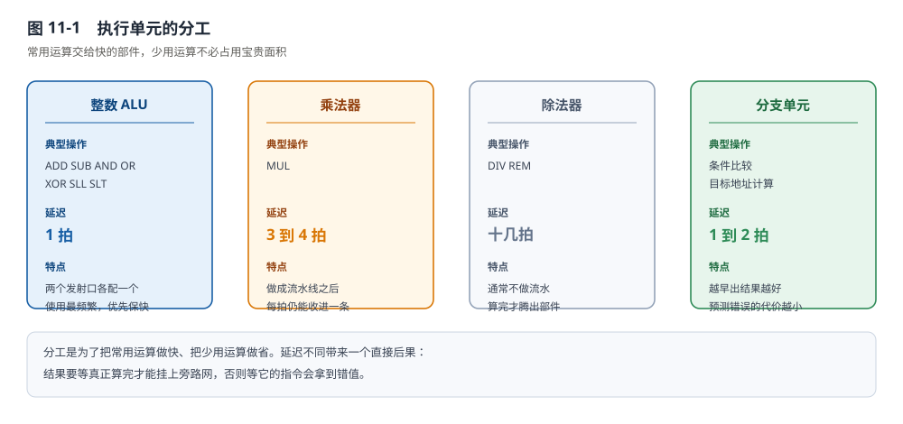
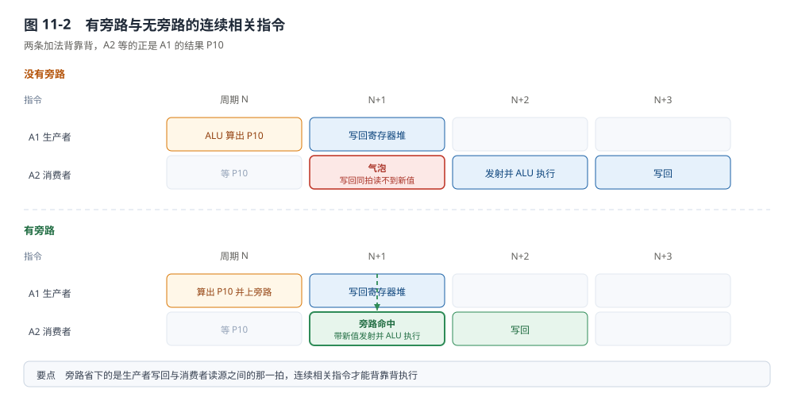
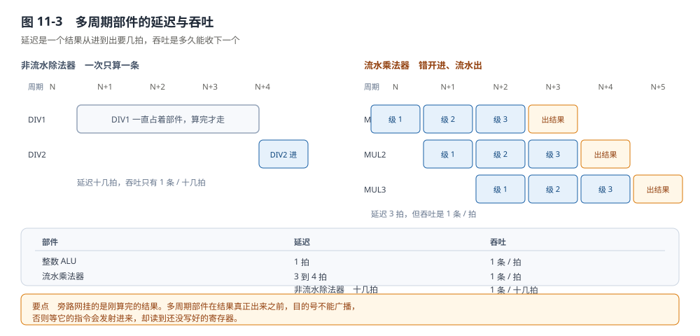
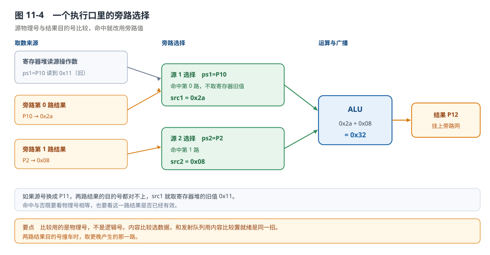

# 第 11 章 执行单元与旁路网络

第 10 章把 uop 送到了执行口门口。这时候操作数还只是两个物理寄存器号，真正的值要从物理寄存器堆里读。麻烦在于，生产者刚算出来的结果往往还没写进寄存器堆，消费者这一拍就要用。如果老老实实去读寄存器，读到的是旧值，算出来的结果自然也是错的。

旁路网络解决的就是这段空档。它把执行单元刚算完的结果直接送到正等它的输入口，不必绕寄存器堆一圈。这一章先看执行单元怎么分工，再看旁路怎么把结果递过去，最后用 Verilog 搭一个执行口出来。

## 11.1 发射之后还差一件事

发射队列里的就绪位只说明一件事：我要等的结果已经算出来了。它没说这个结果此刻在哪里。

来看最短的依赖链。

```
A1  ADD R1, R2, R3     # 写 P10
A2  ADD R4, R1, R5     # 读 P10
```

第 10 章讲过，A1 在周期 N 广播 P10，发射队列里的 A2 同拍置好就绪位，周期 N+1 就能进执行单元。问题出在"进执行单元"这一步：A2 要读源操作数，而 P10 的新值是在 A1 那个时钟沿才写进寄存器堆的。A2 读源发生在沿之前，读到的是 P10 的旧值。

这不是设计失误，而是寄存器的基本时序。写和读都用同一个时钟沿，读者看不到写者刚刚放进去的东西。想让 A2 拿到正确的值，得有一条不经过寄存器堆的近路。

旁路（bypass）就是这条近路。它还有个更常见的叫法是转发（forwarding），说的是同一件事：结果刚出锅就递过去，不必等它装进盘子。

## 11.2 执行单元的分工

一条 uop 进了执行口，具体由谁算，取决于它要做什么。图 11-1 列了四种常见部件。



*图 11-1　整数 ALU、乘法器、除法器和分支单元各管一类运算，延迟和吞吐各不相同。*

整数 ALU 处理加减、逻辑、移位和比较，一拍出结果。它是使用最频繁的部件，两发射核通常两个执行口都配一个。乘法器延迟三到四拍，但做成流水线之后每拍仍能收进一条新指令，吞吐并不低。除法器要十几拍，一般不做流水，一条除法会把部件占满。分支单元负责条件比较和目标地址计算，它的结果越早出来，预测错误时白跑的路越少。

分工的目的有两个。常用运算配足够的部件，别让它们排队；少用运算不必占太多面积，慢一点可以接受。延迟不同这件事，会直接影响旁路的设计：一拍出结果的部件，下一拍就能把结果递出去；十几拍的部件，得等结果真的出来才能挂到旁路网上。

## 11.3 旁路要解决的具体问题

把时序摊开看，问题会更清楚。

执行单元在组合逻辑里算出结果，时钟沿到来时把结果写进目的物理寄存器。同一拍另一个执行口要读这个寄存器，读动作发生在沿之前，所以读到的是上一拍留下的旧值。写者和读者之间差了半个时钟周期，刚好错过。

旁路网提供的是沿之前就已经出现在执行单元输出线上的那个值。这个值还没进寄存器堆，但已经是正确的结果。消费者拿它去做运算，不必再等一个周期。

这里有两个条件，缺一不可。

第一，得知道这个结果写给哪个物理寄存器。执行单元输出结果时要带上目的号，旁路网上挂的是"值加目的号"这一对东西。第二，得知道这个结果已经有效。功能部件还在算的时候，输出端可能是随机值，此时绝对不能让旁路把它当成真结果送出去。

第一条靠内容比较完成，第二条靠一个有效位控制。代码里这两件事分别对应目的号相等判断和 `byp_en_i` 使能信号。

## 11.4 有旁路与无旁路的节奏

图 11-2 把两种做法画在同一张时序图上。



*图 11-2　没有旁路时 A2 要等写回，多出一个气泡；有旁路时 A1 出结果的下一拍 A2 就能带着新值执行。*

看上半部分。周期 N，A1 在 ALU 里算出 P10。周期 N+1，A1 的结果写进寄存器堆，A2 本来该发射了，可它读到的还是旧值，只能再等一拍。周期 N+2，A2 才真正进 ALU。中间那一格就是气泡。

看下半部分。周期 N，A1 算出 P10，同时把结果和目的号放上旁路网。周期 N+1，A2 的源物理号 P10 与旁路网上的目的号比较，命中，直接拿到 0x2a 这个新值，当场发射并算完。原来那格气泡没了。

两行相比，硬件没有多一个执行口，也没有提高主频，只是把结果换了个送法，连续相关的两条指令就背靠背跑完了。第 1 章算过的那笔账里，数据冒险造成的损失，有一块就是这么捡回来的。

## 11.5 多周期部件带来的新问题

单周期 ALU 的情况最简单：这一拍进，这一拍末出结果，下一拍就能旁路。多周期部件没这么爽快。

图 11-3 对比了两种多周期做法。



*图 11-3　非流水除法器一次只算一条；流水乘法器错开进入，每拍仍能出一个结果。*

非流水除法器像只有一个炉灶的厨房。DIV1 进去之后要占十几拍，DIV2 只能在门口等着。它的延迟高，吞吐也低。流水乘法器像一条流水线，MUL1 到 N+3 出结果，MUL2 到 N+4 出结果，彼此错开一级。单看每条指令延迟是三拍，但每拍都有一条新指令进去、一条结果出来，吞吐是一拍一条。

延迟和吞吐是两个不同的量，别混着说。延迟决定一条指令要等多久才出结果，吞吐决定一拍能收几条新指令。旁路关心的是延迟：结果没出来之前，目的号不能挂到旁路网上，也不能拿去唤醒发射队列。要是提前广播，等着它的指令会兴冲冲地发射进来，然后读到一个还没算好的值。

代码里的 `byp_en_i` 就是为这件事留的。流水线第几级出结果，就在那一拍把对应的使能位置一。早一拍不行，晚一拍只是少一次旁路机会，不会算错。

## 11.6 旁路网怎么选数据

现在看选择动作本身。图 11-4 是一个执行口的局部放大。



*图 11-4　源物理号与结果目的号比较，命中就选旁路值，选好的两个操作数送进 ALU。*

uop 带着两个源物理号进来。ps1 是 P10，ps2 是 P2。寄存器堆读出 ps1 得到 0x11，这是旧值。旁路网上这一拍有两路结果，第 0 路写给 P10、值是 0x2a，第 1 路写给 P2、值是 0x08。

两个选择器各干各的。源 1 拿 ps1=P10 与两路目的号比较，命中第 0 路，src1 取 0x2a。源 2 拿 ps2=P2 比较，命中第 1 路，src2 取 0x08。ALU 算 0x2a 加 0x08，得到 0x32，连同目的号 P12 一起送出去。

比较用的是物理号，不是逻辑号。这一点和第 10 章的唤醒完全一致。逻辑号在重命名之后就不再唯一，两条指令都可能写 R1；物理号才是每条结果唯一的身份。

如果两路结果的目的号撞车怎么办？取更晚产生的那一路。代码里用两个 `if` 的顺序表达优先级：先写第 0 路的选择，再写第 1 路，后者覆盖前者。真实机器里这个顺序由结果的产生时刻决定，越新的值越该被采用。

## 11.7 覆盖范围与代价

旁路听起来很划算，但不是白来的。

每多一个执行口，就多一路结果要送到其他执行口的输入端。两个口时是两条交叉的线，四个口时就变成一张小网。线要铺到每个输入选择器旁边，延迟和面积都跟着涨。每个选择器还要为每一路结果准备一套比较器，比较器的数量大致是源操作数个数乘结果路数。

这就是为什么真实处理器不会把旁路做成"所有结果到所有输入"的全连接。常见做法是按执行单元类型分组，整数 ALU 之间的结果互递，浮点单元另成一组，跨组的结果就走寄存器堆，晚一拍用。少了一部分旁路机会，省下大片连线，这笔账通常划算。

旁路网本身也是时序上的紧张地段。从寄存器读值和旁路结果都稳定，到选择器输出送进 ALU，中间只有一小段时间。结果路数越多、比较逻辑越复杂，这段时间越难压住。本书不展开时序收敛的技巧，读者只要知道代价长什么样就够。

## 11.8 重点与权衡

**旁路省的是写回与读源之间的空档。** 生产者写寄存器和消费者读源用同一个时钟沿，读者看不到刚写进去的值。旁路把沿之前的结果直接递给消费者，连续相关的指令不必隔开一拍。

**有效位比目的号更重要。** 目的号相等只说明"这个结果最终会写到这里"，不说明"现在可以拿"。多周期部件没算完之前，结果不能挂上网，否则比没有旁路还糟。

**按物理号比较。** 逻辑号经过重命名后不再唯一，只有物理号能唯一定位一次写操作。这一点贯穿第 9 章到第 11 章。

**覆盖范围要克制。** 全连接的旁路网连线多、比较器多、时序紧。按单元类型分组，把大部分本地相关覆盖掉，是常见的折中。

**延迟与吞吐分开看。** 流水化能把吞吐提到一拍一条，但每条指令的延迟不变。旁路关心延迟，吞吐决定执行口够不够用。

## 11.9 Verilog 骨架

配套代码在 `code/verilog/11_execute/`，三个模块：`bypass.v` 做旁路选择，`alu.v` 做运算，`exec_unit.v` 把两者接成一个执行口。先搭选择器，再搭 ALU，最后拼起来。

### 11.9.1 旁路选择器的接口先长出来

先把最基本的东西摆上。选择器要认得源物理号，才知道该不该换值。

```verilog
module bypass #(
    parameter PS_W   = 6,
    parameter DATA_W = 32
)(
    input  wire [PS_W-1:0]       ps1_i,        // 源1的物理寄存器号
    input  wire [PS_W-1:0]       ps2_i,        // 源2的物理寄存器号
```

光有号不行，还要有寄存器堆读出来的值，以及旁路网上的结果。先接一路结果看看。

```verilog
    input  wire [DATA_W-1:0]     rdata1_i,     // 寄存器堆读出的源1值
    input  wire [DATA_W-1:0]     rdata2_i,
    input  wire [1:0]            byp_en_i,     // 两路旁路结果是否有效
    input  wire [PS_W-1:0]       byp_dest_i0,  // 第0路结果的目的号
    input  wire [DATA_W-1:0]     byp_data_i0,  // 第0路结果的值
```

两发射核有两个执行口，同拍可能出两个结果，于是再加一路。接口尾部是两个选好的值。

```verilog
    input  wire [PS_W-1:0]       byp_dest_i1,  // 第1路结果的目的号
    input  wire [DATA_W-1:0]     byp_data_i1,
    output wire [DATA_W-1:0]     src1_o,       // 选好的源1值
    output wire [DATA_W-1:0]     src2_o        // 选好的源2值
);
```

接口定稿如下。

| 方向 | 信号 | 作用 |
|---|---|---|
| 输入 | `ps1_i`, `ps2_i` | 两个源物理号，用来做相等比较 |
| 输入 | `rdata1_i`, `rdata2_i` | 寄存器堆读出的两个值，未命中时的后备 |
| 输入 | `byp_en_i` | 两路旁路结果是否有效 |
| 输入 | `byp_dest_i0/1`, `byp_data_i0/1` | 两路结果的目的号与值 |
| 输出 | `src1_o`, `src2_o` | 选好之后真正送进 ALU 的值 |

### 11.9.2 旁路选择器的实现

内部先留两个寄存器存中间结果。这里的 `reg` 只是过程赋值的需要，块是 `always @*`，综合出来仍然是一组组合逻辑。

```verilog
    reg [DATA_W-1:0] s1, s2;
```

源 1 的默认选项是寄存器读值。第 0 路命中就覆盖一次，第 1 路命中再覆盖一次。第二个 `if` 写在后面，于是第 1 路优先，正好对应"更新的结果优先"。

```verilog
    // 源1：默认用寄存器堆的值，旁路命中再覆盖
    always @* begin
        s1 = rdata1_i;
        if (byp_en_i[0] && (byp_dest_i0 == ps1_i))
            s1 = byp_data_i0;
        if (byp_en_i[1] && (byp_dest_i1 == ps1_i))
            s1 = byp_data_i1;   // 写在后面的优先级更高
    end
```

源 2 照抄这套逻辑，把源号换成 ps2，读值换成 rdata2。两份代码几乎一样，这正是旁路选择器容易写成生成块的地方；这里故意展开写，读者能一眼看懂每个信号在比什么。

```verilog
    // 源2：同一套逻辑，换成 ps2 和 rdata2
    always @* begin
        s2 = rdata2_i;
        if (byp_en_i[0] && (byp_dest_i0 == ps2_i))
            s2 = byp_data_i0;
        if (byp_en_i[1] && (byp_dest_i1 == ps2_i))
            s2 = byp_data_i1;
    end

    assign src1_o = s1;
    assign src2_o = s2;
endmodule
```

注意每个 `if` 都同时检查使能与目的号。少写 `byp_en_i`，功能部件还在算的时候就会被当成有效结果，这类错误很难在波形里看出来，只会觉得结果偶尔不对。

### 11.9.3 ALU 的接口与实现

ALU 接口只要操作码和两个操作数。先有这三个输入，输出就有着落了。

```verilog
module alu #(
    parameter DATA_W = 32
)(
    input  wire [3:0]            op_i,      // 操作码
    input  wire [DATA_W-1:0]     a_i,       // 第一个操作数
    input  wire [DATA_W-1:0]     b_i,       // 第二个操作数
    output reg  [DATA_W-1:0]     result_o
);
```

操作码写成局部参数，比在 `case` 里直接写数字好读。要加新运算时，这里添一个常量，`case` 里添一支就行。

```verilog
    localparam ALU_ADD = 4'd0;
    localparam ALU_SUB = 4'd1;
    localparam ALU_AND = 4'd2;
    localparam ALU_OR  = 4'd3;
    localparam ALU_XOR = 4'd4;
    localparam ALU_SLL = 4'd5;
    localparam ALU_SLT = 4'd6;
```

实现是一段纯组合的 `case`。左移只用低位五位，避免移位量超过字长。小于置一的结果补零到 32 位，保持输出位宽一致。

```verilog
    always @* begin
        case (op_i)
            ALU_ADD: result_o = a_i + b_i;
            ALU_SUB: result_o = a_i - b_i;
            ALU_AND: result_o = a_i & b_i;
            ALU_OR : result_o = a_i | b_i;
            ALU_XOR: result_o = a_i ^ b_i;
            ALU_SLL: result_o = a_i << b_i[4:0];
            ALU_SLT: result_o = {{(DATA_W-1){1'b0}}, (a_i < b_i)};
            default: result_o = {DATA_W{1'b0}};
        endcase
    end
endmodule
```

这块电路没有时钟，操作数一变结果就变。第 7 章的译码器也是这样，"要不要存跨拍状态"始终是判断要不要时钟的好办法。

### 11.9.4 执行口把两者连起来

最后搭执行口。它要有时钟和复位，因为结果要寄存下来供下一拍广播。先放进来一条 uop 所需的信息：有效位、操作码、两个源号和目的号。

```verilog
module exec_unit #(
    parameter PS_W   = 6,
    parameter DATA_W = 32
)(
    input  wire                   clk,
    input  wire                   rst_n,
    input  wire                   valid_i,      // 本拍发射口是否送来一条 uop
    input  wire [3:0]             op_i,
    input  wire [PS_W-1:0]        ps1_i,
    input  wire [PS_W-1:0]        ps2_i,
    input  wire [PS_W-1:0]        dest_i,       // 目的物理号，随结果一起广播
```

接着把取数和旁路的信号补齐。这部分和 `bypass.v` 的接口一一对应，接的时候不要交换源号与读值。

```verilog
    input  wire [DATA_W-1:0]      rdata1_i,     // 寄存器堆读出的两个源值
    input  wire [DATA_W-1:0]      rdata2_i,
    input  wire [1:0]             byp_en_i,
    input  wire [PS_W-1:0]        byp_dest_i0,
    input  wire [DATA_W-1:0]      byp_data_i0,
    input  wire [PS_W-1:0]        byp_dest_i1,
    input  wire [DATA_W-1:0]      byp_data_i1,
```

输出是结果、目的号和结果有效位。三样一起锁存，下一拍才能作为一次完整的广播送出去。

```verilog
    output reg  [DATA_W-1:0]      result_o,
    output reg  [PS_W-1:0]        dest_o,
    output reg                    out_valid_o
);
    wire [DATA_W-1:0] src1, src2;
```

先把旁路选择器接进来。选择器的两个输出 `src1`、`src2` 是内部线网，不对外暴露。

```verilog
    bypass #(.PS_W(PS_W), .DATA_W(DATA_W)) u_byp (
        .ps1_i(ps1_i), .ps2_i(ps2_i),
        .rdata1_i(rdata1_i), .rdata2_i(rdata2_i),
        .byp_en_i(byp_en_i),
        .byp_dest_i0(byp_dest_i0), .byp_data_i0(byp_data_i0),
        .byp_dest_i1(byp_dest_i1), .byp_data_i1(byp_data_i1),
        .src1_o(src1), .src2_o(src2)
    );
```

再把选好的两个值送进 ALU。运算结果是组合信号，时钟沿才把它锁存到输出。

```verilog
    wire [DATA_W-1:0] alu_result;
    alu #(.DATA_W(DATA_W)) u_alu (
        .op_i(op_i), .a_i(src1), .b_i(src2), .result_o(alu_result)
    );
```

时钟沿做三件事：锁存结果、锁存目的号、传递有效位。复位时把有效位清零，免得输出一个谁也不认识的结果。

```verilog
    always @(posedge clk or negedge rst_n) begin
        if (!rst_n) begin
            result_o    <= {DATA_W{1'b0}};
            dest_o      <= {PS_W{1'b0}};
            out_valid_o <= 1'b0;
        end else begin
            out_valid_o <= valid_i;
            dest_o      <= dest_i;
            result_o    <= alu_result;
        end
    end
endmodule
```

这个时序约定要记牢：本拍从旁路网拿到的值，是上一拍沿已经锁存、现在挂在总线上的结果；本拍算出的结果要到下一拍才对外可用。多周期部件只要在结果真正出来的那一拍拉高有效位，就能接进同一套接口。

## 11.10 图形与实验

本章四张 SVG。图 11-1 看执行单元分工，图 11-2 对比有旁路与无旁路的节奏，图 11-3 看多周期部件的延迟与吞吐，图 11-4 放大一个执行口里的选择过程。

Digital 电路在 `code/digital/11_bypass_mux.dig`。它用一位选择信号控制的八位二选一器件搭出旁路选择：命中时输出旁路结果，未命中时输出寄存器读值。选中信号 `hit` 由物理号相等检测产生，电路里用一个输入开关代替，这样能把二选一这个动作单独拨清楚。自带的真值表用旧值 23、新值 42 演示四种情况，拨动开关就能看到输出怎么变。真实的相等比较电路已经在第 3 章和第 10 章出现过，这里不再重复。

Verilog 实验在 `code/verilog/11_execute/`。进入目录后执行：

```bash
iverilog -g2012 -o sim.vvp *.v
vvp sim.vvp
```

自测程序有 18 项检查，覆盖复位、源 1 命中、目的号不符、旁路未使能、源 2 命中、两路分别命中、两路撞车时新的优先、减法与逻辑运算走旁路、左移与比较、目的号透传和空泡传播。建议特别看两处：寄存器里是旧值 0x11、旁路送来 0x2a 时，结果对不对；两路结果都写 P10 时，选择器有没有取更晚的那个 0x30。

调试时踩过一个坑，写进了 README。测试台的 `drive` 任务里，两路结果的目的号和值要按 `bd0, bv0, bd1, bv1` 交错声明；如果顺手写成 `bd0, bd1, bv0, bv1`，值会被当成目的号截断成 0，于是所有"命中"用例全挂，"未命中"用例倒是全过。这种症状看着像比较逻辑坏了，其实是测试台自己传错了参数。

## 11.11 香山一瞥（选读）

香山的执行单元按类型分成几组，整数、浮点、访存各有各的流水线。旁路主要在本地组内做：同一个整数簇里刚算完的结果，可以直接递给同簇的下一个执行口。跨簇的结果通常要等写回之后再从寄存器堆读，走的路长一些。

它也有类似 CDB 的结果广播，把目的物理号和值一起送出去，供发射队列唤醒和重命名后的寄存器读取。广播和旁路在概念上是同一件事的两种用法：一个用来告诉等待者"结果好了"，一个用来把结果本体直接递过去。

读香山文档时，可以顺着"旁路""结果总线""执行单元"这些词找过去。具体的端口数、分组方式和布线细节属于工程规模上的选择，本书不展开。这里只要认出"目的号加值，按物理号比较，命中就用新值"这个骨架就够了。

## 11.12 小结

这一章讲的是结果怎么最快送到等它的指令手里。

执行单元按运算类型分工，延迟和吞吐各不相同。旁路把刚算完的结果连同目的物理号挂在总线上，消费者拿自己的源物理号去比较，命中就直接用这个值，不命中才读寄存器堆。有效位保证没算完的结果不会被误用。

旁路省下的正是生产者写回与消费者读源之间那一拍。代价是连线、比较器和时序压力，所以真实处理器会按单元类型限制覆盖范围，不做全连接。

代码部分先搭旁路选择器，再搭 ALU，最后接成一个执行口。选择器的两个 `if` 顺序决定撞车时的优先级，执行口的时钟沿把结果、目的号和有效位一起锁存，供下一拍广播。

一句话记住本章：结果刚算出来就递过去，但要等它真的算完。

## 11.13 思考题

1. 生产者写回和消费者读源用同一个时钟沿，为什么消费者读不到刚写进去的值？旁路网绕开了哪一步？
2. 旁路选择为什么要同时检查目的号相等和结果有效位？只检查其中一个各会出什么问题？
3. 流水乘法器的延迟是三拍，吞吐是一拍一条。这两个量分别影响什么？为什么旁路关心的是延迟？
4. 两路旁路结果的目的号都是 P10，值分别是 0x2a 和 0x30。应该选择哪一个？代码里用什么保证这个选择？
5. 为什么真实处理器不把所有执行口的结果都接到所有输入选择器上？全连接旁路网的成本体现在哪些地方？
