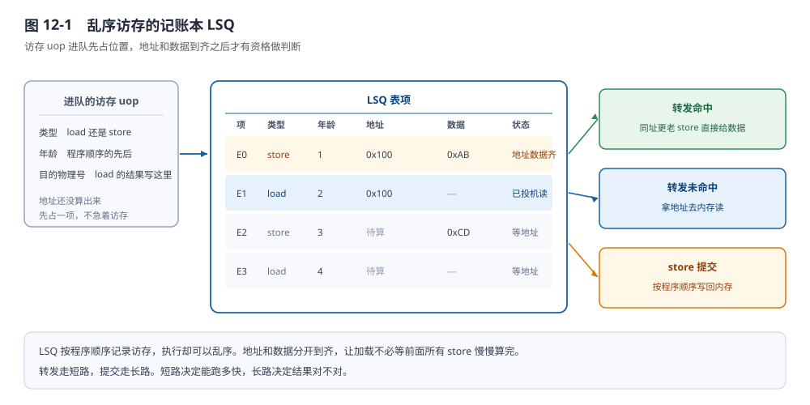
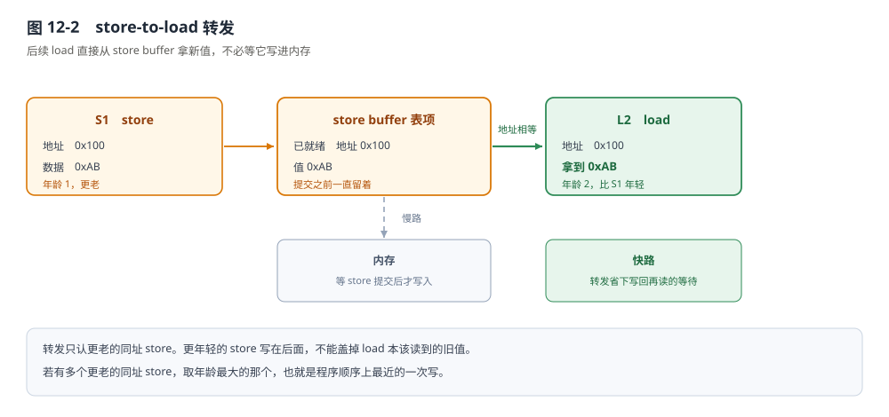
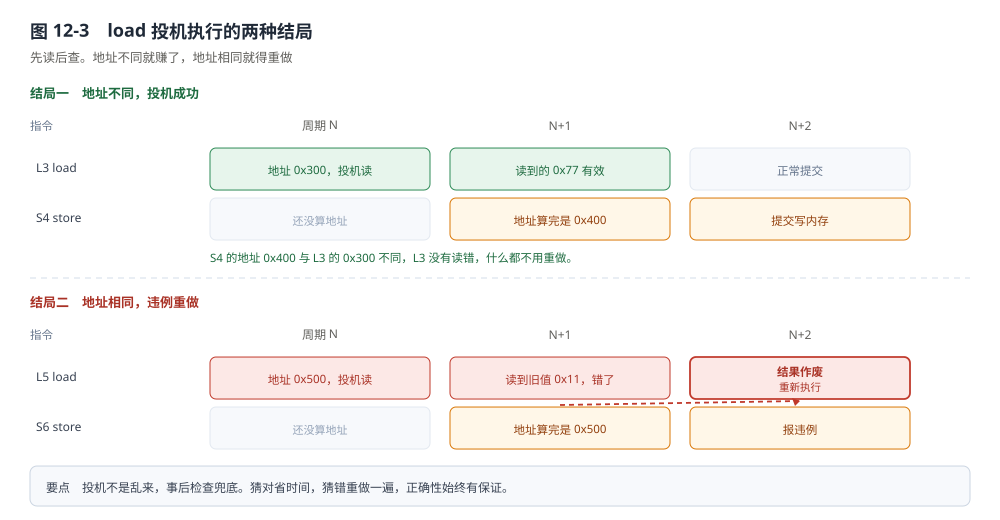
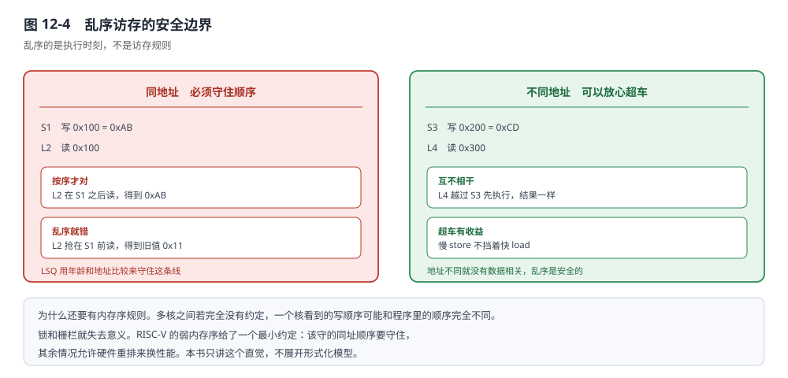

# 第 12 章 乱序访存

前面几章里，uop 的目的物理号在重命名时就定下来了，发射和旁路都靠编号说话。访存指令没这么省事：它要访问哪个地址，得等地址加法器算完才知道。地址没算出来之前，谁也说不清这条 load 和那条 store 会不会撞在同一个位置上。

这一章讲乱序处理器怎么处理访存。答案是给访存单独记一本账，按程序顺序排好队；能安全提前的 load 就提前做，做错了再重来。账本就叫 LSQ。

## 12.1 访存为什么更难

整数运算的顺序约束在重命名那一站就基本理清了。访存多出两个麻烦。

第一个麻烦是地址的不确定性。ADD 的目的寄存器写在指令里，重命名时就知道结果要放哪；LD 的地址却要等基址寄存器就绪、加法器算完才出现。地址没出来，就没法和前面的 store 比是否同址。

第二个麻烦是访存之间的顺序约束。两条整数指令写同一个物理寄存器，重命名会给它们不同编号，先后关系已经化解。两条 store 写同一个内存地址，重命名站帮不上忙——内存没有物理寄存器池可分配，谁先谁后直接决定最终结果。

顺序错了会出两种错。load 跑到更老的 store 前面，读到旧值；两条 store 交换顺序，最后留下的是年轻那条写的值。两种都是货真价实的程序错误，不是性能损失。

## 12.2 LSQ 记什么

LSQ 是 load/store queue 的缩写，也就是访存队列。图 12-1 画了它的结构。



*图 12-1　访存 uop 按程序顺序占项，地址和数据到齐之后才有资格做判断。*

每条访存 uop 进队时带着类型、年龄和目的物理号。store 没有目的寄存器，目的号这一栏空着；load 的结果要写回，目的号照填不误。年龄仍然来自重命名站，用来判断谁更老。

表项里还要记地址、数据和就绪状态。store 的地址和数据分开到达，各自有个就绪位；load 的地址算出来之后，要记下它是否已经投机读过。这些位看着琐碎，正是它们让"等谁、不等谁"变得可判断。

入队按程序顺序，出队和执行却可以乱序。LSQ 记的是账，不是行程表。

## 12.3 地址和数据分开到齐

store 要写两样东西：写到哪里，写什么。这两样东西的就绪时刻常常不同。

地址由地址生成单元算出，依赖基址寄存器；数据来自另一个源操作数，可能还在等 ALU 或乘法器。约定好两者分别就绪，store 才能在表项里慢慢凑齐，不必因为其中一样没到就把整个队列堵住。

更关键的是，转发只需要"地址和数据都齐了"的 store。地址没齐，没法比；数据没齐，比上了也没值可转。代码里两个就绪位分别置位，转发检查同时看这两个条件。

load 这边简单些。地址算出来就可以发起读，不需要等别的数据。

## 12.4 store-to-load 转发

来看一个最常见的场景。

```
S1  SD  x5, 0(x6)     # 写地址 0x100，值 0xAB
L2  LD  x7, 0(x6)     # 读地址 0x100
```

S1 比 L2 老，而且写和读是同一个地址。L2 应该读到 0xAB。如果 S1 还没提交、内存里还是旧值 0x11，L2 直接读内存就读错了。

图 12-2 给出了正确做法。



*图 12-2　更老的同址 store 直接把新值交给 load，不必等它写进内存。*

S1 的地址和数据到齐后留在 store 缓冲区里，等着按程序顺序提交。L2 的地址算出来是 0x100，和 S1 的地址比较，命中，于是直接从 S1 的数据栏拿到 0xAB。写内存那条慢路照走不误，但 L2 不用等它。

转发的条件有三条：store 比 load 老、地址相等、store 的数据已经就绪。少一条都不行。比 load 年轻的 store 不能转发，因为 load 读的是它执行时刻之前的值，让后来的写入盖掉就错了。

如果同时有好几个更老的同址 store，取最年轻的那个。程序顺序上它最近，它写的值才是 load 该看到的。代码里用年龄比较挑出这一项，`best_age` 记录和当前最优项的年龄。

## 12.5 load 投机执行

转发能解决"store 已经到齐"的情况。麻烦的是 store 还在慢慢算地址的时候，load 该怎么办。

保守做法是等。等所有更老的 store 都把地址算出来，确认没有同址的，再让 load 去读。这样绝不会错，但一条慢 store 能拖住后面一堆 load，乱序的好处大打折扣。

激进做法是投机。load 地址算出来就先读，同时记下"我读的时候，前面哪些 store 还没算出地址"。等那些 store 的地址出来，再回头比对。地址不同，load 读的值有效，赚了；地址相同，说明 load 读早了，报一次违例，让它重做。

图 12-3 把两种结局画在一起。



*图 12-3　地址不同则投机成功；地址相同则报违例，load 结果作废重做。*

结局一里，L3 先读 0x300。后来更老的 S4 地址算出来是 0x400，和 L3 无关，L3 的结果照用。结局二里，L5 读了 0x500，后来更老的 S6 地址也算出来是 0x500。S6 本该先写，L5 却提前读了旧值，于是报违例。

投机不是冒险蛮干。它先用起来再说，同时留着核对的账。正确性由事后的检查兜底，速度由猜对的那些次赚回来。

## 12.6 违例之后怎么办

LSQ 报出违例之后，要做的事是让这条 load 重新执行。这一步在本章的代码里没有实现，骨架只负责检测；真正的恢复要等第 14 章讲重定向时一起说。

这里先说清楚它和分支预测错误的区别。分支预测错了，整条错误路径上的指令都要冲掉，前端重新取指，动静很大。load 违例只涉及这条 load 以及用了它结果的后继指令，范围小得多。有些设计只重放 load 和它的消费者，有些干脆让这条 load 从发射队列再走一遍。

代价也不一样。分支错误常常要等前端重新喂指令，几十拍起步；load 违例通常几拍到十几拍就能补回来。正是这个差别，让投机 load 成为一个划算的选择。

## 12.7 乱序访存的安全边界

乱序访存有条底线：同一个地址的访问必须保持程序顺序。这条线以内可以放开手脚，跨过去就会出错。图 12-4 画了这条边界。



*图 12-4　同地址必须保序，不同地址可以乱序执行。*

左边是同地址。S1 写 0x100，L2 读 0x100。L2 只能在 S1 之后读，否则拿到的是旧值。右边是不同地址。S3 写 0x200，L4 读 0x300，两者互不相干，L4 完全可以越过慢吞吞的 S3 先执行。

把这条边界再往外推一层，就到了多核之间的内存序问题。如果两个核看到的写顺序可以任意颠倒，一个核更新了锁变量，另一个核却还看到旧值，同步就失效了。RISC-V 的弱内存序给了一个最小约定：该守的同址顺序要守住，其余情况允许重排换性能。

本书只讲这个直觉，不展开弱内存序的形式化模型。对单核乱序设计来说，守住同地址顺序就是最重要的那条规矩。

## 12.8 重点与权衡

**访存顺序靠 LSQ 记账。** 入队按程序顺序，执行可以乱序。年龄用来判断先后，地址用来判断相关。

**store 的地址和数据分开就绪。** 两者到齐才能参与转发。这样慢的基址计算不会连带堵住数据通路。

**转发优先于读内存。** 更老的同址 store 数据已经就绪时，直接把值给 load，省掉写回再读的一整段等待。多个命中取最年轻的那个。

**投机加检测比保守等待快。** load 先读，store 地址出来后再核对。猜对赚时间，猜错重做，代价远小于整条流水线冲刷。

**队列深度要合适。** 太浅装不下足够的在飞访存，转发和投机都施展不开；太深则地址比较和年龄管理都要看更多项，面积和延迟一起涨。深度通常和 ROB、发射队列一起定。

**store 什么时候写内存。** 真实机器要等 store 提交才写，这样预测错误时不会污染内存。教学骨架只做到转发和违例检测，提交留给后面的章节。

## 12.9 Verilog 骨架

配套代码在 `code/verilog/12_lsq/`，只有一个模块 `lsq.v`。先看接口，再看内部存储，最后看三个动作。

### 12.9.1 接口的模子先搭起来

先给出模块和参数。八项队列，索引需要三位。

```verilog
module lsq #(
    parameter ENTRY  = 8,
    parameter ADDR_W = 32,
    parameter DATA_W = 32,
    parameter AGE_W  = 8,
    parameter PS_W   = 6,
    parameter IDX_W  = 3   // ENTRY=8 时索引需要 3 位
)(
```

第一条访存 uop 进队，先要知道它是 load 还是 store、年龄多大、结果写哪个物理号。

```verilog
    // 入队：一条访存 uop 占一项，顺序由年龄给出
    input  wire                    alloc_en_i,
    input  wire                    alloc_is_store_i,
    input  wire [AGE_W-1:0]        alloc_age_i,
    input  wire [PS_W-1:0]         alloc_dest_i,
```

前面说过 store 的地址和数据分开到齐，接口就按两路分别给。每路都带表项编号和值。

```verilog
    // store 的地址与数据分开就绪
    input  wire                    st_addr_en_i,
    input  wire [IDX_W-1:0]        st_addr_idx_i,
    input  wire [ADDR_W-1:0]       st_addr_i,
    input  wire                    st_data_en_i,
    input  wire [IDX_W-1:0]        st_data_idx_i,
    input  wire [DATA_W-1:0]       st_data_i,
```

load 只要地址。地址一算出来就发起投机读，同时请求转发检查。

```verilog
    // load 地址算完，投机读
    input  wire                    ld_en_i,
    input  wire [IDX_W-1:0]        ld_idx_i,
    input  wire [ADDR_W-1:0]       ld_addr_i,

    // 转发结果：命中时 data 有效，未命中时给出地址去访存
    output reg  [DATA_W-1:0]       ld_fwd_data_o,
    output reg                     ld_fwd_hit_o,
    output reg  [ADDR_W-1:0]       ld_addr_o,
    output reg  [PS_W-1:0]         ld_dest_o,
```

最后加上违例输出和占用情况。违例带回年龄，方便外部找到该重做的那一条。

```verilog
    // 违例：更老的 store 地址算完后，发现它和已投机的 load 同址
    output reg                     violation_o,
    output reg  [AGE_W-1:0]        violation_age_o,

    output wire [ENTRY-1:0]        busy_o
);
```

接口定稿如下。

| 组 | 信号 | 作用 |
|---|---|---|
| 入队 | `alloc_en_i`, `alloc_is_store_i`, `alloc_age_i`, `alloc_dest_i` | 进一条访存 uop |
| store | `st_addr_en_i/idx_i/addr_i`, `st_data_en_i/idx_i/data_i` | 地址、数据分别就绪 |
| load | `ld_en_i`, `ld_idx_i`, `ld_addr_i` | 地址算完，请求投机读 |
| 输出 | `ld_fwd_hit_o`, `ld_fwd_data_o`, `ld_addr_o`, `ld_dest_o` | 转发结果或未命中的地址 |
| 违例 | `violation_o`, `violation_age_o` | 哪条 load 读错了 |
| 观察 | `busy_o` | 哪些项还占着 |

### 12.9.2 表项里存什么

每个表项要记下类型、年龄、目的号、地址、数据，以及三个状态位。地址就绪和数据就绪分开，load 是否投机过单独记一位。

```verilog
    reg                   valid    [0:ENTRY-1];
    reg                   is_store [0:ENTRY-1];
    reg  [AGE_W-1:0]      age      [0:ENTRY-1];
    reg  [PS_W-1:0]       dest     [0:ENTRY-1];
    reg  [ADDR_W-1:0]     addr     [0:ENTRY-1];
    reg                   addr_rdy [0:ENTRY-1];
    reg  [DATA_W-1:0]     data     [0:ENTRY-1];
    reg                   data_rdy [0:ENTRY-1];
    reg                   ld_done  [0:ENTRY-1];
```

占用情况直接从有效位拉出来，不必另存一份。

```verilog
    integer e;
    reg [ENTRY-1:0] busy;
    always @* begin
        for (e = 0; e < ENTRY; e = e + 1)
            busy[e] = valid[e];
    end
    assign busy_o = busy;
```

### 12.9.3 转发检查是纯组合逻辑

load 一请求，就把自己的地址同所有表项比一遍。命中的条件写在 `if` 里：这一项有效、是 store、地址和数据都齐、地址相等、年龄比 load 小。

```verilog
    // 转发检查：找所有更老、同址、地址和数据都已就绪的 store，取其中最年轻的
    reg [DATA_W-1:0] fwd_data;
    reg              fwd_hit;
    reg [AGE_W-1:0]  best_age;
    always @* begin
        fwd_data = {DATA_W{1'b0}};
        fwd_hit  = 1'b0;
        best_age = {AGE_W{1'b0}};
        if (ld_en_i) begin
            for (e = 0; e < ENTRY; e = e + 1) begin
                if (valid[e] && is_store[e] && addr_rdy[e] && data_rdy[e] &&
                    (addr[e] == ld_addr_i) &&
                    (age[e] < age[ld_idx_i]) &&
                    (!fwd_hit || (age[e] > best_age))) begin
                    best_age = age[e];
                    fwd_data = data[e];
                    fwd_hit  = 1'b1;
                end
            end
        end
    end
```

挑最年轻的那一项用了一个小技巧。`!fwd_hit` 保证第一个命中项无条件入选，后面的项只有在年龄更大时才覆盖它。`best_age` 的初值给 0 就够了，不必费心去找最大值。

这个地方踩过一个坑。初值要是写成全 1，年龄又是正数，`age[e] > best_age` 就永远不成立，转发永远不命中。症状很有迷惑性：违例检测全对，只有转发全挂。原因不在比较逻辑，而在起跑线设错了。

组合结果直接送到输出。转发未命中时，地址原样送出去，交给下一级去读内存。

```verilog
    always @* begin
        ld_fwd_data_o = fwd_data;
        ld_fwd_hit_o  = fwd_hit;
        ld_addr_o     = ld_addr_i;
        ld_dest_o     = valid[ld_idx_i] ? dest[ld_idx_i] : {PS_W{1'b0}};
    end
```

### 12.9.4 入队和复位

时序部分先处理复位，把所有表项清干净，违例位也清零。

```verilog
    always @(posedge clk or negedge rst_n) begin
        if (!rst_n) begin
            for (e = 0; e < ENTRY; e = e + 1) begin
                valid[e]    <= 1'b0;
                is_store[e] <= 1'b0;
                age[e]      <= {AGE_W{1'b0}};
                dest[e]     <= {PS_W{1'b0}};
                addr[e]     <= {ADDR_W{1'b0}};
                addr_rdy[e] <= 1'b0;
                data[e]     <= {DATA_W{1'b0}};
                data_rdy[e] <= 1'b0;
                ld_done[e]  <= 1'b0;
            end
            violation_o    <= 1'b0;
            violation_age_o <= {AGE_W{1'b0}};
        end else begin
```

正常工作时第一件事是把违例位默认清零。只有确实查到问题才在这一拍重新置一，免得上一拍的违例一直挂着。

```verilog
            // 默认这一拍没有违例
            violation_o     <= 1'b0;
            violation_age_o <= {AGE_W{1'b0}};
```

入队找第一个空项。这里用一个命名块包住局部变量 `first_free`，找到就写进去，找不到就什么也不做，相当于队列满时拒绝入队。

```verilog
            // 入队：找第一个空项
            begin : alloc_block
                integer first_free;
                first_free = -1;
                for (e = 0; e < ENTRY; e = e + 1)
                    if (!valid[e] && (first_free < 0)) first_free = e;
                if (alloc_en_i && (first_free >= 0)) begin
                    valid[first_free]    <= 1'b1;
                    is_store[first_free] <= alloc_is_store_i;
                    age[first_free]      <= alloc_age_i;
                    dest[first_free]     <= alloc_dest_i;
                    addr_rdy[first_free] <= 1'b0;
                    data_rdy[first_free] <= 1'b0;
                    ld_done[first_free]  <= 1'b0;
                end
            end
```

### 12.9.5 地址到齐时查违例

store 的地址写进表项，这一拍顺手做违例检查。遍历所有表项，找已经投机读过、年龄更大、而且地址相同的 load。三个条件都满足就报违例，并把那条 load 的年龄送出去。

```verilog
            // store 地址就绪，顺便检查有没有更老的 load 已经投机读过同一地址
            if (st_addr_en_i) begin
                addr[st_addr_idx_i]     <= st_addr_i;
                addr_rdy[st_addr_idx_i] <= 1'b1;
                for (e = 0; e < ENTRY; e = e + 1) begin
                    if (valid[e] && !is_store[e] && ld_done[e] &&
                        (age[e] > age[st_addr_idx_i]) &&
                        (addr[e] == st_addr_i)) begin
                        violation_o     <= 1'b1;
                        violation_age_o <= age[e];
                    end
                end
            end
```

注意年龄比较的方向。这里要比的是"load 比这条 store 年轻"，所以是 `age[e] > age[st_addr_idx_i]`。方向和转发检查里正好相反，写反了会把 younger 和 older 全搞乱。

### 12.9.6 数据到齐与 load 投机

store 的数据单独写入，只管置就绪位。load 地址来了就记下地址，并打上已投机的标记，供后面的 store 检查。

```verilog
            // store 数据就绪
            if (st_data_en_i) begin
                data[st_data_idx_i]     <= st_data_i;
                data_rdy[st_data_idx_i] <= 1'b1;
            end

            // load 地址就绪，记下地址和已投机标记
            if (ld_en_i) begin
                addr[ld_idx_i]     <= ld_addr_i;
                addr_rdy[ld_idx_i] <= 1'b1;
                ld_done[ld_idx_i]  <= 1'b1;
            end
        end
    end
endmodule
```

一处细节：索引位宽用的是 `IDX_W` 而不是 `ENTRY`。八项队列的编号只要三位，写成 `[ENTRY-1:0]` 虽然能靠零扩展跑通，端口语义却是错的。这个教训和转发初值的坑一起写进了 README。

## 12.10 图形与实验

本章四张 SVG。图 12-1 是 LSQ 的表项结构，图 12-2 看转发，图 12-3 对比投机的两种结局，图 12-4 看乱序访存的安全边界。

Digital 电路在 `code/digital/12_violation_detect.dig`。它用两个与门搭出违例判据：地址相等、store 更老、load 已投机，三个条件同时成立才输出 1。前级的地址比较和年龄比较在电路里用输入开关代替，这样能单独拨动三个条件看输出。真值表列了八种组合，只有最后一种报违例。这个电路对应的正是 `lsq.v` 里 store 地址到齐时那段遍历检查。

Verilog 实验在 `code/verilog/12_lsq/`。进入目录后执行：

```bash
iverilog -g2012 -o sim.vvp *.v
vvp sim.vvp
```

自测程序有 20 项检查，覆盖复位、入队、同址转发、目的号与地址透传、地址未算出时不转发、投机违例、地址不同不报违例、更年轻的 store 不转发、多个更老 store 取最近、数据未就绪不转发和队列满时拒绝。建议特别看两处：两个更老的同址 store 分别写 0x11 和 0x22 时，load 拿到的是 0x22；load 先读 0x500、更老的 store 地址后算出也是 0x500 时，违例位当拍就拉高。

## 12.11 香山一瞥（选读）

香山把访存拆成几条独立的流水线：load 走一条，store 的地址走一条，store 的数据再走一条。三条流水线各自简单，带宽可以分别配置，store 的地址和数据也不必同时到齐，最后在提交时才配对写内存。

本章代码里 `st_addr_en_i` 和 `st_data_en_i` 分成两个接口，正是这个思想的简化版。真实的访存流水线还要处理地址转换、缓存命中和缺失、访存违例的回滚路径，这些都不在本书范围内。

读香山文档时，可以顺着"访存流水线""加载队列""存储队列"这些词找过去。具体有多少项、几条流水线、延迟多少拍，属于工程规模上的选择。这里只要认出"地址和数据分开走，顺序由队列守住"这个骨架就够了。

## 12.12 小结

这一章讲的是访存指令怎么在乱序机器里既跑得快又不算错。

LSQ 按程序顺序记录每条访存，地址和数据分开到齐。更老的同址 store 数据就绪时，直接转发给 load，省掉写回再读的等待。store 还在算地址时，load 可以投机先读，等 store 地址出来再核对；地址相同就报违例，让 load 重做。

乱序的边界是同地址顺序。同地址的访存必须守住先后，不同地址才可以放心超车。推到多核之间，这就是内存序规则要解决的问题。

代码部分先搭 LSQ 的接口，再列表项，然后分别实现转发检查、入队、违例检测和数据写入。转发用组合逻辑按物理地址和年龄比较，违例在 store 地址就绪那一拍检查。

一句话记住本章：访存可以乱着跑，但账要按顺序记。

## 12.13 思考题

1. 访存指令和整数运算相比，多出哪两个麻烦？为什么重命名解决不了它们？
2. store-to-load 转发的三个条件是什么？为什么更年轻的 store 不能转发给 load？
3. 投机 load 为什么要在 store 地址算出来之后再检查？如果 store 一直算不出地址，load 的结果能用吗？
4. load 违例和分支预测错误相比，恢复范围有什么不同？为什么前者的代价通常小得多？
5. 代码里转发检查取的是"最年轻的更老 store"。如果有两个更老的同址 store，取错一个会读到什么值？
