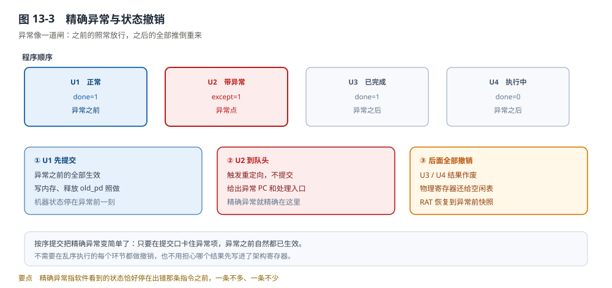

# 第 13 章 重排序缓冲 ROB 与精确异常

前面几章把指令打散了跑。重命名让同名指令各拿一个物理号，发射队列让就绪的先上，执行单元各算各的，访存还能投机。机器内部已经乱成一锅粥。

但程序员看到的世界不能乱。软件认定指令一条接一条执行，第 5 条出错时，前 4 条的效果必须都在，第 6 条往后一个都不许留下。这一章讲的 ROB 就是把乱序执行收拾回顺序表象的那本账。

## 13.1 乱序执行怎么收尾

先想清楚一件事。指令乱序执行带来的好处，是在执行阶段榨出并行度。可它带来的麻烦，是执行完了之后不能直接把结果写进架构寄存器。

为什么不能直接写。假设 U1 和 U4 都写 x1，重命名后分别拿到 P10 和 P14。U4 短，先算完；U1 慢，还在等乘法器。如果 U4 算完就把 P14 当成新的 x1 公布出去，紧接着发生异常或者分支预测错误，机器要退回 U4 之前，P14 已经生效了，退不回去。

所以乱序机器多了一道手续。执行结果先写在物理寄存器里，但对外不公布。等到这条指令前面的所有指令都处理完了，才让它正式生效。这道手续叫提交，负责排队的账本叫重排序缓冲，简称 ROB。

## 13.2 为什么需要 ROB

ROB 干三件事。

第一件是按程序顺序记录。指令进入后端时按取指顺序占一项，不管后面怎么乱，账本上的先后顺序不变。

第二件是让乱序写回、按序提交。执行单元算完只打一个完成标记，提交口从队头开始，只放行连续完成的项。队头没好，后面全算完了也得等着。

第三件是兜住精确异常。异常这条指令之前的，提交时已经生效；异常这条到队头时卡住，报错并重新取指；异常之后的，结果全部作废。软件看到的状态恰好停在出错指令之前，不多也不少。

第三件事是前两件的自然结果。把提交口卡好，精确异常不用额外设计，这是 ROB 最优雅的地方。

## 13.3 ROB 记什么

ROB 是一个环形队列，图 13-1 画了它的样子。


*图 13-1　ROB 按程序顺序占项，tail 在尾部写入，head 在头部退休。*

每项记六样东西。有效位说这一项是否被占用；完成位说这条 uop 写回没有；异常位说它执行时有没有出错。这三样是控制位。

另外三样是数据。PC 是这条指令的地址，异常时要交给重定向逻辑；目的物理号是结果写到了哪里；旧物理号是被这条指令覆盖掉的那个，提交时才能还给空闲表。最后这个字段接上了第 9 章埋下的伏笔——old_pd 必须等覆盖它的指令提交才能回收。

为什么要等到提交。因为提交之前，这条指令还可能因为异常或分支错误被撤销。一旦撤销，RAT 要恢复到旧映射，那个被覆盖的物理寄存器还得能用。提前回收就把它给别人了，恢复时数据已经没了。

## 13.4 环形队列与两个指针

ROB 用两个指针。tail 指向下一个写入位置，分配时往后走；head 指向队头，提交时往后走。两个指针都朝同一个方向绕圈，绕到末尾回到开头。

判空判满用的是第 4 章 FTQ 那套多一位指针。指针比索引多一位，索引取低位。head 和 tail 完全相等是空；最高位不同、低位相同是满。

```
    reg [PTR_W-1:0] head, tail;
```

八项队列的索引只要三位，指针给四位，最高位专门用来区分绕了几圈。少了这一位，绕回开头之后就无法分辨是空还是满。

环形索引还有个细节。从 head 往后数第 j 项时，写的是 `head[PTR_W-2:0] + j`。ENTRY 取 8 这样的 2 的幂，三位加法溢出后自动回绕，不用写取模运算。这个技巧在全书的队列里反复出现。

## 13.5 乱序写回与按序提交

图 13-2 把这两个动作放在一起。


*图 13-2　写回可以按索引打任意一项，提交只认从 head 开始的连续完成项。*

U3、U2 先后算完，各自打上完成标记。U1 慢，还没好。这时候队头是 U1，提交数只能是零。U2 和 U3 就算把结果放在物理寄存器里躺很久，也不能对外公布。

等 U1 写完，提交口从 head 开始数：U1 完成、U2 完成、U3 完成，一拍最多提交两条，于是第一批 U1 加 U2，第二批 U3。提交宽度本例是 2。

这里能看出提交和写回的分工。写回解决的是数据什么时候算出来，提交解决的是结果什么时候算数。两个问题分开答，机器既能乱着算，又能按序收尾。

## 13.6 精确异常

精确异常听着术语味重，意思其实朴素。程序员希望出错那一条之前的指令都生效，出错那一条和之后的都不生效，就像机器真的按顺序一条条跑到出错点停下来一样。

图 13-3 用一条更老的异常指令来看这件事。



*图 13-3　异常之前的 U1 照常提交，U2 卡住报错，之后的 U3、U4 全部撤销。*

U2 带异常，它前面有 U1，后面有 U3 和 U4。按序提交带来三步结果。

第一步，U1 先提交。它的结果写进架构状态，如果是 store，这时候才真正写内存，持有的旧物理号也这时候释放。

第二步，U2 到队头。提交口发现它带异常，不放行，给出它的 PC 和处理入口。机器状态此时恰好停在 U1 之后。

第三步，U2 之后的全部撤销。U3 的结果作废，U4 还在执行就冲掉，它们占的物理寄存器还给空闲表，RAT 恢复到 U2 之前。前端从异常 PC 重新取指。

三步里最难的是第三步，但它不在本章代码里。本章只做到卡住异常项、报出重定向目标、清空 ROB。真正的 RAT 恢复和前端冲刷要到第 14 章。这里先把接口和数据通路搭起来。

## 13.7 提交宽度与退休

提交宽度是一拍最多退休几条指令。图 13-4 说它为什么不能随便定。


*图 13-4　提交宽度要和重命名、发射宽度匹配，store 也在提交时真正写内存。*

退休时做三件事。结果正式进架构状态，store 写进内存，释放旧物理号。这三件事都得按顺序来，所以提交口天然是个瓶颈。

宽度太窄，后端一拍能算两条，提交一拍只放一条，ROB 很快被在飞指令占满，前端跟着停。宽度太宽，一拍要查更多表项、释放更多寄存器，组合逻辑变长，时钟反而跑不快。教学核取 2，和重命名、发射宽度齐平。

ROB 深度也要配套。深一点能藏住更多在飞指令，扛得住长延迟的访存，代价是面积、提交逻辑和恢复开销一起涨。本书的八项只是为了看清机制，真实核通常是它的几十倍。

## 13.8 重点与权衡

**ROB 是顺序与乱序的分界线。** 它里面可以乱着算，跨过提交口，机器的架构状态才算改变。

**写回打标记，提交才生效。** 执行单元只管置完成位，提交口从 head 放行连续完成的项。队头阻塞时后面全等。

**精确异常靠按序提交兜底。** 异常项之前的先提交，异常项到队头时重定向，之后的全部撤销。不需要在每个执行环节都做撤销。

**old_pd 提交时才释放。** 在这之前指令还可能被撤销，被覆盖的物理寄存器得留着供恢复。

**宽度要匹配，深度要权衡。** 提交宽度对齐前后各站，ROB 深度权衡并行度和硬件开销。

## 13.9 Verilog 骨架

配套代码在 `code/verilog/13_rob/`，只有一个模块 `rob.v`。还是老规矩，先看接口，再看实现。接口按需求一样一样地加。

### 13.9.1 先把模块的框子搭起来

先给参数和模块头。队列八项，PC 三十二位，物理号六位，指针四位，提交宽度二。

```verilog
module rob #(
    parameter ENTRY    = 8,
    parameter PC_W     = 32,
    parameter PS_W     = 6,
    parameter PTR_W    = 4,      // 多一位用于判满，ENTRY=8 时索引占 3 位
    parameter COMMIT_W = 2        // 每拍最多提交几条
)(
```

第一条要能往里放指令。分配发生在重命名阶段，按顺序写入，所以要给写入使能、PC、目的物理号和旧物理号。

```verilog
    // 分配：重命名/分派阶段按程序顺序写入
    input  wire                    alloc_en_i,
    input  wire [PC_W-1:0]         alloc_pc_i,
    input  wire [PS_W-1:0]         alloc_dest_i,
    input  wire [PS_W-1:0]         alloc_old_pd_i,
```

执行单元算完了要来登记。它带自己的 ROB 索引，还要说这一条有没有异常。

```verilog
    // 乱序写回：执行完成时按 ROB 索引登记，可带异常
    input  wire                    complete_en_i,
    input  wire [PTR_W-2:0]        complete_idx_i,
    input  wire                    complete_except_i,
```

提交口要对外说话。本拍提交了几条，第一条的 PC 是什么，释放了哪两个旧物理号。释放信号接回第 9 章的空闲表。

```verilog
    // 提交输出：本拍提交了几条、第一条 PC、释放的 old_pd
    output reg  [COMMIT_W-1:0]     commit_cnt_o,
    output reg  [PC_W-1:0]         commit_pc_o,
    output reg  [PS_W-1:0]         commit_free0_o,
    output reg  [PS_W-1:0]         commit_free1_o,
```

最后是异常重定向、满空状态和端口收尾。

```verilog
    // 异常重定向：队头指令带异常时拉高，给出它的 PC
    output reg                     redirect_en_o,
    output reg  [PC_W-1:0]         redirect_pc_o,

    output wire                    full_o,
    output wire                    empty_o
);
```

接口定稿如下。

| 组 | 信号 | 作用 |
|---|---|---|
| 分配 | `alloc_en_i`, `alloc_pc_i`, `alloc_dest_i`, `alloc_old_pd_i` | 按程序顺序写入 |
| 写回 | `complete_en_i`, `complete_idx_i`, `complete_except_i` | 按索引登记完成，可带异常 |
| 提交 | `commit_cnt_o`, `commit_pc_o`, `commit_free0_o`, `commit_free1_o` | 本拍提交数与释放的旧号 |
| 异常 | `redirect_en_o`, `redirect_pc_o` | 队头异常时的重定向目标 |
| 观察 | `full_o`, `empty_o` | 队列满 / 空 |

### 13.9.2 表项里存什么

六样东西一人一行。三个是控制位，三个是数据位。

```verilog
    reg                   valid   [0:ENTRY-1];
    reg                   done    [0:ENTRY-1];
    reg                   except  [0:ENTRY-1];
    reg  [PC_W-1:0]        pc      [0:ENTRY-1];
    reg  [PS_W-1:0]        dest    [0:ENTRY-1];
    reg  [PS_W-1:0]        old_pd  [0:ENTRY-1];
```

两个指针加满空判断。判满用当前 tail，和第 4、6 章的 FIFO 一致。索引用低位，最高位只用于判满。

```verilog
    reg [PTR_W-1:0] head, tail;

    wire empty_i = (head == tail);
    wire full_i  = (head[PTR_W-1] != tail[PTR_W-1]) &&
                   (head[PTR_W-2:0] == tail[PTR_W-2:0]);
    assign empty_o = empty_i;
    assign full_o  = full_i;
```

### 13.9.3 提交决策是纯组合逻辑

提交数不用寄存器存，一拍之内就能算出来。从 head 开始往后数，最多看 COMMIT_W 项。

```verilog
    // 提交决策：从 head 起数连续 done 的项，遇到带异常的项就停并触发重定向
    reg [PTR_W-2:0]    cmt_idx;
    reg [COMMIT_W-1:0] cmt_cnt;
    reg                cmt_redirect;
    reg [PC_W-1:0]     cmt_redirect_pc;
    reg                cmt_stop;
    integer j;
    always @* begin
        cmt_cnt         = {COMMIT_W{1'b0}};
        cmt_redirect    = 1'b0;
        cmt_redirect_pc = {PC_W{1'b0}};
        cmt_stop        = 1'b0;
        for (j = 0; j < COMMIT_W; j = j + 1) begin
            cmt_idx = head[PTR_W-2:0] + j;   // ENTRY 取 2 的幂，低位加法自然回绕
            if (!cmt_stop && !empty_i && valid[cmt_idx] && done[cmt_idx]) begin
                if (except[cmt_idx]) begin
                    // 异常项之前的正常项本拍照常提交；异常项本身留到下一拍触发重定向
                    if (cmt_cnt == 0) begin
                        cmt_redirect    = 1'b1;
                        cmt_redirect_pc = pc[cmt_idx];
                    end
                    cmt_stop = 1'b1;
                end else begin
                    cmt_cnt = cmt_cnt + 1'b1;
                end
            end else begin
                cmt_stop = 1'b1;
            end
        end
    end
```

`cmt_stop` 是个刹车。一旦遇到没完成的项或者异常项，就把它置一，后面的项不再看。提交只能是一段连续的完成项，中间断了就得停。

异常这里有个讲究。代码用 `if (cmt_cnt == 0)` 判断异常项是不是已经在队头。如果异常项前面还有本拍要提交的正常项，先把那些提交掉，异常项留到下一拍；只有异常项本身就是队头时才触发重定向。这样异常之前的指令才能全部生效。

这个地方踩过坑。初版一看到提交窗口里有异常项就整批撤销，连它前面的正常项也不提交。结果精确异常变成粗略异常——出错之前本该生效的指令被冤枉掉了。修正就是加这道判断，让正常项先走。

### 13.9.4 复位

复位把所有表项清干净，指针归零，输出全部拉低。

```verilog
    integer i;
    reg [PTR_W-2:0] s_idx;
    always @(posedge clk or negedge rst_n) begin
        if (!rst_n) begin
            for (i = 0; i < ENTRY; i = i + 1) begin
                valid[i]  <= 1'b0;
                done[i]   <= 1'b0;
                except[i] <= 1'b0;
                pc[i]     <= {PC_W{1'b0}};
                dest[i]   <= {PS_W{1'b0}};
                old_pd[i] <= {PS_W{1'b0}};
            end
            head <= {PTR_W{1'b0}};
            tail <= {PTR_W{1'b0}};
            commit_cnt_o   <= {COMMIT_W{1'b0}};
            commit_pc_o    <= {PC_W{1'b0}};
            commit_free0_o <= {PS_W{1'b0}};
            commit_free1_o <= {PS_W{1'b0}};
            redirect_en_o  <= 1'b0;
            redirect_pc_o  <= {PC_W{1'b0}};
        end else begin
```

### 13.9.5 写回与提交的优先级

正常工作时先把提交数和重定向位默认清零。只有确实发生了才在这一拍重新置上，免得上一拍的信号一直挂着。

```verilog
            // 默认：本拍没有提交、没有重定向
            commit_cnt_o  <= {COMMIT_W{1'b0}};
            redirect_en_o <= 1'b0;

            // 1) 乱序写回：登记完成，并记下是否带异常
            if (complete_en_i) begin
                done[complete_idx_i]   <= 1'b1;
                except[complete_idx_i] <= complete_except_i;
            end
```

写回只打两个标记，不碰提交。它按索引找到自己的表项，置完成位，顺便记下异常位。

接着处理提交。重定向优先级最高，一旦队头异常，就报出目标 PC、清空整个 ROB、两个指针归零。这一拍不提交任何项。

```verilog
            // 2) 提交
            if (cmt_redirect) begin
                // 队头异常：精确重定向，清空整个 ROB，从异常 PC 重新取指
                redirect_en_o <= 1'b1;
                redirect_pc_o <= cmt_redirect_pc;
                for (i = 0; i < ENTRY; i = i + 1)
                    valid[i] <= 1'b0;
                head <= {PTR_W{1'b0}};
                tail <= {PTR_W{1'b0}};
```

没有异常但要提交时，把组合逻辑算出的提交数登记出去。第一条的 PC 和旧物理号直接按 head 索引取。第二条只在提交数大于一时才取，所以代码里单独判断了一次。

清 valid 用一个小循环，只清本拍提交的那些项。head 的推进量就是提交数，因为提交宽度是 2，拼位时要补到指针宽度。

```verilog
            end else if (cmt_cnt != 0) begin
                // 正常提交：释放 old_pd，推进 head
                commit_cnt_o   <= cmt_cnt;
                commit_pc_o    <= pc[head[PTR_W-2:0]];
                commit_free0_o <= old_pd[head[PTR_W-2:0]];
                if (cmt_cnt > 1)
                    commit_free1_o <= old_pd[head[PTR_W-2:0] + 1'd1];
                for (i = 0; i < COMMIT_W; i = i + 1)
                    if (i < cmt_cnt) begin
                        s_idx = head[PTR_W-2:0] + i;
                        valid[s_idx] <= 1'b0;
                    end
                head <= head + { {(PTR_W-COMMIT_W){1'b0}}, cmt_cnt };
            end
```

### 13.9.6 分配放在最后

分配找 tail 指向的空位写入，然后推进 tail。这段代码特意放在 always 块的最后。提交清 valid 和分配写 valid 可能落在同一个时钟沿，分配写在后面，语义才清楚。这个坑和第 10 章发射队列同源。

```verilog
            // 3) 分配：写在最后，避免同拍提交清掉刚进来的项
            if (alloc_en_i && !full_i) begin
                valid[tail[PTR_W-2:0]]  <= 1'b1;
                done[tail[PTR_W-2:0]]   <= 1'b0;
                except[tail[PTR_W-2:0]] <= 1'b0;
                pc[tail[PTR_W-2:0]]     <= alloc_pc_i;
                dest[tail[PTR_W-2:0]]   <= alloc_dest_i;
                old_pd[tail[PTR_W-2:0]] <= alloc_old_pd_i;
                tail <= tail + 1'b1;
            end
        end
    end
endmodule
```

## 13.10 图形与实验

本章四张 SVG。图 13-1 看 ROB 的环形结构和两个指针，图 13-2 对比乱序写回与按序提交，图 13-3 走一遍精确异常，图 13-4 看提交宽度与退休。

Digital 电路在 `code/digital/13_rob_commit.dig`。它用两个与门和一个非门搭出队头提交允许信号：队头有效、已完成、且不带异常，三个条件同时成立才允许提交。前级的完成检测和异常检测用输入开关代替，真值表列了八种组合，只有 `1 1 0` 这一种放行。这个电路对应的正是 `rob.v` 里提交决策最核心的那一步。

Verilog 实验在 `code/verilog/13_rob/`。进入目录后执行：

```bash
iverilog -g2012 -o sim.vvp *.v
vvp sim.vvp
```

自测程序有 17 项检查，覆盖复位、分配、队头未完成时阻塞提交、按宽度 2 提交、提交 PC 与旧号释放、异常前正常项先提交、异常重定向到正确 PC、冲刷后变空、写满、满时拒写和提交总数。建议特别看两处：U1、U2、U3 乱序写回后，U1 一写完就一次提交两条；U4、U5、U6 中 U5 带异常时，U4 先提交，U5 到队头才触发重定向。

## 13.11 香山一瞥（选读）

香山的 ROB 管理着所有在飞指令，从重命名分派一直跟到提交。提交口按顺序退休 uop，把结果写回架构寄存器堆，把 old_pd 还给重命名空闲表，store 在这一步才真正写进存储系统。

异常和分支错误走另一条路。香山用检查点恢复 RAT，按检查点粒度回滚，而不是一条条倒着退。这样恢复速度和检查点间隔有关，比逐条回退快得多。第 14 章会把这条恢复路径讲清楚。

读香山文档时，可以顺着"重排序缓冲""提交""精确异常"这些词找过去。具体多少项、几个提交口、检查点怎么布，属于工程规模上的选择。这里只要认出"乱序执行加按序提交换精确异常"这个骨架就够了。

## 13.12 小结

这一章讲的是乱序机器怎么看起来按顺序完成。

ROB 按程序顺序记录每条指令。执行单元乱序写回只打完成标记，提交口从 head 放行连续完成的项，队头没好就全等。精确异常是这套机制的副产品：异常之前的先提交，异常项到队头时重定向，之后的全部撤销。

代码部分先搭 ROB 的接口，再列表项，然后分别实现提交决策、复位、写回与提交的优先级、分配。提交决策是纯组合逻辑，用 `cmt_stop` 在断点处刹车；异常处理要先把前面的正常项提交掉，再在下一拍重定向。

一句话记住本章：乱着算可以，按序认账，异常才不会留下烂摊子。

## 13.13 思考题

1. 为什么执行单元算完不能立刻把结果写进架构寄存器？如果这么做，异常时会出什么问题？
2. 提交口为什么只放行从 head 开始的连续完成项？队头没完成、后面全完成时会发生什么？
3. 精确异常要求软件看到的状态恰好停在出错指令之前。ROB 的按序提交为什么能自然保证这一点？
4. 代码里用 `if (cmt_cnt == 0)` 判断异常项是否在队头。如果去掉这个判断，一看到窗口里有异常就整批撤销，会破坏什么语义？
5. old_pd 为什么要等到提交才释放？如果写回时就还给空闲表，分支预测错误恢复时会出什么问题？
