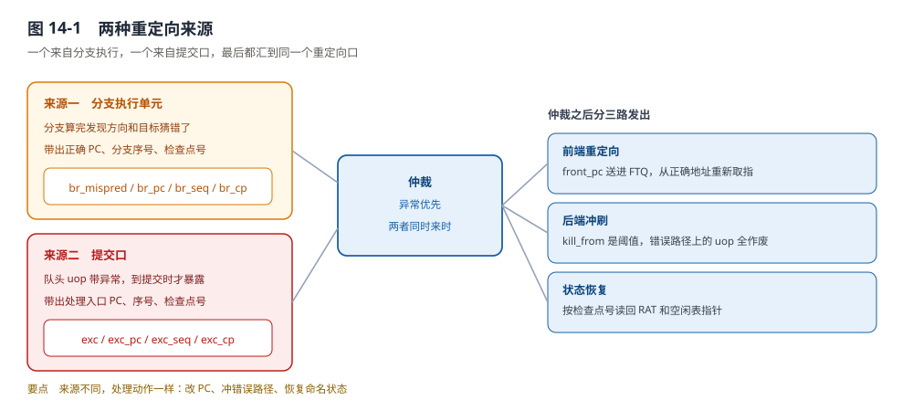
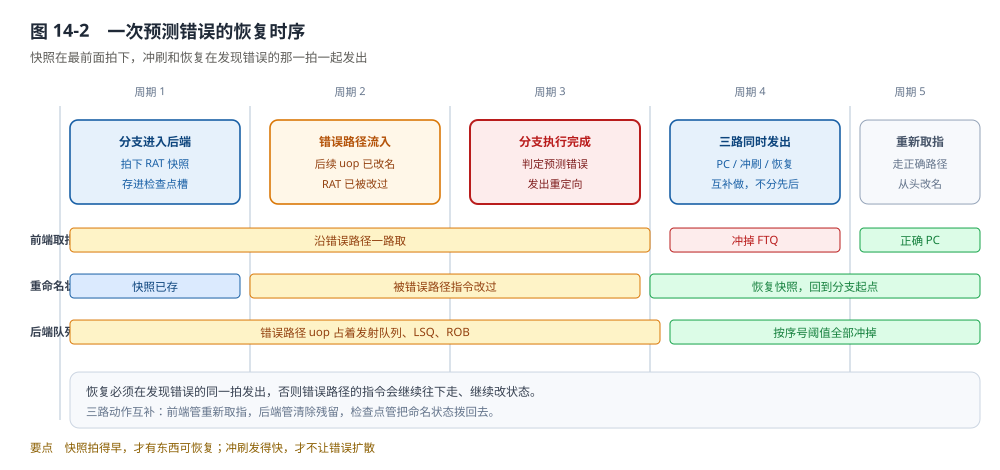
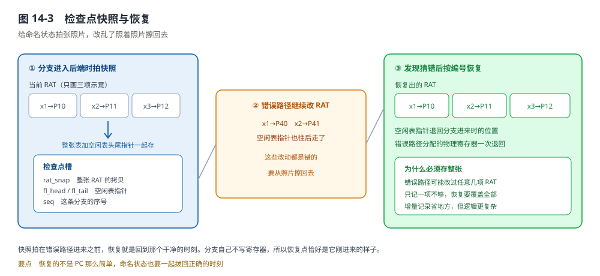
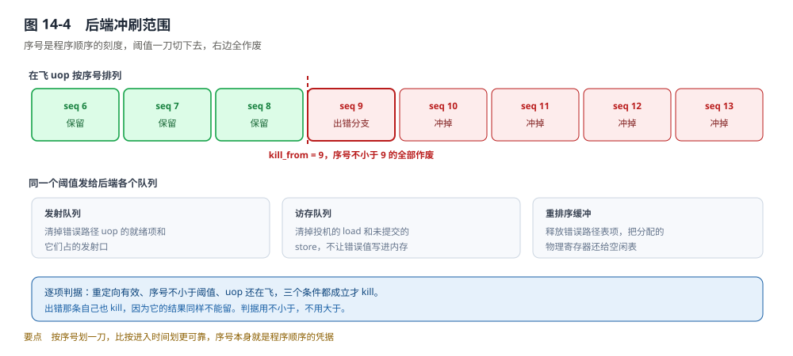

# 第 14 章 重定向与状态恢复

顺序流水线里，分支猜错了只要冲掉后面几条指令，重新取指就行。乱序机器没这么轻松。预测错误被发现的时候，错误路径上的指令可能已经改了重命名表、占了发射队列、甚至投机读过内存。光把 PC 改回去远远不够，这些痕迹都得擦掉。

这一章把前面铺的路收拢起来。第 5 章讲预测，第 9 章讲拍快照，第 13 章说异常在提交口卡住。这些线索在这里接上，形成一套完整的恢复机制。

## 14.1 为什么恢复比顺序流水线难

先把麻烦说清楚。乱序机器里，一条指令从取指到提交要走好几站，每一站都可能留下状态。

重命名站改了 RAT，把逻辑寄存器指向新分配的物理寄存器。发射队列里排着等着执行的 uop。ROB 记着在飞指令的账。访存队列里可能有投机的 load 和没提交的 store。前端的 FTQ 和指令缓冲里还排着还没进后端的指令。

分支执行完发现猜错的那一刻，这些地方可能同时躺着错误路径上的东西。前端取指方向要改，这是重定向；后端这些残留要清，这是冲刷；被改乱的命名状态要拨回去，这是状态恢复。三件事都得做，少一件就会算错。

顺序流水线只有第一件事。乱序机器难就难在后两件。

## 14.2 两种重定向来源

图 14-1 画了重定向的两个来源。



*图 14-1　分支执行单元和提交口都能触发重定向，处理动作相同。*

第一个来源是分支执行单元。分支指令算完了，发现实际方向和目标跟预测的不一样，于是报出正确 PC、这条分支的序号，还有它当年拍下的检查点号。前端预测错了，靠这个纠正。

第二个来源是提交口。ROB 队头那条指令带异常，到第 13 章说的提交关口卡住了。这时候报出异常处理入口的地址、那条指令的序号和检查点号。

两者带的信号长得一样，都是"去哪里、从哪条开始作废、拿哪份快照恢复"。所以后面走同一套逻辑。区别只在优先级，提交口的事更紧急，两路同时来时让它先走。

## 14.3 一次完整的恢复过程

图 14-2 按时间顺序走了一遍。



*图 14-2　快照先拍下，发现错误那一拍三个动作同时发出。*

周期一，分支进入后端。重命名这一站顺手拍下当前的 RAT 和空闲表指针，存进一个检查点槽。此刻错误路径上的指令还没进来，这份快照是干净的。

周期二，前端顺着错误预测继续取指，后续指令进了后端。它们改名、占队列、改 RAT。此刻 RAT 已经被改乱了。

周期三，分支执行单元算完，判定预测错误，发出重定向。

周期四，三个动作同时发出。前端把正确 PC 送进 FTQ 重新取指；后端按序号阈值冲刷各队列；检查点按编号吐出快照，覆盖当前 RAT 和空闲表指针。

周期五，前端沿正确路径重新取指，一切从分支那个点重新开始。

这里有个要紧的时间要求。冲刷和恢复必须在发现错误的同一拍发出。慢一拍，错误路径上的指令就多走一步，可能又改了状态、又占了资源，擦起来更费劲。

## 14.4 检查点怎么工作

图 14-3 把快照和恢复画在一起。



*图 14-3　分支进来时拍整张 RAT，发现错误后按编号读回覆盖。*

检查点存整张 RAT。为什么整张，因为错误路径上可能改过任意几项 RAT，事先不知道哪几项。只存一项不够，恢复时不知道该覆盖哪些。存整张最省事，代价是每个在飞分支都要一份 32×6 位的空间。

除了 RAT，还要存空闲表的头尾指针。错误路径上的指令分配出去的物理寄存器，就靠把指针拨回去一次性退回池子，不必一条条查是谁占的。

快照拍在错误路径进来之前，恢复就是回到那个干净的时刻。分支本身不写目的寄存器，所以恢复点恰好是它刚进来的样子。

真实处理器很少存整张表。分支越密集，快照越多，代价越大。常见做法是只记这条分支之后改过哪几项，恢复时只回退那几项。第 9 章提过这个取舍，这里不再展开。本书选整表快照，为的是让恢复这件事一眼能看懂。

## 14.5 冲刷范围怎么定

恢复的关键是把错误路径划清楚。图 14-4 用序号来划。



*图 14-4　序号不小于出错分支的全部冲掉，三个队列用同一个阈值。*

每条 uop 在重命名时领一个序号，序号反映程序顺序。分支在序号 9 出错，那么 6、7、8 这三条比它老，是正确的路径，保留；9、10、11 往后都是错误路径，冲掉。

注意分支自己也在冲掉之列。它的结果不能留下，判据要用"不小于"而不是"大于"。代码里那句 `uop_seq_i[a*SEQ_W +: SEQ_W] >= sel_seq` 就是这个意思。测试里漏掉这条边界，掩码就会少一个 1。

同一个阈值发给发射队列、访存队列和 ROB，各自清掉序号达标的项。为什么能用同一个序号，因为所有 uop 的序号都来自同一个重命名站，是同一把尺子量出来的。按序号划一刀，比按进入各队列的时间划可靠得多。

## 14.6 重点与权衡

**三件事缺一不可。** 前端改 PC、后端冲残留、检查点恢复命名状态，这三件事互补，任何一件漏掉都会留下错误痕迹。

**快照要拍在错误路径进来之前。** 拍晚了就把错误状态也存进去了，恢复等于没做。分支重命名那一拍是天然的时机。

**恢复要在一拍内发出。** 发现错误的当拍就把三路信号发出去，不让错误继续扩散。真实机器可能流水做，但逻辑上仍是一组动作。

**按序号划冲刷范围。** 序号是程序顺序的刻度，比时间戳可靠。判据用不小于，出错指令自己也作废。

**整表快照简单但占地方。** 真实设计用增量记录省空间，代价是恢复逻辑复杂。这是典型的面积与复杂度取舍。

## 14.7 Verilog 骨架

配套代码在 `code/verilog/14_recovery/`，两个模块。先看检查点缓冲，再看重定向控制。接口仍按需求一样一样地加。

### 14.7.1 检查点缓冲的接口

先给参数和模块头。四个槽，每槽存一张 32 项、每项 6 位的 RAT，加两个 6 位空闲表指针和一个 8 位序号。

```verilog
module checkpoint #(
    parameter NCP      = 4,
    parameter CP_ID_W  = 2,
    parameter PHYS_W   = 6,
    parameter NUM_LOGIC = 32,
    parameter FL_PTR_W = 6,
    parameter SEQ_W    = 8
)(
    input  wire                         clk,
    input  wire                         rst_n,
```

拍照要给它整张 RAT、两个指针和序号。它回一个槽号，告诉调用方存哪了；满了就拉高 `save_full_o`。

```verilog
    // 拍快照：分支重命名时存进第一个空槽
    input  wire                         save_en_i,
    input  wire [NUM_LOGIC*PHYS_W-1:0]  save_rat_i,
    input  wire [FL_PTR_W-1:0]          save_fl_head_i,
    input  wire [FL_PTR_W-1:0]          save_fl_tail_i,
    input  wire [SEQ_W-1:0]             save_seq_i,
    output wire [CP_ID_W-1:0]           save_id_o,
    output wire                         save_full_o,
```

恢复给一个编号，吐出快照。释放给一个编号，回收槽位。

```verilog
    // 恢复：按编号组合读出快照
    input  wire [CP_ID_W-1:0]           restore_id_i,
    output reg  [NUM_LOGIC*PHYS_W-1:0]  restore_rat_o,
    output reg  [FL_PTR_W-1:0]          restore_fl_head_o,
    output reg  [FL_PTR_W-1:0]          restore_fl_tail_o,

    // 释放：分支退休后回收槽位
    input  wire                         release_en_i,
    input  wire [CP_ID_W-1:0]           release_id_i
);
```

接口定稿如下。

| 组 | 信号 | 作用 |
|---|---|---|
| 拍快照 | `save_en_i`, `save_rat_i`, `save_fl_head_i`, `save_fl_tail_i`, `save_seq_i` | 存入一份快照 |
| 槽号 | `save_id_o`, `save_full_o` | 存在哪、满了没有 |
| 恢复 | `restore_id_i`, `restore_rat_o`, `restore_fl_head_o`, `restore_fl_tail_o` | 按编号读回 |
| 释放 | `release_en_i`, `release_id_i` | 回收槽位 |

### 14.7.2 检查点的存储与读写

先看存什么。四组数组，一组一个槽。

```verilog
    reg                         valid [0:NCP-1];
    reg [SEQ_W-1:0]             seq_snap   [0:NCP-1];
    reg [FL_PTR_W-1:0]          fl_head_s  [0:NCP-1];
    reg [FL_PTR_W-1:0]          fl_tail_s  [0:NCP-1];
    reg [PHYS_W-1:0]            rat_snap   [0:NCP-1][0:NUM_LOGIC-1];
```

存的时候要找空槽。组合逻辑从 0 号往后找第一个 `valid` 为零的，编号送出去，找不到就说明满了。

```verilog
    // 找第一个空槽
    reg [CP_ID_W-1:0] free_id;
    reg found;
    integer s;
    always @* begin
        free_id = {CP_ID_W{1'b0}};
        found   = 1'b0;
        for (s = 0; s < NCP; s = s + 1)
            if (!valid[s] && !found) begin
                free_id = s;
                found   = 1'b1;
            end
    end
    assign save_id_o   = free_id;
    assign save_full_o = !found;
```

恢复是纯组合读。编号一到，数据就出来，不用等时钟。RAT 存的是二维数组，读出来要拼回扁平向量，用 `$:` 按位切片。

```verilog
    // 恢复是纯组合读，编号一到数据就出来
    integer r;
    always @* begin
        for (r = 0; r < NUM_LOGIC; r = r + 1)
            restore_rat_o[r*PHYS_W +: PHYS_W] = rat_snap[restore_id_i][r];
        restore_fl_head_o = fl_head_s[restore_id_i];
        restore_fl_tail_o = fl_tail_s[restore_id_i];
    end
```

时序部分负责写入和释放。整张 RAT 按切片一位位写进去。释放写在后面，同一拍既存又放同一槽时让释放优先。

```verilog
    integer k;
    always @(posedge clk or negedge rst_n) begin
        if (!rst_n) begin
            for (s = 0; s < NCP; s = s + 1)
                valid[s] <= 1'b0;
        end else begin
            // 拍快照：整张 RAT 按位切片写进去
            if (save_en_i && found) begin
                valid[free_id]       <= 1'b1;
                seq_snap[free_id]    <= save_seq_i;
                fl_head_s[free_id]   <= save_fl_head_i;
                fl_tail_s[free_id]   <= save_fl_tail_i;
                for (k = 0; k < NUM_LOGIC; k = k + 1)
                    rat_snap[free_id][k] <= save_rat_i[k*PHYS_W +: PHYS_W];
            end
            // 释放写在后面：同一拍既存又放同一槽时，释放优先
            if (release_en_i)
                valid[release_id_i] <= 1'b0;
        end
    end
endmodule
```

这里踩过一个测试台的坑。`save_id_o` 是组合信号，时钟沿一过快照写进去，`free_id` 马上指向下一个空槽。测试台要在拉高 `save_en_i` 之后、时钟沿之前读这个编号，沿后再读就变了。代码本身没错，是观察的时机要对。

### 14.7.3 重定向控制的接口

第二个模块管仲裁和发信号。先看两路来源。分支错带正确 PC、序号、检查点号；异常带处理入口 PC、序号、检查点号。两路的字段一模一样。

```verilog
module recover #(
    parameter CP_ID_W   = 2,
    parameter SEQ_W     = 8,
    parameter PHYS_W    = 6,
    parameter NUM_LOGIC = 32,
    parameter FL_PTR_W  = 6,
    parameter PC_W      = 32,
    parameter NUM_UOP   = 8
)(
    input  wire                         clk,
    input  wire                         rst_n,

    // 来源一：分支执行单元发现预测错误
    input  wire                         br_mispred_i,
    input  wire [PC_W-1:0]              br_pc_i,        // 算出来的正确目标
    input  wire [SEQ_W-1:0]             br_seq_i,       // 分支的序号
    input  wire [CP_ID_W-1:0]           br_cp_i,        // 分支的检查点号

    // 来源二：提交口发现异常
    input  wire                         exc_i,
    input  wire [PC_W-1:0]              exc_pc_i,
    input  wire [SEQ_W-1:0]             exc_seq_i,
    input  wire [CP_ID_W-1:0]           exc_cp_i,
```

拍快照和释放的接口原样透传给检查点缓冲。

```verilog
    // 拍快照的接口，透传给检查点缓冲
    input  wire                         save_en_i,
    input  wire [NUM_LOGIC*PHYS_W-1:0]  save_rat_i,
    input  wire [FL_PTR_W-1:0]          save_fl_head_i,
    input  wire [FL_PTR_W-1:0]          save_fl_tail_i,
    input  wire [SEQ_W-1:0]             save_seq_i,
    output wire [CP_ID_W-1:0]           save_id_o,
    output wire                         save_full_o,

    // 释放检查点
    input  wire                         release_en_i,
    input  wire [CP_ID_W-1:0]           release_id_i,
```

输出三组，对应图 14-1 的三个去向。还有一组在飞 uop 的序号，用来逐项判该不该 kill。

```verilog
    // 输出：前端重定向
    output reg                          front_redirect_o,
    output reg  [PC_W-1:0]              front_pc_o,
    // 输出：后端冲刷，序号不小于阈值的 uop 全部作废
    output reg                          back_flush_o,
    output reg  [SEQ_W-1:0]             kill_from_o,
    // 输出：恢复到检查点的 RAT 与空闲表指针
    output wire                         restore_en_o,
    output wire [NUM_LOGIC*PHYS_W-1:0]  restore_rat_o,
    output wire [FL_PTR_W-1:0]          restore_fl_head_o,
    output wire [FL_PTR_W-1:0]          restore_fl_tail_o,
    // 输入：一组在飞 uop 的序号，用来逐项判定该不该 kill
    input  wire [SEQ_W*NUM_UOP-1:0]     uop_seq_i,

    // 输出：这组 uop 中哪些落在错误路径上
    output reg  [NUM_UOP-1:0]           kill_mask_o
);
```

接口定稿如下。

| 组 | 信号 | 作用 |
|---|---|---|
| 来源 | `br_*`, `exc_*` | 两路重定向请求，各带 PC、序号、检查点号 |
| 快照 | `save_*`, `release_*`, `save_id_o`, `save_full_o` | 透传给检查点缓冲 |
| 判定输入 | `uop_seq_i` | 一组在飞 uop 的序号 |
| 前端 | `front_redirect_o`, `front_pc_o` | 重新取指的目标 |
| 后端 | `back_flush_o`, `kill_from_o`, `kill_mask_o` | 冲刷阈值与掩码 |
| 恢复 | `restore_en_o`, `restore_rat_o`, `restore_fl_*` | 快照数据 |

### 14.7.4 仲裁与快照连接

两路来源仲裁，异常优先。选中哪路，就把那路的 PC、序号、检查点号送出去。都没来时全部给零，`any_redirect` 拉低，后面的输出自然都不生效。

```verilog
    // 两路来源仲裁：异常优先，因为提交口的事必须马上处理
    reg [PC_W-1:0]   sel_pc;
    reg [SEQ_W-1:0]  sel_seq;
    reg [CP_ID_W-1:0] sel_cp;
    reg any_redirect;
    always @* begin
        any_redirect = exc_i || br_mispred_i;
        if (exc_i) begin
            sel_pc  = exc_pc_i;
            sel_seq = exc_seq_i;
            sel_cp  = exc_cp_i;
        end else if (br_mispred_i) begin
            sel_pc  = br_pc_i;
            sel_seq = br_seq_i;
            sel_cp  = br_cp_i;
        end else begin
            sel_pc  = {PC_W{1'b0}};
            sel_seq = {SEQ_W{1'b0}};
            sel_cp  = {CP_ID_W{1'b0}};
        end
    end
```

把检查点缓冲接进来。恢复编号接的是选中那路的 `sel_cp`，不是某个输入端口。前面提过这个坑：没有重定向请求时改 `br_cp_i` 不会影响恢复输出，因为选中的是零。

```verilog
    // 检查点缓冲：保存时挑空槽，恢复时按选中的编号读
    checkpoint #(
        .NCP(4), .CP_ID_W(CP_ID_W),
        .PHYS_W(PHYS_W), .NUM_LOGIC(NUM_LOGIC),
        .FL_PTR_W(FL_PTR_W), .SEQ_W(SEQ_W)
    ) u_cp (
        .clk(clk), .rst_n(rst_n),
        .save_en_i(save_en_i), .save_rat_i(save_rat_i),
        .save_fl_head_i(save_fl_head_i), .save_fl_tail_i(save_fl_tail_i),
        .save_seq_i(save_seq_i),
        .save_id_o(save_id_o), .save_full_o(save_full_o),
        .restore_id_i(sel_cp),
        .restore_rat_o(restore_rat_o),
        .restore_fl_head_o(restore_fl_head_o),
        .restore_fl_tail_o(restore_fl_tail_o),
        .release_en_i(release_en_i), .release_id_i(release_id_i)
    );

    assign restore_en_o = any_redirect;
```

### 14.7.5 三路输出与 kill 掩码

输出直接由仲裁结果驱动。有重定向请求时三路信号一起拉高，没有时一起拉低。

```verilog
    // 输出直接由仲裁结果驱动，组合逻辑，一拍内完成
    always @* begin
        front_redirect_o = any_redirect;
        front_pc_o       = sel_pc;
        back_flush_o     = any_redirect;
        kill_from_o      = sel_seq;
    end
```

kill 掩码逐项判定。每个在飞 uop 的序号跟阈值比，不小于就置一。掩码里出错那条自己也置一，这正是精确恢复要的。

```verilog
    // kill 掩码：给每个在飞 uop 判年龄，序号不小于出错序号的都冲掉
    integer a;
    always @* begin
        for (a = 0; a < NUM_UOP; a = a + 1)
            kill_mask_o[a] = any_redirect &&
                (uop_seq_i[a*SEQ_W +: SEQ_W] >= sel_seq);
    end
endmodule
```

测试台上这里出过一个岔子。序号 9 出错、在飞序号是 6 到 13 时，正确的掩码是 `8'b11111000`，五条要冲掉。我一开始写成四个 1，把出错那条漏了。仿真报出来才想起判据该用 `>=`。这种边界错看着小，真发生时会把出错指令的错误结果留下。

## 14.8 图形与实验

本章四张 SVG。图 14-1 看两个重定向来源和三个去向，图 14-2 走一遍恢复时序，图 14-3 看检查点怎么拍和恢复，图 14-4 看冲刷范围怎么定。

Digital 电路在 `code/digital/14_flush_kill.dig`。它用两个与门搭出冲刷判据：分支猜错、序号达标、uop 还在飞，三个条件同时成立才输出 kill。序号比较由前级电路给出，这里用输入开关代替，把判据单独看清楚。真值表列了八种组合，只有三个条件全为 1 时才 kill。这个电路对应的正是 `recover.v` 里生成 kill 掩码的那句判断。

Verilog 实验在 `code/verilog/14_recovery/`。进入目录后执行：

```bash
iverilog -g2012 -o sim.vvp *.v
vvp sim.vvp
```

自测程序有 17 项检查，覆盖复位、两次拍快照拿槽号、按编号恢复 RAT 与空闲表指针、分支错重定向、kill 掩码、异常优先、释放后槽位复用和检查点写满。建议特别看两处：序号 9 出错时掩码是 `8'b11111000`，五条全冲；异常和分支错同时来时，前端 PC 取的是异常的处理入口。

## 14.9 香山一瞥（选读）

香山处理重定向走的是同一条思路，只是规模大得多。它同时在飞的分支很多，每个分支都要保住恢复信息。为此在重命名阶段用了检查点加增量记录的组合：常见的少量改动走增量，省空间；必要时才回退到快照。

分支执行单元发现猜错后，香山会做几件事。前端从正确地址重新取指；后端把错误路径上的 uop 从各队列和 ROB 里清掉；RAT 用检查点恢复；物理寄存器池回滚到分支之前的状态。这几件事分拍流水完成，不像教学核那样一拍做完，但逻辑上的内容和这里讲的完全一样。

读香山文档时，可以顺着"分支预测错误恢复""检查点""重定向""冲刷"这些词找过去。具体几个检查点、恢复分几拍、怎么和取指流水线对接，属于工程规模上的选择。这里只要认出"改 PC、冲残留、恢复状态"这三件事就够了。

## 14.10 小结

这一章把预测、重命名和提交串成了完整的恢复闭环。

乱序机器猜错之后的恢复比顺序流水线难，因为错误路径上的指令已经在重命名表、发射队列、访存队列和 ROB 里留下了痕迹。要做的有三件事：前端改 PC 重新取指，后端按序号阈值冲刷错误路径，检查点把 RAT 和空闲表指针拨回分支刚进来的时刻。

检查点在分支重命名时拍下整张 RAT，存的是错误路径进来之前的干净状态。冲刷范围用序号划定，序号不小于出错指令的全部作废，出错指令自己也算。异常和分支错走同一套逻辑，只是异常优先。

代码部分先搭检查点缓冲，再搭重定向控制。前者管快照的存取和槽位回收，后者管两路仲裁、三路输出和 kill 掩码。

一句话记住本章：乱序机器跑得远，摔得也重，恢复就是把时钟拨回出错那一刻，从头再跑一遍。

## 14.11 思考题

1. 顺序流水线里分支猜错只要改 PC 和冲掉后面几条，乱序机器为什么还要额外做冲刷和状态恢复？
2. 检查点为什么要在分支重命名时拍，而不是等分支执行完再拍？如果拍晚了会怎样？
3. 检查点除了存整张 RAT，为什么还要存空闲表的头尾指针？
4. 冲刷判据用序号"不小于"出错指令，而不是"大于"。如果用大于会漏掉什么？
5. 异常和分支预测错误都触发重定向，但它们对精确异常的要求不同。为什么说按序提交把精确异常变简单了？
