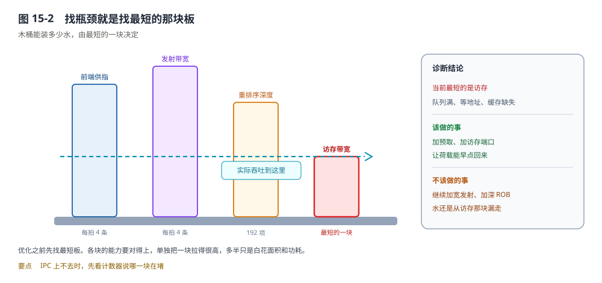
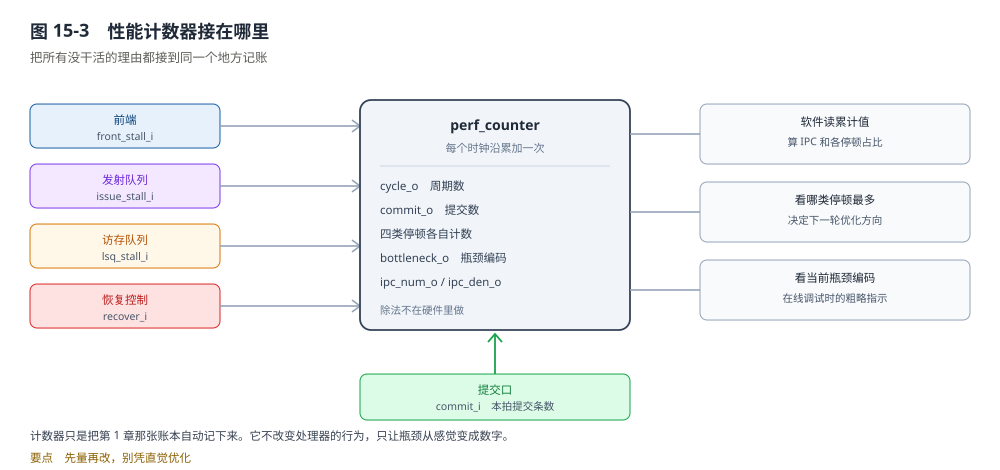
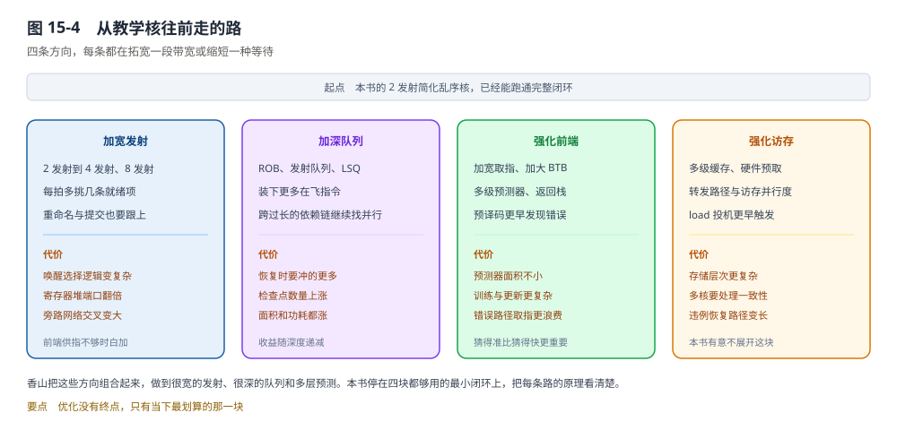

# 第 15 章　性能分析与延伸阅读

> **本章导读**
> 到这里，一台 2 发射乱序核的各个部件都已经讲过：前端把指令喂进来，后端重命名、发射、执行、访存，提交口按顺序收尾，出错时还能回到正确的路上。剩下的问题很自然：这台机器到底跑得好不好，怎么量化？哪里堵了，怎么找出来？
>
> 这一章回到第 1 章那张性能账本，把当时手算的 CPI 分解换成可测量的计数器，再给一套找瓶颈的通用方法。最后把全书走过的地方连成一条线，并指出从教学核继续往前走有哪些方向。
>
> 学完本章，你应该能够：
> 1. 用 IPC 和停顿分布描述一个核跑得好不好，并说清统计口径；
> 2. 用木桶效应定位当前瓶颈，避免凭直觉改参数；
> 3. 说出从教学核到真实处理器还有哪些主要优化方向；
> 4. 把第 1 章到第 14 章串成一条完整的线索。

---

## 15.1 怎么衡量一个核好不好

先设想一个场景。有两台机器跑同一段程序，A 用了 1000 个周期，退休了 1500 条指令；B 用了 1200 个周期，退休了 1700 条指令。哪台更快？

如果直接比总周期，A 更短。但 B 干的活更多。算 IPC（每周期指令数），A 是 1.50，B 是 1.42，A 还是更高。两台机器的主频如果不一样，结论还可能反过来。所以谈性能不能只看一个数字，至少要把指令数、周期数和主频放在一起。

第 1 章给出的公式在这里仍然成立：

```
CPU 时间 = 指令数 × CPI × 时钟周期
```

多发射以后，CPI 会小于 1，用 IPC 更顺口，两者互为倒数。乱序机器里还有一个口径问题：提交口退休的是 uop，而第 1 章数的是架构指令。一条复杂指令可能拆成多条 uop（第 7 章），几条也可能融成一条。因此报告 IPC 时要说清分子数的是什么。本书统一按退休的架构指令算，和前面的章节保持一致。

> 有些论文和工具报告的是每周期 uop 数。两种口径都对，但不能混着比。看到 IPC 数字先问一句分子是什么，能省掉很多误会。

## 15.2 从 CPI 账本到 IPC 账本

第 1 章把 CPI 拆成理想值加三类冒险停顿，那张账本的作用是解释为什么要乱序。到了乱序核里，很多停顿已经被各章的机制悄悄消化了：寄存器重命名消掉了伪相关，分支预测躲开了大部分控制冒险，旁路网络补上了写回与读源之间那一拍。再按老三样去归类，反而说不清当下到底卡在哪。

图 15-1 对比了两种记法。新的做法很朴素，只直接数两个量。


*图 15-1　第 1 章按冒险类型拆 CPI，乱序核直接数周期数和提交数，停顿另按四个来源记账。*

周期计数器每拍加一，做分母。提交计数器按本拍实际退休的条数加，做分子。两者相除就是 IPC。至于为什么没有产出，另外记四类账：前端断粮、发射阻塞、访存阻塞和恢复冲刷。它们对应前面讲过的四个环节，定位问题比老三样更直接。

这里有个细节值得点出来。四类停顿可能在同一拍同时成立，比如分支猜错的那一拍，前端也在断粮。如果四类各记各的，各列之和可能大于总的未提交周期。这不是算错了，而是同一拍被记了两笔。要看总体还得回到周期数和提交数。

## 15.3 还有一些常用指标

IPC 是最常露面的一个，但不是唯一值得看的。下面几个量在定位问题时往往更有用。

**队列占用率**。ROB 长期接近满，说明提交口在等前面某条指令，后端被堵住了。发射队列长期空，说明前端没供上货，或者依赖链还没解开。访存队列满，则指向访存带宽或缓存缺失。这些状态在前面各章都见过，现在把它们当成仪表盘上的指针。

**分支预测准确率与误预测代价**。第 5 章讲过预测器本身，第 14 章讲过猜错的恢复。实际调优时，准确率和代价要分开看：猜错得多，该升级预测器；猜错不多但每次代价很大，该缩短恢复路径或者让分支早点执行。

**在飞指令数**。这是同一时刻在流水线里没退休的指令条数，受 ROB 深度限制。有一个好用的直觉来自利特尔法则：在飞数约等于吞吐乘以平均驻留时间。一台 4 发射、ROB 深 192 项的机器，一条指令平均可以在里面待约 48 个周期。这个时间足够跨过较长的依赖链，也足够等一次访存回来。这解释了为什么加深 ROB 能挖出更多并行度，也解释了为什么收益会递减。

**带宽匹配**。第 4 章讲过前端和后端要门当户对。取指带宽、译码宽度、重命名宽度、发射宽度、提交宽度，这几个数字如果参差不齐，短板那一处就会成为瓶颈。加宽任何一处之前，先看它旁边那一段够不够。

## 15.4 瓶颈定位的通用方法

图 15-2 用木桶来比喻这件事。四块板分别代表前端供指、发射带宽、重排序深度和访存带宽，桶里能装多少水由最短的那块决定。图中访存最短，这时继续加宽发射没有用，水还是从访存那块漏走。



*图 15-2　四块板围成一个桶，实际吞吐由最短的一块决定。图中最短的是访存。*

找瓶颈的步骤可以固定下来。

第一步，先量一轮，拿到 IPC 和各类停顿的计数。没有基线就谈不上改进。

第二步，看哪个队列经常满。满的那一段通常就是当下的短板。

第三步，看停顿分布。前端断粮多，问题在取指或预测；发射阻塞多，问题在依赖链或执行端口；访存阻塞多，问题在存储层次；恢复冲刷多，问题在预测准确率。

第四步，做单变量实验。一次只改一个参数，比如只把发射宽度从 2 调到 4，再量一轮。多处同时改，就算 IPC 涨了也不知道是谁的功劳。

第五步，改完再量，确认收益。如果 IPC 没动，说明找错了板，回到第二步。

这套方法不挑处理器。五级流水线能用，乱序核能用，换成别的微结构也一样。

## 15.5 逐个环节看线索

把上一节的方法落到具体信号上，线索大致如下。

**前端断粮**。FTQ 和指令缓冲长时间为空，提交口跟着闲下来。可能的原因有取指带宽不够、分支预测器不准导致频繁重定向、指令缓存缺失。第 4 章到第 6 章讲的结构都在这里起作用。

**发射没货**。发射队列空，但 ROB 里还有不少项在等。这说明指令进来了却拿不到操作数：要么是依赖链太长，要么是唤醒不及时，要么是执行端口不够。第 10 章和第 11 章对应这一类。

**重排序缓冲满**。提交口停摆，队头有一条迟迟没完成的指令。长延迟的除法或缓存缺失常造成这种局面。第 13 章讲过，按序提交的好处和代价都集中在这里。

**访存阻塞**。访存队列满、load 违例频发，通常指向缓存缺失、转发路径太长或投机失败。第 12 章讲过这些机制。

**恢复冲刷多**。分支猜错的比例偏高，或每次猜错要冲掉的指令太多。前者该改预测器，后者该考虑让分支更早执行，缩短错误路径的长度。第 14 章的恢复逻辑决定冲掉的代价。

## 15.6 一次性能观察实验

大纲里给这一章安排的实验，是在全书最终的 2 发射核上做一次简单的性能观察。做法不必复杂，下面三步就够。

先挑一段有点依赖链、又带几个分支的程序，跑一遍，记下 IPC 和四类停顿计数。再人为制造一次分支猜错，观察恢复计数增加多少，以及提交口停了多久。最后把发射宽度从 2 改成 4 再跑一遍，看 IPC 有没有涨。

关键在最后一步的解释。如果前端断粮计数本来就高，加宽发射不会带来收益，因为执行单元根本拿不到足够的指令。这时候该做的是加宽取指或改进预测，而不是继续堆执行端口。反过来，如果发射队列长期有货却抢不到端口，加宽发射才是对的方向。

Digital 电路 `code/digital/15_bottleneck.dig` 把瓶颈判据做成了可以拨动开关观察的电路。四个输入分别代表四类停顿，输出是独热形式，四个中最多一个为 1。真值表列了 16 种组合，并给出对应的两位编码。注意电路里没有编码器，独热到两位的对应关系写在真值表最后一列，这一列用来对照 Verilog 代码里的 `bottleneck_o`。

## 15.7 重点与权衡

第一，IPC 是结果，不是目标本身。同一个核跑不同程序，IPC 可以差很多。报数字时带上程序、输入集和统计口径，才有意义。

第二，停顿计数用来诊断，不用来考核。同一拍记多笔是设计使然，把各列加起来跟总周期对不上，不代表计数器坏了。

第三，收益递减。第 1 章提过阿姆达尔定律：改善某一部分，整体收益受限于这部分所占的比例。发射宽度从 2 加到 4，如果前端只能供上 2 条，IPC 基本不动。真要提升，得把整条链上相关的短板一起看。

第四，计数器自己也有成本。几个加法器不算什么，但在真实的核里，性能监测电路可能相当可观。教学核里随便加，工程上要算账。

## 15.8 Verilog 骨架

这一节把上面的账本做成电路。代码在 `code/verilog/15_perf/perf_counter.v`。老规矩，先看接口需要哪些信号，需要哪个才引出哪个，再看实现。

### 15.8.1 先要两个数字

要算 IPC，最少只要一个分母和一个分子。分母是周期数，每拍加一。分子是提交数，得由提交口告诉模块本拍 retired 了几条。时钟和复位自然少不了。

```verilog
    input  wire                    clk,
    input  wire                    rst_n,

    // 第一组：算 IPC 要的两个数
    input  wire [COMMIT_W-1:0]     commit_i,     // 本拍提交了几条 uop
    output reg  [CNT_W-1:0]        cycle_o,      // 累计周期数
    output reg  [CNT_W-1:0]        commit_o,     // 累计提交数
```

`COMMIT_W` 取 2，对应教学核的两发射。计数器宽 32 位，跑一会儿不会溢出。

实现只有一个时钟块。周期每拍加一，提交按输入值加。`commit_i` 只有两位，跟 32 位的计数器相加时会按上下文零扩展，不必手工拼接。

```verilog
    // 周期数和提交数各走各的：周期每拍加一，提交按本拍实际条数加
    always @(posedge clk or negedge rst_n) begin
        if (!rst_n) begin
            cycle_o  <= {CNT_W{1'b0}};
            commit_o <= {CNT_W{1'b0}};
        end else begin
            cycle_o  <= cycle_o + 1'b1;
            commit_o <= commit_o + commit_i;   // 短信号按上下文零扩展
        end
    end
```

### 15.8.2 光有总数还不够

知道 IPC 低，还不知道为什么低。于是加上四类停顿事件，每类给一个输入和一个累计值。

```verilog
    // 第二组：定位瓶颈要的四类事件
    input  wire                    front_stall_i, // 前端断粮
    input  wire                    issue_stall_i, // 发射口没货或执行端口不够
    input  wire                    lsq_stall_i,   // 访存队列满或等地址
    input  wire                    recover_i,     // 重定向与冲刷
    output reg  [CNT_W-1:0]        front_stall_o,
    output reg  [CNT_W-1:0]        issue_stall_o,
    output reg  [CNT_W-1:0]        lsq_stall_o,
    output reg  [CNT_W-1:0]        recover_o,
```

四个事件各记各的账，用一个独立的时钟块。同一拍有多个事件成立时，四个计数器都会加一，这正是上一节说的"一拍记多笔"。

```verilog
    // 四类停顿各记各的账，同一拍可以同时命中多个
    always @(posedge clk or negedge rst_n) begin
        if (!rst_n) begin
            front_stall_o <= {CNT_W{1'b0}};
            issue_stall_o <= {CNT_W{1'b0}};
            lsq_stall_o   <= {CNT_W{1'b0}};
            recover_o     <= {CNT_W{1'b0}};
        end else begin
            front_stall_o <= front_stall_o + front_stall_i;
            issue_stall_o <= issue_stall_o + issue_stall_i;
            lsq_stall_o   <= lsq_stall_o   + lsq_stall_i;
            recover_o     <= recover_o     + recover_i;
        end
    end
```

### 15.8.3 当前这一拍卡在哪

累计值适合跑完后看，调试时还想知道当下卡在哪。加一个两位编码和一个有没有停顿的标志。

```verilog
    // 第三组：当前瓶颈与 IPC 的分子分母
    output wire [1:0]              bottleneck_o,  // 0 前端 1 发射 2 访存 3 恢复
    output wire                    stall_any_o,   // 本拍是否有停顿
```

编码采用固定优先级。一拍里多个事件同时成立时，按影响面从大到小取一个：恢复最重，前端最轻。这个优先级跟 Digital 电路里的判据完全对应。

```verilog
    // 同一拍多个事件同时成立时按影响面取一个：恢复最重，前端最轻
    assign stall_any_o = front_stall_i | issue_stall_i | lsq_stall_i | recover_i;
    assign bottleneck_o = recover_i     ? 2'd3 :
                          lsq_stall_i   ? 2'd2 :
                          issue_stall_i ? 2'd1 :
                          front_stall_i ? 2'd0 : 2'd0;
```

### 15.8.4 IPC 留给软件算

最后加两个输出，把分子分母送出去。硬件里不做除法，省得为一个人机界面上的数字在时序关键路径上放除法器。

```verilog
    output wire [CNT_W-1:0]        ipc_num_o,
    output wire [CNT_W-1:0]        ipc_den_o
```

```verilog
    // IPC 留给上层软件算，这里只给分子分母，避免定点除法白丢精度
    assign ipc_num_o = commit_o;
    assign ipc_den_o = cycle_o;
```

### 15.8.5 接口定稿

把上面攒下来的信号合在一起，就是完整端口列表。参数放最前面，方便以后改计数宽度。

```verilog
module perf_counter #(
    parameter CNT_W    = 32,
    parameter COMMIT_W = 2
)(
    input  wire                    clk,
    input  wire                    rst_n,

    // 第一组：算 IPC 要的两个数
    input  wire [COMMIT_W-1:0]     commit_i,     // 本拍提交了几条 uop
    output reg  [CNT_W-1:0]        cycle_o,      // 累计周期数
    output reg  [CNT_W-1:0]        commit_o,     // 累计提交数

    // 第二组：定位瓶颈要的四类事件
    input  wire                    front_stall_i, // 前端断粮
    input  wire                    issue_stall_i, // 发射口没货或执行端口不够
    input  wire                    lsq_stall_i,   // 访存队列满或等地址
    input  wire                    recover_i,     // 重定向与冲刷
    output reg  [CNT_W-1:0]        front_stall_o,
    output reg  [CNT_W-1:0]        issue_stall_o,
    output reg  [CNT_W-1:0]        lsq_stall_o,
    output reg  [CNT_W-1:0]        recover_o,

    // 第三组：当前瓶颈与 IPC 的分子分母
    output wire [1:0]              bottleneck_o,  // 0 前端 1 发射 2 访存 3 恢复
    output wire                    stall_any_o,   // 本拍是否有停顿
    output wire [CNT_W-1:0]        ipc_num_o,
    output wire [CNT_W-1:0]        ipc_den_o
);
```

端口之后就是前面那几个时钟块和连续赋值，拼起来便是完整模块。整个模块没有状态机，也没有仲裁，本质上就是几个加法器加一个优先级判断。

### 15.8.6 测试里踩到的两个坑

自测程序有 21 项检查，覆盖复位、理想两发射、四类停顿、多事件同拍和停顿清除。调试时踩到两个跟模块无关、但很值得记住的坑。

第一个是自测任务的实参顺序。我把 `chk` 的形参写成消息在前、条件在后，调用时却先传条件。结果消息打印成一片空白，判定也跟着乱掉，21 项里有 13 项报失败。把形参顺序改成条件在前才对上。测试代码写反了，会让人怀疑被测的模块，这种误导比崩溃还费时间。

第二个是异步复位的下降沿。测试台里把 `rst_n` 的初值写成 0，从未知态变到 0 并不会触发 `negedge rst_n`，计数器停在全未知。要先拉高再拉低，给出一个明确的 1 到 0 沿，复位才真正发生。

## 15.9 图形与实验

这一章四张 SVG。图 15-1 对比两种账本，图 15-2 看木桶效应，图 15-3 看计数器接在哪些信号上，图 15-4 是从教学核往前走的优化地图。



*图 15-3　前端、发射、访存和恢复各自报停顿事件，提交口给出提交条数，计数器汇总后输出分子分母和瓶颈编码。*

Digital 电路在 `code/digital/15_bottleneck.dig`。拨动四个输入开关，就能看到当前被判为哪一种瓶颈。真值表有 16 行，包含多个事件同时成立的情况。前面说过，电路输出的是独热形式，没有做编码；两位数只在真值表里列出来，用来对照代码里的 `bottleneck_o`。

Verilog 实验在 `code/verilog/15_perf/`。进入目录后执行：

```bash
iverilog -g2012 -o sim.vvp *.v
vvp sim.vvp
```

自测程序有 21 项检查。建议特别看两处：理想两发射时分子是 8、分母是 4，算出来 IPC 是 2；四类事件同拍成立时四个计数器都加一，而瓶颈编码取的是优先级最高的恢复。



*图 15-4　加宽发射、加深队列、强化前端、强化访存四条方向，每一条都有对应的代价。*

## 15.10 香山延伸阅读（选读）

香山是一条线，可以顺着它的公开文档把前面的原理对上工程实现。这里只指方向，不展开。

发射宽度上，香山从早期的 6 发射演进到更宽的设计。宽度提上去之后，重命名、发射选择、寄存器堆端口和旁路网络都要一起加宽。读文档时可以关注"每一处加宽带来的连锁反应"，这正是木桶效应的现实版。

队列深度上，ROB、发射队列和访存队列各有各的取舍。深了能挖更多并行度，但恢复时要处理的状态也更多。第 13 章和第 14 章讲的提交与恢复，在真实设计里会拆成多拍流水，还要和前端的取指流水线对齐。

前端方面，香山用了多级预测器，把不同历史长度和不同风格的预测器组合起来。第 5 章讲的 2 位计数器是最简单的起点，TAGE 只讲了思想。这里可以看到思想怎样落到可用的设计里。

访存方面，香山把访存流水线拆成几条，地址计算、数据访问和 store 转发各有通路。第 12 章讲过的 load 投机执行和违例恢复，在缓存缺失和多核一致性加入之后会复杂得多。缓存一致性协议本书有意略过，这里知道它存在、知道它是访存这条路上绕不开的一关就够了。

## 15.11 全书回顾

走一遍这 15 章，线索其实很清楚。

第 1 章算账，发现五级流水线的 IPC 天花板卡在三类冒险上。第 2 章分清哪些相关是真堵、哪些只是名字冲突。第 3 章用保留站、重命名和广播搭出最小闭环，回答了"操作数就绪就执行"这件事怎么做到。

第 4 章到第 7 章讲前端。解耦取指让预测先行、取指跟随；分支预测尽量猜准方向和目标；预译码和指令缓冲把指令整理好；译码把复杂指令变成后端能统一处理的 uop。这一段解决的是"怎么持续、准确地把指令喂进来"。

第 8 章给了一张后端地图，把后面要展开的站点先认脸熟。第 9 章讲重命名，用物理寄存器解开伪相关。第 10 章讲发射与调度，就绪的指令按年龄挑。第 11 章讲执行与旁路，让刚算完的结果马上送到等待者手里。第 12 章讲乱序访存，用 LSQ 守住同地址顺序。这一段解决的是"怎么让指令真正并行地跑起来"。

第 13 章的 ROB 把乱序执行的结果按程序顺序提交，精确异常成为副产品。第 14 章把前端预测、后端冲刷和检查点恢复接成闭环，回答"跑错了怎么回来"。第 15 章回到性能本身，给出量测和定位的方法。

从"为什么会堵"到"怎么跑起来"到"跑错了怎么回来"再到"跑得好不好怎么量"，这就是全书走过的路。

## 15.12 小结

衡量一个核跑得好不好，最直接的是 IPC，也就是提交数除以周期数。统计时要说清分子数的是架构指令还是 uop，两种口径不能混着比。

找瓶颈靠木桶效应：前端供指、发射带宽、重排序深度和访存带宽四块板，最短的那块决定吞吐。做法是先量一轮，再看队列占用和停顿分布，然后一次只改一个参数，改完再量。

代码部分把账本做成了计数器。先有周期数和提交数，再加四类停顿事件，然后加当前瓶颈编码，最后把 IPC 的分子分母送出去。除法留给软件，硬件只管数数。

全书到这里收官。从五级流水线出发，我们搭起了一台能跑通完整闭环的 2 发射乱序核，也知道往哪些方向可以继续走。真正的处理器要处理的细节比这里多得多，但那些原理，已经在最小模型里看清楚了。

## 15.13 思考题

1. 两台机器跑同一段程序，A 的 IPC 是 1.5，B 的 IPC 是 1.4，但 B 的总周期数更少。这可能吗？如果能，说明还缺什么信息才能判断谁更快？
2. 为什么乱序核不适合继续用第 1 章那套三类冒险停顿来解释性能？改用周期数和提交数解决了什么问题？
3. 四类停顿计数在同一拍可以同时加一，导致各列之和大于总的未提交周期。这种记法有什么好处，又有什么必须注意的地方？
4. 一台 4 发射的机器，前端每拍只能供上 2 条指令。按木桶效应，此时加宽发射宽度会有什么效果？应该先动哪一块？
5. 回看第 3 章的最小闭环和第 14 章的恢复闭环，说出一个最初看起来只是工程细节、其实改变了你对"指令执行"理解的设计选择。
